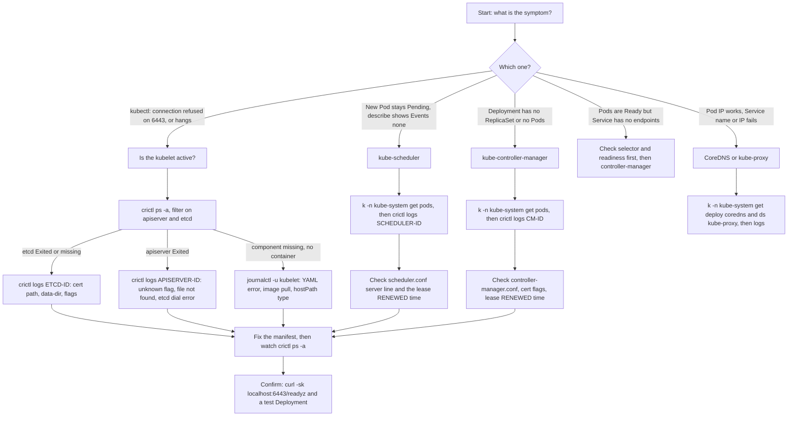

# T4.25 Troubleshoot cluster components

> Competency: "Troubleshoot cluster components" (CKA-2.2) | Domain/weight: CKA — Troubleshooting (30%) | Est. time: 4 h | Prerequisites: T4.02, T4.04, T4.23, T1.06

Set up your shell first. On the lab nodes you work as root (`sudo -i`, summary E8, source: https://docs.linuxfoundation.org/tc-docs/certification/tips-cka-and-ckad), and root has no kubeconfig by default, so the third line below matters.

```bash
alias k=kubectl
export do="--dry-run=client -o yaml"
export now="--force --grace-period=0"
source <(kubectl completion bash); complete -o default -F __start_kubectl k
export KUBECONFIG=/etc/kubernetes/admin.conf   # root on cp1 only; whether the exam node already has a kubeconfig for root: UNVERIFIED
```

Where this lesson builds on others:

- How the cluster was built with kubeadm: [T4.02](../part4-cka/T4.02-create-and-manage-kubernetes-clusters-using.md).
- etcd backup and restore, certificate renewal, node maintenance: [T4.04](../part4-cka/T4.04-manage-the-lifecycle-of-kubernetes-clusters.md).
- Reading container output with `crictl logs` and `/var/log/pods`: [T4.23](../part4-cka/T4.23-manage-and-evaluate-container-output-streams.md). This lesson uses those commands and does not re-teach the log file format.
- `systemctl` and `journalctl`: [T1.06](../part1-linux/T1.06-systemd-and-journalctl.md).
- CoreDNS in depth: [T4.19](../part4-cka/T4.19-understand-and-use-coredns.md).

## 1. Why this matters

When the API server, etcd, the scheduler or the controller-manager breaks, `kubectl` may stop working entirely, or it may work but nothing you create ever happens. In real life this is the "the cluster is up but the platform is dead" outage. In the CKA you can be handed a broken control plane and be expected to repair it from the node, with no `kubectl` to help you. If you only know how to debug with `kubectl describe` and `kubectl logs`, you have no tools at the exact moment you need them.

## 2. Concepts

### 2.1 The control plane is a set of static Pods

A kubeadm cluster does not install the control plane as systemd services. It runs four **static Pods** on the control-plane node (`cp1` in the lab):

| Component | Manifest file in `/etc/kubernetes/manifests/` | Listens on | Talks to |
|---|---|---|---|
| etcd (the database) | `etcd.yaml` | 2379 client, 2380 peer, 127.0.0.1:2381 metrics and `/health` | its own disk (`/var/lib/etcd`) |
| kube-apiserver (the only door to etcd) | `kube-apiserver.yaml` | 6443 (HTTPS) | etcd |
| kube-scheduler (picks a node for each new Pod) | `kube-scheduler.yaml` | 127.0.0.1:10259 (HTTPS health) | API server |
| kube-controller-manager (runs the controllers) | `kube-controller-manager.yaml` | 127.0.0.1:10257 (HTTPS health) | API server |

A **static Pod** is a Pod that the **kubelet** (the node agent) reads from a file on its own disk, with no help from the API server. The directory the kubelet watches is the `staticPodPath` setting in its config:

```bash
grep staticPodPath /var/lib/kubelet/config.yaml
```

```
staticPodPath: /etc/kubernetes/manifests
```

EXPECTED OUTPUT (not captured)

**Why kubeadm does this.** The API server cannot be started by the API server. Something on the node has to start it. The kubelet is already there, so kubeadm gives it four files and the kubelet starts them.

**What it means for you.**

1. **Edit the file, the Pod changes.** The kubelet notices a file change (it watches the directory, and it also re-reads it on a timer, `fileCheckFrequency`, 20 s by default). If the content of the Pod changed, the kubelet stops the old containers and starts new ones. You never run `kubectl apply` on these.
2. **Move the file out, the Pod stops.** Move the file back, the Pod starts again. This is the standard way to "restart" a control-plane component.
3. **`kubectl delete pod kube-apiserver-cp1` does nothing useful.** What you see in `kubectl get pods -n kube-system` is a **mirror Pod**: a read-only copy that the kubelet creates in the API so people can see the static Pod. Deleting the mirror does not stop the real container, and the kubelet recreates the mirror. Mirror Pods have the node name as a suffix: `kube-apiserver-cp1`.
4. **The kubelet keeps the control plane running while the API server is dead.** That is the whole reason you can fix a broken API server from the node. If the **kubelet itself** is down, nothing restarts. Node and kubelet faults are a separate lesson (T4.26, "Troubleshoot clusters and nodes"); here you only check that the kubelet is `active`.
5. **The kubelet tries to read every regular file in that directory whose name does not start with a dot.** The extension is not a filter. A leftover `kube-apiserver.yaml.bak` or `kube-apiserver.yaml~` is read as another Pod (see section 6). This is the reason for the "back up outside the directory" rule in 2.10. The exact behaviour for odd file names is on the "To verify" list.

**Dependency order.** Each layer needs the one below it:

```
kubelet  ->  etcd  ->  kube-apiserver  ->  scheduler, controller-manager  ->  your Pods
                                       ->  CoreDNS, kube-proxy (normal workloads)
```

So when many things fail, fix the lowest broken layer first. A dead etcd makes the API server look broken. A dead API server makes the scheduler and controller-manager log connection errors even if their own files are perfect.

### 2.2 What each component does, and how it looks when it is down

Know what each piece does, because the symptom is the missing job.

| Component | Its job | If it is down, you see | What still works |
|---|---|---|---|
| kube-apiserver | Validates and stores every object; serves `kubectl` | `kubectl` prints `The connection to the server <ip>:6443 was refused - did you specify the right host or port?` (connection refused on `:6443`) | Existing Pods keep running (the kubelet and containerd do not need the API server to keep them alive) |
| etcd | Stores all cluster state | The API server cannot read or write. `kubectl` hangs or returns timeouts or `etcdserver` errors. `/readyz` fails the `etcd` check. | Existing Pods keep running |
| kube-scheduler | Picks a node for each Pod whose `spec.nodeName` is empty | A new Pod stays `Pending`. `kubectl describe pod` shows `Events: <none>`: nobody tried to schedule it, so there is no `FailedScheduling` event either. | Everything already scheduled; Pods that use `nodeName` directly |
| kube-controller-manager | Runs the controllers: Deployment, ReplicaSet, Job, Node lifecycle, EndpointSlice, ServiceAccount token, namespace cleanup | A Deployment is created but `k get rs` is empty and no Pods appear. A Service has no endpoints. Deleting a namespace hangs in `Terminating`. A dead node is never marked `NotReady`. | Plain Pods created with `k run` still get scheduled and run (the scheduler is separate) |

**Under the hood.** The scheduler and controller-manager are not smart servers. They are clients of the API server. Each one keeps a **watch** open on the objects it cares about (the scheduler watches Pods with no node; the ReplicaSet controller watches ReplicaSets and Pods). When something changes, it reacts and writes the result back through the API server. Nobody calls them. So when they are down there is no error message at all in your `kubectl` output. There is only an object that nothing is acting on. That is why "no events" and "no ReplicaSet" are the symptoms, not an error.

**Use the difference to tell scheduler from controller-manager in 20 seconds.**

```bash
k run probe --image=nginx:1.27 -n lab-t425      # a bare Pod needs only the scheduler
k create deploy probe2 --image=nginx:1.27 -n lab-t425   # a Deployment needs the controller-manager first, then the scheduler
k -n lab-t425 get pod,rs
```

| `probe` (bare Pod) | `probe2` (Deployment) | Meaning |
|---|---|---|
| `Pending` | no ReplicaSet at all | Both are down, or the API server is lagging |
| `Pending` | ReplicaSet and Pod exist, Pod `Pending` | Scheduler is down |
| `Running` | `k get rs` is empty | Controller-manager is down |
| `Running` | Running | Both fine |

(Clean up with `k -n lab-t425 delete pod/probe deploy/probe2`.)

### 2.3 Health endpoints

The API server has built-in health checks. They are plain HTTPS paths:

| Path | Meaning | Use |
|---|---|---|
| `/livez` | "Is the process alive?" Failure means a restart may be needed. | What the kubelet uses for the liveness and startup probes |
| `/readyz` | "Can it serve traffic?" Includes the etcd check and the informer sync check. | What the readiness probe uses; the best "is it healthy" test |
| `/healthz` | Old combined endpoint, deprecated since v1.16 in favour of the two above | Still answers; do not teach new users to use it |

Add `?verbose` to see each check. From a machine where `kubectl` works:

```bash
k get --raw='/readyz?verbose'
```

The output is one line per check, `[+]` for pass and `[-]` for fail, with a final summary line:

```
[+]ping ok
[+]log ok
[+]etcd ok
[+]etcd-readiness ok
[+]informer-sync ok
...
[+]shutdown ok
readyz check passed
```

EXPECTED OUTPUT (not captured). The list of checks in the middle is longer in a real cluster and changes between versions, so I show only the stable lines. The format (`[+]name ok`, final line `readyz check passed`) is listed in "To verify".

If a check fails, the line becomes `[-]etcd failed: reason withheld` and the last line becomes `readyz check failed`. With `kubectl get --raw`, a failing endpoint comes back as an HTTP 500, and kubectl prints it as an `Error from server (InternalError)` message that contains the same lines. That is awkward to read.

**When `kubectl` does not work, use `curl`.** You are on the control-plane node. By default the API server lets anonymous clients read the health paths, through the built-in `system:public-info-viewer` role. So this works with no kubeconfig:

```bash
curl -sk 'https://localhost:6443/readyz?verbose'
curl -sk 'https://localhost:6443/livez'
```

`-k` skips certificate checking (fine on localhost, for a health check). `curl` is one of the tools listed for exam hosts (summary E9, https://docs.linuxfoundation.org/tc-docs/certification/tips-cka-and-ckad). `curl` prints the body of the 500 response too, which `kubectl --raw` hides. If the cluster turned anonymous access off (`--anonymous-auth=false`), `curl` returns 401 and you use the other tools in 2.4.

You can ask for one check, or exclude one: `curl -sk https://localhost:6443/livez/etcd`, and `.../readyz?exclude=etcd`.

**The other components have their own health ports** on localhost (HTTPS, self-signed, so `-k`):

```bash
curl -sk https://127.0.0.1:10259/livez        # kube-scheduler  -> ok
curl -sk https://127.0.0.1:10257/livez        # kube-controller-manager -> ok
curl -s  http://127.0.0.1:2381/health         # etcd (plain HTTP metrics listener) -> {"health":"true",...}
curl -s  http://127.0.0.1:10248/healthz       # kubelet -> ok
```

EXPECTED OUTPUT (not captured). A reply of "connection refused" on one of these ports means that process is not listening. That is the same information as `crictl ps -a`, but 1 second faster. The exact JSON text for etcd is in "To verify".

**`kubectl get componentstatuses` (short name `cs`) is deprecated.** It has been deprecated since v1.19. It checked the scheduler, controller-manager and etcd through fixed addresses, and on kubeadm clusters it gives wrong answers (for example it can show a healthy component as `Unhealthy`). Do not use it to decide anything. Use `/readyz?verbose`, `crictl ps -a` and `kubectl -n kube-system get pods`. Whether the object still exists in v1.37, and what it prints, is in "To verify".

### 2.4 Tools when `kubectl` fails

`kubectl` talks to the API server. When the API server is the broken thing, you go one layer down, to what runs on the node:

| Tool | Talks to | Use it for |
|---|---|---|
| `crictl ps -a` | containerd (CRI socket) | Is the container there? `Running` or `Exited`? How many restarts (the `ATTEMPT` column)? |
| `crictl logs <id>` | the container's log file | Why it crashed. The first error is usually the answer. |
| `crictl pods` | containerd | Is the Pod sandbox created? (A Pod with a sandbox but no container means the image pull or the volume mount failed.) |
| `journalctl -u kubelet` | the kubelet's log in the journal | Why the kubelet did not start a container at all: YAML parse errors, image pull errors, volume mount errors |
| `/var/log/pods/` | files on disk | The same container logs when containerd is not answering; see [T4.23](../part4-cka/T4.23-manage-and-evaluate-container-output-streams.md) |
| `ss -tlnp` | the kernel | Who listens on 6443, 2379, 10259, 10257. Also finds "address already in use". |
| `curl -sk https://localhost:6443/...` | the API server | Health, without a kubeconfig |

`crictl` needs root and knows the runtime socket from `/etc/crictl.yaml`. If it prints an endpoint warning, create the file:

```bash
cat > /etc/crictl.yaml <<'EOF'
runtime-endpoint: unix:///run/containerd/containerd.sock
EOF
```

Whether `crictl` is installed on the exam hosts is UNVERIFIED: it is not in the tool list in summary E9. It is part of the standard kubeadm toolchain and it is installed by `env/vm-prereqs.sh` in the lab. If it is missing, `journalctl -u kubelet` and `/var/log/pods` still work.

**The first three commands, always in this order.**

```bash
systemctl is-active kubelet                                   # the kubelet is the one thing that must be alive
crictl ps -a | grep -E 'apiserver|etcd|scheduler|controller'  # state of the four containers
crictl logs <container-id> 2>&1 | tail -20                    # the reason
```

How to read `crictl ps -a`. It lists newest first. The columns are, roughly, `CONTAINER`, `IMAGE`, `CREATED`, `STATE`, `NAME`, `ATTEMPT`, `POD ID` (newer crictl adds more). Look at:

- `STATE`: `Running` is good. `Exited` is a crash. A component that is not listed at all has never started (go to the kubelet journal).
- `ATTEMPT`: it counts restarts. A number that keeps growing means a crash loop (the kubelet waits longer between restarts each time, up to 5 minutes).
- `CREATED`: if the newest line is "2 hours ago" and you edited the file a minute ago, the kubelet has not yet acted on your edit.

**Why `2>&1`.** `crictl logs` prints the container's stderr on its own stderr. Kubernetes components log to stderr. Without `2>&1` a pipe such as `| tail` misses those lines. (Details in T4.23.)

**Which tool, by symptom of the container:**

| What `crictl ps -a` shows | Where the reason is |
|---|---|
| Container `Exited` or restarting, `ATTEMPT` growing | `crictl logs <id>` (flag, certificate, kubeconfig, etcd connection errors) |
| Container never appears, but `crictl pods` lists the sandbox | `journalctl -u kubelet` (image pull error, hostPath type check failed) |
| Nothing at all for that component (no sandbox either) | `journalctl -u kubelet` and the manifest file itself (YAML error, wrong file name, file not in `staticPodPath`) |
| Container `Running`, ready, but the component does nothing | `crictl logs <id>`: it is up but cannot reach the API server (wrong kubeconfig URL) |

### 2.5 Typical breakages, and what each looks like

Six kinds of fault cover almost every control-plane break-fix task. For each, learn where the evidence shows up.

| # | Breakage | Typical edit | Evidence appears in | What you see (placeholders mean "do not trust the exact words") |
|---|---|---|---|---|
| 1 | **Typo in a flag** | `--advertise-adress=...` | `crictl logs` of the crashed container | `Error: unknown flag: --advertise-adress` |
| 2 | **Wrong certificate or key path** | `--tls-cert-file=/etc/kubernetes/pki/apiserver.crtt` | `crictl logs` | an error that names the path, ends in `no such file or directory` |
| 3 | **Wrong etcd endpoint or port** | `--etcd-servers=https://127.0.0.1:2399` | `crictl logs` of the API server: repeated dial errors; `/readyz` `etcd` check failing | `... dial tcp 127.0.0.1:2399: connect: connection refused` |
| 4 | **Bad image tag** | `image: registry.k8s.io/kube-scheduler:v1.37.99` | `journalctl -u kubelet`, `kubectl describe pod` if the API works | `ErrImagePull`, then `ImagePullBackOff`; no new container exists to read logs from |
| 5 | **Wrong `hostPath`** | `path: /etc/kubernetes/scheduler.cnf` | `crictl logs` (file missing or empty), or `journalctl -u kubelet` if the type check fails | see 2.6 |
| 6 | **YAML error in the manifest** | wrong indent, missing colon | `journalctl -u kubelet` only | `Could not process manifest file` with the path; the old Pod disappears and no new one starts |

Breakage 3 hides in two places. The wrong port might be in the API server manifest (`--etcd-servers`), or etcd itself might listen somewhere else (`--listen-client-urls` in `etcd.yaml`). Find out which with `ss -tlnp | grep etcd` (what etcd really listens on) and `grep etcd-servers /etc/kubernetes/manifests/kube-apiserver.yaml` (what the API server asks for). The two must match.

**Warning about etcd's data directory.** If you change `--data-dir` in `etcd.yaml` without changing the matching `hostPath` volume, etcd starts happily with an empty database in the container's own filesystem. The API server then works, and your cluster looks wiped. Nothing is lost: the real data is still in `/var/lib/etcd` on the host. Put the flag back and the cluster state returns. Do not "fix" the empty cluster by restoring a snapshot. For the restore procedure, which you only use for real data loss, see [T4.04](../part4-cka/T4.04-manage-the-lifecycle-of-kubernetes-clusters.md).

### 2.6 Verify every file path: flag, host file, and mount

A path in a flag works only if **both** are true:

1. The file exists on the host.
2. The container can see it: the path is inside a `volumeMounts[].mountPath` of that container, and that mount's `hostPath` points to the real location.

The component runs inside a container with its own file system. kubeadm mounts the host directories at the same path inside, so the flag value and the host path are the same string. That is why checking the host works.

Each manifest mounts only what it needs:

| Manifest | Mounts (host path, same inside) | So its flags may point only under |
|---|---|---|
| `kube-apiserver.yaml` | `/etc/kubernetes/pki`, `/etc/ssl/certs`, `/etc/ca-certificates`, `/usr/share/ca-certificates`, `/usr/local/share/ca-certificates` | those directories |
| `etcd.yaml` | `/etc/kubernetes/pki/etcd` (only the etcd sub-directory), `/var/lib/etcd` | those two directories |
| `kube-scheduler.yaml` | one file: `/etc/kubernetes/scheduler.conf` | that one file |
| `kube-controller-manager.yaml` | `/etc/kubernetes/pki`, `/etc/kubernetes/controller-manager.conf`, the CA directories | those |

This gives you two classic traps. A scheduler flag pointing to `/etc/kubernetes/pki/ca.crt` fails even though the file exists, because nothing mounts `pki` into the scheduler. And an etcd flag pointing to `/etc/kubernetes/pki/apiserver.crt` fails because etcd only has `pki/etcd`.

**Scan one manifest for missing files in one command.** This pulls out every `/etc/...` or `/var/...` path and tests it:

```bash
f=/etc/kubernetes/manifests/kube-apiserver.yaml
grep -oE '/(etc|var)/[^ ,"=]+' $f | sort -u | while read -r p; do test -e "$p" || echo "MISSING $p"; done
```

No output means every path exists on the host. It does not check point 2 (the mount), so read the `volumeMounts` yourself when the paths all exist and the component still fails. I tested the loop on hand-made sample files (the shape of kubeadm files, trimmed), not on a node. After I changed `--key-file=.../server.key` to `servers.key` in the sample `etcd.yaml`:

```
MISSING /etc/kubernetes/pki/etcd/servers.key
```

REAL OUTPUT (Docker, ubuntu:24.04, sample manifest files, not a Kubernetes node)

**What `hostPath.type` does.** The `type` field decides what the kubelet does when the path is wrong:

| `type` | If the path does not exist | If the path is the wrong kind | Where kubeadm uses it |
|---|---|---|---|
| `DirectoryOrCreate` | the kubelet **creates an empty directory** | fails | `pki`, `/var/lib/etcd` |
| `FileOrCreate` | the kubelet **creates an empty file** | fails | `scheduler.conf`, `controller-manager.conf` |
| `Directory` / `File` | the Pod is **not started**; the kubelet logs a mount error (text like `hostPath type check failed: <path> is not a file`) | fails | rarely |
| (empty, the default) | no check at all; the kubelet follows what is there | no check | not used for control plane files |

So a typo in a `hostPath` often does not give a clear "missing" error. For `FileOrCreate` the kubelet silently creates an empty `scheduler.cnf` on the host, mounts it, and the scheduler starts with an empty kubeconfig and complains about that. When you see "empty" or "no configuration" errors, look for a stray new file next to the real one (`ls -la /etc/kubernetes`) and delete it after you fix the manifest.

Also check certificate **validity**, not only existence. An expired certificate gives `x509: certificate has expired or is not yet valid` in the logs. Check with `kubeadm certs check-expiration`, and renew as in [T4.04](../part4-cka/T4.04-manage-the-lifecycle-of-kubernetes-clusters.md).

### 2.7 The kubeconfig files of the scheduler and controller-manager

The scheduler and controller-manager authenticate to the API server with a **kubeconfig** (a file that holds the server URL, the CA, and a client certificate). kubeadm writes one per component:

| File | Used by | Identity inside |
|---|---|---|
| `/etc/kubernetes/admin.conf` | you (`kubectl` as root on the node) | `kubernetes-admin`, group `system:masters` |
| `/etc/kubernetes/scheduler.conf` | kube-scheduler | `system:kube-scheduler` |
| `/etc/kubernetes/controller-manager.conf` | kube-controller-manager | `system:kube-controller-manager` |
| `/etc/kubernetes/kubelet.conf` | the kubelet | `system:node:<name>` |

The only part that normally goes wrong is the `server:` line. This is a shortened excerpt (the `<...>` values are long base64 strings):

```yaml
apiVersion: v1
kind: Config
clusters:
- cluster:
    certificate-authority-data: <base64 CA certificate>
    server: https://192.168.64.10:6443      # must be the API server address and port
  name: kubernetes
contexts:
- context:
    cluster: kubernetes
    user: system:kube-scheduler
  name: system:kube-scheduler@kubernetes
current-context: system:kube-scheduler@kubernetes
kind: Config
users:
- name: system:kube-scheduler
  user:
    client-certificate-data: <base64 client certificate>
    client-key-data: <base64 client key>
```

This is an excerpt of a kubeconfig, not an object for `kubectl apply`.

Compare against a file you trust, in one line each:

```bash
grep server: /etc/kubernetes/{admin,scheduler,controller-manager}.conf
```

All three must name the same address and port. A wrong port gives `connection refused` in the scheduler log. A wrong host gives `no such host` or a timeout. A wrong CA or an expired client certificate gives an `x509` or `Unauthorized` message instead.

**Two behaviours you must know.**

1. **A scheduler with a bad server URL does not crash.** It starts, fails to reach the API server, logs an error every few seconds, and keeps running. `crictl ps` shows it `Running`, and `kubectl get pods -n kube-system` (if the API server is up) shows it `1/1 Running`. It simply never schedules. The evidence is in `crictl logs` and in a stale leader lease (2.8).
2. **Editing a kubeconfig does not restart the component.** The static Pod manifest did not change, so the kubelet does nothing, and the running process read the file only at start. After you fix `scheduler.conf`, restart the container: `crictl stop <id>` (the kubelet starts a new one), or move the manifest out and back (2.10).

If a kubeconfig is missing or damaged beyond repair, `kubeadm init phase kubeconfig scheduler` can write a new one. Whether it overwrites an existing file is on the "To verify" list, so prefer fixing the `server:` line by hand.

### 2.8 Leader election leases

A control plane can have three copies of the scheduler and three of the controller-manager (an HA setup, [T4.05](../part4-cka/T4.05-implement-and-configure-a-highly-available.md)). Only one copy of each may act at a time, or two schedulers would put two Pods on the same last bit of CPU. They elect a leader with a **Lease** object (an object in the `coordination.k8s.io/v1` API with a holder name and a timestamp). The flag is `--leader-elect=true`.

Each leader renews its lease every couple of seconds. The defaults are: lease valid for 15 s, renew deadline 10 s, retry period 2 s. If the leader stops, the lease runs out and another copy takes over.

On a one-node control plane the leases still exist, and they are a very good health check, because they prove the component can reach the API server **and** write:

```bash
k -n kube-system get lease
k -n kube-system get lease kube-scheduler kube-controller-manager \
  -o custom-columns=NAME:.metadata.name,HOLDER:.spec.holderIdentity,RENEWED:.spec.renewTime
```

```
NAME                      HOLDER                          RENEWED
kube-scheduler            cp1_<uuid>                      2026-10-28T10:15:42.512341Z
kube-controller-manager   cp1_<uuid>                      2026-10-28T10:15:43.201873Z
```

EXPECTED OUTPUT (not captured). The `holderIdentity` is `<hostname>_<uuid>`. The uuid changes every time the process starts.

How to read it:

| What you see | Meaning |
|---|---|
| `RENEWED` within the last few seconds (compare with `date -u`) | The component is alive and talking to the API server |
| `RENEWED` minutes or hours old | The component is down, stuck, or cannot reach the API server |
| `HOLDER` has a new uuid after your edit | The process restarted (good proof your edit took effect) |
| The lease does not exist | That component has never started successfully, or leader election is turned off with `--leader-elect=false` |

Log lines to look for in the scheduler or controller-manager log: `attempting to acquire leader lease kube-system/kube-scheduler...` followed by `successfully acquired lease kube-system/kube-scheduler`. If you only see the first one, or errors such as `error retrieving resource lock`, the component cannot reach the API server. Newer clusters also keep one `apiserver-<hash>` lease per API server in `kube-system`; you can ignore these here.

### 2.9 CoreDNS and kube-proxy are components too, but they are normal workloads

CoreDNS and kube-proxy run in `kube-system` but they are **not** static Pods. They are a Deployment and a DaemonSet, so the controller-manager and scheduler create their Pods, and you debug them with `kubectl`.

| Component | Kind | Normal state | First checks |
|---|---|---|---|
| CoreDNS (cluster DNS) | Deployment `coredns`, usually 2 replicas, label `k8s-app=kube-dns` | `READY 2/2` | `k -n kube-system get deploy coredns`, then `k -n kube-system logs -l k8s-app=kube-dns --tail=20` |
| kube-proxy (writes the Service rules on each node) | DaemonSet `kube-proxy`, one Pod per node, label `k8s-app=kube-proxy` | `DESIRED` equals `READY` | `k -n kube-system get ds kube-proxy`, then `k -n kube-system logs -l k8s-app=kube-proxy --tail=20` |

```bash
k -n kube-system get deploy coredns
k -n kube-system get ds kube-proxy
k -n kube-system get pods -o wide
```

Typical findings: Pods `Pending` (no scheduler, or no node ready because the CNI is missing), `CrashLoopBackOff` (read the logs), `ImagePullBackOff` (image tag or registry). kube-proxy reads its settings from the ConfigMap `kube-proxy` (`k -n kube-system get cm kube-proxy -o yaml`, look at the `mode` and `clusterCIDR` keys and the kubeconfig it uses). A wrong `server:` in that kubeconfig breaks it the same way as 2.7.

How to tell which one is broken from the symptom: if a Pod can reach another Pod by IP but not by Service name, suspect CoreDNS. If it works by Pod IP and by name but not by Service IP, suspect kube-proxy. Deep dives: CoreDNS is in [T4.19](../part4-cka/T4.19-understand-and-use-coredns.md); Service and network faults are in T4.27, "Troubleshoot services and networking".

### 2.10 The safe edit routine and timing

You will edit these manifests under time pressure. A typo made while fixing a typo can take your cluster from "partly broken" to "gone". Use a routine.

```bash
cp /etc/kubernetes/manifests/kube-apiserver.yaml /root/kube-apiserver.yaml.bak   # 1. backup, OUTSIDE manifests/
vim /etc/kubernetes/manifests/kube-apiserver.yaml                                  # 2. edit once, carefully
watch -n2 "crictl ps -a | grep -E 'apiserver|etcd|scheduler|controller'"        # 3. wait for a new container
crictl logs $(crictl ps -a --name kube-apiserver -q | head -1) 2>&1 | tail -20   # 4. read the newest logs
ls -la /etc/kubernetes/manifests                                                   # 5. exactly four files, no strays
```

Why each step exists:

1. **Backup outside `manifests/`.** A backup inside the directory is read as a second Pod (see section 6). `/root` is safe. Never leave a `.bak`, `.orig`, `~` or `.swp`-like file in `/etc/kubernetes/manifests`.
2. **Edit once.** Each save is a change event. If you save a half-finished edit, the kubelet restarts the component with the half-finished file.
3. **Watch, do not guess.** A restart takes time (below). `watch` re-runs the command every 2 seconds, so you see the old container stop and the new one start. `watch` is part of the Ubuntu `procps` package; if it is missing on a host, repeat the command by hand (UNVERIFIED for the exam host).
4. **Newest logs first.** `crictl ps -a` is sorted newest first, so `head -1` picks the latest container, which is the one running your edit. Old exited containers keep the old error and will mislead you.
5. **Check the directory.** It must contain exactly `etcd.yaml`, `kube-apiserver.yaml`, `kube-controller-manager.yaml`, `kube-scheduler.yaml`.

**Timing.** After you save, the sequence is: the kubelet notices the change (immediately through the file watch; at the latest after `fileCheckFrequency`, 20 s), stops the old container (the API server has a termination grace period of up to 30 s), starts a new one, and the container becomes ready only after its startup probe passes. For the API server the startup probe allows up to 24 failures at 10 s intervals (about 4 minutes). In practice expect roughly 20 to 90 seconds for a healthy restart. If a **crashing** container is restarted many times, the kubelet waits longer between tries (back-off up to 5 minutes). The measured restart time on kubelet 1.37 is on the "To verify" list. A good rule: if 90 seconds pass and `crictl ps -a` shows no new container created after your edit, stop waiting and read `journalctl -u kubelet`.

**Restart without editing.** Three ways, from gentlest:

| Goal | Command | Notes |
|---|---|---|
| Restart one container (for example after fixing a kubeconfig) | `crictl stop $(crictl ps --name kube-scheduler -q)` | The kubelet sees the container exit and starts a new one in the same Pod |
| Restart the whole static Pod | `mv /etc/kubernetes/manifests/kube-scheduler.yaml /root/ ; sleep 20 ; mv /root/kube-scheduler.yaml /etc/kubernetes/manifests/` | Wait until the old container is gone before you move the file back. This also resets any crash back-off. |
| Force a fresh start after a long back-off | the `mv` method above | `touch` does not work: the file content did not change |

**Related but different.** A **mirror Pod** (what `kubectl` shows) is not the container. The container is a runtime object, visible with `crictl`. If they disagree (kubectl shows `Running`, crictl shows `Exited`) trust `crictl`, because the mirror can be out of date while the API server is down.

### 2.11 A repeatable troubleshooting path

Follow this order every time. It saves you from guessing.

1. **Does `kubectl` work?** `k get nodes`. If it works, go to step 4. If it says `connection refused`, go on.
2. **Is the kubelet alive?** `systemctl is-active kubelet`. If not, this is a node problem (T4.26). Otherwise go on.
3. **What do the four containers look like?** `crictl ps -a | grep -E 'apiserver|etcd|scheduler|controller'`. Fix the lowest broken layer first: etcd, then the API server.
4. **Why?** `crictl logs <id> 2>&1 | tail -20`. If no container exists, `journalctl -u kubelet --no-pager | tail -50`.
5. **What changed?** Compare with a known-good: `diff` against a backup, or check each path with the loop in 2.6. Fix the one cause you found.
6. **Prove it.** `curl -sk https://localhost:6443/readyz?verbose | tail -1`, then a real test: create a Deployment and see Pods `Running` (that exercises the scheduler and the controller-manager too).
7. **Look for a second fault.** Fixing one cause often reveals the next (section 7, Lab 3).

## 3. How it works (diagram)



How to read it:

1. Pick the branch by the symptom, not by a guess about the cause. Each symptom points to one component (section 2.2).
2. For "kubectl dead", the branch goes through the kubelet and then `crictl ps -a`. The state of the container (`Exited` against "never started") decides whether you read `crictl logs` or the kubelet journal.
3. For "Pending" and "no Pods", `kubectl` still works, so you read the mirror Pods and then the logs. The lease time tells you if the process is really talking to the API server.
4. Every path ends in the same loop: fix one thing, `watch crictl ps -a`, then prove it with `readyz` and a real Deployment.
5. If the proof fails, go back to the symptom table: you probably had a second fault.

## 4. Commands and YAML you must produce fast

### 4.1 Imperative commands

There is no `kubectl` shortcut for a broken control plane. The skill is the order of these commands.

```bash
crictl ps -a | grep -E 'apiserver|etcd|scheduler|controller'   # one-line state of all four
crictl logs <id> 2>&1 | tail -20                                # why the newest one died
crictl logs $(crictl ps -a --name kube-apiserver -q | head -1) 2>&1 | tail -20   # same, no copy-paste of the ID
journalctl -u kubelet --no-pager | tail -50                     # the kubelet's side of the story
journalctl -u kubelet -f                                        # follow it live while you edit
k -n kube-system get pods                                       # mirror Pods (only if the API works)
k get --raw='/readyz?verbose'                                   # per-check health (only if the API works)
curl -sk 'https://localhost:6443/readyz?verbose'                # the same, with no kubeconfig
k -n kube-system get lease                                      # leader leases
vim /etc/kubernetes/manifests/kube-apiserver.yaml              # the fix
```

- `-q` prints only IDs, `--name` filters by container name, `head -1` picks the newest.
- `journalctl -u kubelet -f` in a **second terminal** while you save the manifest shows the kubelet's reaction as it happens. Press Ctrl+C to stop following.

### 4.2 The safe edit routine

```bash
cp /etc/kubernetes/manifests/kube-apiserver.yaml /root/backup.yaml     # backup OUTSIDE manifests/
vim /etc/kubernetes/manifests/kube-apiserver.yaml                      # edit
watch -n2 "crictl ps -a | grep -E 'apiserver|etcd|scheduler|controller'"   # wait for the new container
crictl logs $(crictl ps -a --name kube-apiserver -q | head -1) 2>&1 | tail -20   # read the logs
ls /etc/kubernetes/manifests                                           # four files only
```

If your edit makes it worse and you cannot see why, restore: `cp /root/backup.yaml /etc/kubernetes/manifests/kube-apiserver.yaml`. That is the reason the backup exists.

### 4.3 The declarative YAML: a control-plane static Pod manifest

This is the layout of a kubeadm scheduler manifest, the smallest of the four. It is representative: your file has the same structure, and details such as the image tag follow your `kubeadm` version (pinned here to `v1.37.1`, the tag in the research summary). It is a valid Pod, but do **not** `kubectl apply` it. It only works as a **file** in `staticPodPath`.

```yaml
apiVersion: v1                      # a static Pod is an ordinary v1 Pod
kind: Pod
metadata:
  name: kube-scheduler              # the mirror Pod will be named kube-scheduler-<node name>
  namespace: kube-system            # static Pods created by kubeadm live in kube-system
  labels:
    component: kube-scheduler       # used by humans and tools to select it
    tier: control-plane
spec:
  hostNetwork: true                 # uses the node's network; the health port 10259 is on the node's localhost
  priority: 2000001000              # must match priorityClassName below; kubeadm sets both
  priorityClassName: system-node-critical   # makes the kubelet keep it when the node is short of resources
  securityContext:
    seccompProfile:
      type: RuntimeDefault          # default syscall filter
  containers:
  - name: kube-scheduler
    image: registry.k8s.io/kube-scheduler:v1.37.1   # a wrong tag here = ImagePullBackOff
    imagePullPolicy: IfNotPresent   # use the local image if it exists
    command:                        # the process and its flags; a typo here = crash with "unknown flag"
    - kube-scheduler
    - --authentication-kubeconfig=/etc/kubernetes/scheduler.conf   # who may call me (delegated authentication)
    - --authorization-kubeconfig=/etc/kubernetes/scheduler.conf    # what callers may do (delegated authorization)
    - --bind-address=127.0.0.1      # the health/metrics port listens only on localhost
    - --kubeconfig=/etc/kubernetes/scheduler.conf    # how I talk to the API server; must be a mounted path
    - --leader-elect=true           # use the Lease so only one scheduler acts; default true
    resources:
      requests:
        cpu: 100m                   # scheduling hint for the node; not a limit
    livenessProbe:                  # failing this restarts the container
      httpGet:
        host: 127.0.0.1
        path: /livez
        port: 10259
        scheme: HTTPS
      initialDelaySeconds: 10
      periodSeconds: 10
      timeoutSeconds: 15
      failureThreshold: 8
    readinessProbe:                 # failing this only marks the Pod not ready
      httpGet:
        host: 127.0.0.1
        path: /readyz
        port: 10259
        scheme: HTTPS
      periodSeconds: 1
      timeoutSeconds: 15
      failureThreshold: 3
    startupProbe:                   # gives the process time to start before liveness begins
      httpGet:
        host: 127.0.0.1
        path: /livez
        port: 10259
        scheme: HTTPS
      initialDelaySeconds: 10
      periodSeconds: 10
      timeoutSeconds: 15
      failureThreshold: 24
    volumeMounts:
    - name: kubeconfig
      mountPath: /etc/kubernetes/scheduler.conf   # the ONLY file the container can see; flags must use this path
      readOnly: true
  volumes:
  - name: kubeconfig
    hostPath:
      path: /etc/kubernetes/scheduler.conf        # the file on the node; a typo here creates an empty file
      type: FileOrCreate            # create an empty file if missing (that is what hides the typo)
```

Fields to remember for troubleshooting: `command` (flags), `image` (tag), `volumeMounts[].mountPath` and `volumes[].hostPath.path` (the two must agree with the flags), `hostPath.type`, and the probe `port` and `path`.

### 4.4 Speed drill

Setup: on `cp1`, as root, `export KUBECONFIG=/etc/kubernetes/admin.conf` and `mkdir -p ~/lab/t425`. Drills 1 to 4 and 6 to 8 only read. Drill 5 edits the scheduler manifest and puts it back. The cluster must be healthy before you start. Target time for each is in brackets.

1. [45 s] Print the directory the kubelet reads static Pods from, and list its files.
2. [90 s] List every path in `kube-apiserver.yaml` that does not exist on the node.
3. [60 s] Without `kubectl`, print the last line of the API server's verbose readiness report.
4. [60 s] Print the holder and last renew time of the scheduler and controller-manager leases.
5. [4 min] With the safe edit routine, add `--v=2` to the scheduler, prove the new container runs it, then restore the original.
6. [90 s] Save the last 30 log lines of the newest API server container to `/root/apiserver.log`, without `kubectl`.
7. [90 s] Show the last 5 kubelet journal lines that mention a manifest.
8. [60 s] Show whether CoreDNS and kube-proxy are fully ready.

Cleanup: `rm -f /root/apiserver.log ~/lab/t425/kube-scheduler.yaml.bak; ls /etc/kubernetes/manifests` must list four files.

<details><summary>Answers</summary>

```bash
# 1
grep staticPodPath /var/lib/kubelet/config.yaml; ls -la /etc/kubernetes/manifests

# 2 (no output = nothing missing)
grep -oE '/(etc|var)/[^ ,"=]+' /etc/kubernetes/manifests/kube-apiserver.yaml | sort -u | while read -r p; do test -e "$p" || echo "MISSING $p"; done

# 3  (expected last line: readyz check passed)
curl -sk 'https://localhost:6443/readyz?verbose' | tail -1

# 4
k -n kube-system get lease kube-scheduler kube-controller-manager \
  -o custom-columns=NAME:.metadata.name,HOLDER:.spec.holderIdentity,RENEWED:.spec.renewTime

# 5
cp /etc/kubernetes/manifests/kube-scheduler.yaml ~/lab/t425/kube-scheduler.yaml.bak
sed -i 's#- --leader-elect=true#- --leader-elect=true\n    - --v=2#' /etc/kubernetes/manifests/kube-scheduler.yaml
watch -n2 "crictl ps -a | grep scheduler"          # wait for a new line with a recent CREATED time, then Ctrl+C
crictl inspect $(crictl ps --name kube-scheduler -q) | grep -c -- '--v=2'   # 1 or more means the new container has the flag
cp ~/lab/t425/kube-scheduler.yaml.bak /etc/kubernetes/manifests/kube-scheduler.yaml   # restore; wait for another new container

# 6
crictl logs --tail=30 $(crictl ps -a --name kube-apiserver -q | head -1) &> /root/apiserver.log; wc -l /root/apiserver.log

# 7
journalctl -u kubelet --no-pager | grep -i manifest | tail -5

# 8
k -n kube-system get deploy coredns; k -n kube-system get ds kube-proxy
```

The `sed` in drill 5 matches the line `- --leader-elect=true` and keeps its indentation, then adds a line with four spaces (the indentation kubeadm uses under `command:`). I ran that exact `sed` on a sample scheduler manifest in Docker and got the `- --v=2` line directly under `- --leader-elect=true` (REAL OUTPUT (Docker), sample file). In drill 5 the new container's flags come from `crictl inspect`; if `grep -c` prints 0, the kubelet has not replaced the container yet: wait and repeat. In drill 6, `&>` sends both streams to the file, which is what you need because the log is on stderr.

</details>

## 5. Worked example

Goal: break the API server with a wrong certificate path, and repair it from the node. This is the kind of fault you will meet most often. Environment: **vms** (`cp1`), cluster healthy. All output below is EXPECTED OUTPUT (not captured) because this machine has no VMs; commands are written so that you can run them as is.

**Step 0. Start clean and set up your safety net.**

```bash
ssh cp1
sudo -i
export KUBECONFIG=/etc/kubernetes/admin.conf
mkdir -p ~/lab/t425
cp /etc/kubernetes/manifests/kube-apiserver.yaml ~/lab/t425/kube-apiserver.yaml.good
k get nodes
```

The backup is in `~/lab/t425`, outside `manifests/`. `k get nodes` proves the API server works before you break it.

**Step 1. Break it** (this stands in for "someone else's change"):

```bash
sed -i 's#--tls-cert-file=/etc/kubernetes/pki/apiserver.crt#--tls-cert-file=/etc/kubernetes/pki/apiserver.crtt#' /etc/kubernetes/manifests/kube-apiserver.yaml
```

**Step 2. Notice the symptom.** After about a minute:

```bash
k get nodes
```

```
The connection to the server 192.168.64.10:6443 was refused - did you specify the right host or port?
```

EXPECTED OUTPUT (not captured). The IP is your control plane address. "Connection refused" means nothing is listening on 6443: the API server process is not running. (A timeout would suggest a network or a firewall problem instead.) Do not retry `kubectl`; it cannot help now.

**Step 3. Is the kubelet alive?**

```bash
systemctl is-active kubelet
```

```
active
```

EXPECTED OUTPUT (not captured). The kubelet is the thing that can restart the API server, so it must be alive. It is.

**Step 4. See the containers.**

```bash
crictl ps -a | grep -E 'apiserver|etcd|scheduler|controller'
```

```
CONTAINER      IMAGE          CREATED          STATE    NAME                    ATTEMPT   POD ID   ...
<id>           <image id>     20 seconds ago   Exited   kube-apiserver          3         <pod>    ...
<id>           <image id>     2 hours ago      Running  etcd                    0         <pod>    ...
<id>           <image id>     2 hours ago      Running  kube-scheduler          1         <pod>    ...
<id>           <image id>     2 hours ago      Running  kube-controller-manager 1         <pod>    ...
```

EXPECTED OUTPUT (not captured; the real columns and extra lines differ). Read it: etcd, scheduler and controller-manager are `Running`. Only the API server is `Exited`, with a growing `ATTEMPT`. The scheduler and controller-manager are running but cannot reach the API server, so they are victims, not causes. Etcd is fine, so the fault is in the API server itself and the container started and then died: the reason is in its log.

**Step 5. Read the reason.**

```bash
crictl logs $(crictl ps -a --name kube-apiserver -q | head -1) 2>&1 | tail -5
```

```
... open /etc/kubernetes/pki/apiserver.crtt: no such file or directory
```

EXPECTED OUTPUT (not captured). The words around the path will differ; the path and the `no such file or directory` ending are what you look for. The path ends in `crtt`: a typo.

**Step 6. Confirm with the path scan, which also finds any other missing file.**

```bash
grep -oE '/(etc|var)/[^ ,"=]+' /etc/kubernetes/manifests/kube-apiserver.yaml | sort -u | while read -r p; do test -e "$p" || echo "MISSING $p"; done
```

```
MISSING /etc/kubernetes/pki/apiserver.crtt
```

EXPECTED OUTPUT (not captured). One missing path, the same one as in the log. Good: one fault.

**Step 7. Fix it.** The backup was made before the break, so you could restore it; here, edit the one flag, as you would with a real unknown change:

```bash
vim /etc/kubernetes/manifests/kube-apiserver.yaml     # change apiserver.crtt back to apiserver.crt
ls /etc/kubernetes/manifests                          # still four files, no strays
```

**Step 8. Wait and watch.**

```bash
watch -n2 "crictl ps -a | grep apiserver"
```

Expect a new `kube-apiserver` line with `Running`, a recent `CREATED`, and an `ATTEMPT` that is one higher than before the fix (the exact number depends on your history), within roughly a minute (the exact time on kubelet 1.37 is on the "To verify" list). Press Ctrl+C.

**Step 9. Prove it.** First the health report, then a real workload:

```bash
k get --raw='/readyz?verbose' | tail -3
k create deploy t425 --image=nginx:1.27 -n default
k rollout status deploy/t425 --timeout=120s
k delete deploy t425
```

```
[+]shutdown ok
readyz check passed
deployment "t425" successfully rolled out
```

EXPECTED OUTPUT (not captured). The Deployment test proves the whole chain: API server, etcd, controller-manager (creates the ReplicaSet), scheduler (places the Pod), kubelet (runs it).

**What the example taught.** The symptom said "API server". The container list said "only the API server". The log gave the exact path. The path scan confirmed there was just one problem. The test proved the rest of the control plane survived. That is the routine from 2.11.

## 6. Common mistakes and how to fix them

All "What you will see" cells are EXPECTED OUTPUT (not captured). Where I am not sure of the exact words I wrote only the part I am sure of and left `...`.

| Symptom | What you will see | Cause | Fix (command) |
|---|---|---|---|
| `kubectl` fails with connection refused | `The connection to the server <ip>:6443 was refused - did you specify the right host or port?`; `crictl ps -a` shows `kube-apiserver` `Exited` with a growing `ATTEMPT`; `crictl logs` ends with a flag or file error | The API server crash-loops: a typo in a flag, a wrong certificate path, or a path that is not mounted | `crictl logs $(crictl ps -a --name kube-apiserver -q \| head -1) 2>&1 \| tail -20`, fix the named flag or path in `/etc/kubernetes/manifests/kube-apiserver.yaml`, `watch crictl ps -a` |
| Two API server Pods, or odd behaviour after an edit | `ls /etc/kubernetes/manifests` shows `kube-apiserver.yaml.bak` or `kube-apiserver.yaml~`; `crictl ps -a` shows more than one `kube-apiserver` container or one that exits at once; `ss -tlnp` shows only one process on 6443 | A backup copy was left **inside** `manifests/`; the kubelet reads every regular non-hidden file there as its own Pod. Both copies want port 6443 (they use the host network), so one cannot bind and keeps failing, with an "address already in use" style message in its log | `mv /etc/kubernetes/manifests/kube-apiserver.yaml.bak /root/` then `ls /etc/kubernetes/manifests`; wait for the extra container to go away |
| New Pods stay `Pending`, no events | `k describe pod x` shows `Events: <none>`; `k -n kube-system get pods` shows the scheduler `CrashLoopBackOff`/`Error`, or `Running` while the lease is old | Scheduler down, or running but unable to reach the API server (bad `scheduler.conf` URL or path) | `crictl logs $(crictl ps -a --name kube-scheduler -q \| head -1) 2>&1 \| tail`; fix `--kubeconfig` flag, `hostPath` or the `server:` line in `/etc/kubernetes/scheduler.conf`; then `crictl stop $(crictl ps --name kube-scheduler -q)` if you edited a kubeconfig |
| Deployments do not create Pods; Services have no endpoints | `k get deploy` shows `0/1`; `k get rs` is empty; `k -n kube-system get pods` shows the controller-manager not `Running`; lease `RENEWED` is old | Controller-manager down: bad flag, bad kubeconfig path, bad image | `crictl logs $(crictl ps -a --name kube-controller-manager -q \| head -1) 2>&1 \| tail -20`, fix `/etc/kubernetes/manifests/kube-controller-manager.yaml`, watch for the new container |
| `kubectl` hangs or returns timeouts, but the API server container is `Running` | `curl -sk 'https://localhost:6443/readyz?verbose'` shows `[-]etcd failed: ...`; `crictl logs` of the API server repeats `connection refused` or `context deadline exceeded` towards the etcd address | etcd down, or the API server points to the wrong etcd address or port (`--etcd-servers`), or etcd uses a wrong certificate path | `crictl ps -a \| grep etcd`; `crictl logs <etcd id> 2>&1 \| tail`; `ss -tlnp \| grep 2379`; fix the etcd manifest or `--etcd-servers` |
| The component disappears after a manifest edit, and no container is created | `crictl ps -a` has no new container; `journalctl -u kubelet --no-pager \| tail` shows `Could not process manifest file` with the path of the file | YAML does not parse (indentation, missing colon, tab character) or the object is not a valid Pod | Restore from your backup: `cp /root/backup.yaml /etc/kubernetes/manifests/<file>.yaml`, then redo the edit carefully. Check parse with `yq . file >/dev/null` (`yq` is on exam hosts, summary E9) |
| Component container never starts, `crictl pods` shows the sandbox | `journalctl -u kubelet` shows `ErrImagePull` then `ImagePullBackOff` for the image | Bad image tag or registry in `image:` | Correct the tag (compare with another static Pod: `grep image: /etc/kubernetes/manifests/*.yaml`) |
| Scheduler or controller-manager reports an empty or invalid kubeconfig | Log says the configuration is empty or invalid; a new, empty file exists next to the real one (`ls -la /etc/kubernetes`) | `hostPath.path` typo with `type: FileOrCreate`: the kubelet created an empty file and mounted it | Fix the `path:` to the real file, then `rm` the stray empty file |
| Fixed the kubeconfig but nothing changed | Scheduler still logs the same error; lease `HOLDER` uuid is unchanged | The process read the file only at start; the manifest did not change so the kubelet did nothing | `crictl stop $(crictl ps --name kube-scheduler -q)` and check that `HOLDER` changes |
| Edited, and nothing happens at all | `crictl ps -a` shows no new container after 90 seconds | You edited a copy (for example `/root/backup.yaml`), or a file outside `staticPodPath`, or the kubelet is down | `grep staticPodPath /var/lib/kubelet/config.yaml`; `systemctl is-active kubelet`; `journalctl -u kubelet --no-pager \| tail` |
| API server up, but `x509` errors in logs | `x509: certificate has expired or is not yet valid` | An expired or not-yet-valid certificate | `kubeadm certs check-expiration`; renew as in [T4.04](../part4-cka/T4.04-manage-the-lifecycle-of-kubernetes-clusters.md) |

**Reasoning for the four failures the exam-style tasks lean on.**

1. **`kubectl` connection refused.** First command: `systemctl is-active kubelet`. Active means go down a layer. Second: `crictl ps -a | grep -E 'apiserver|etcd'`. If etcd is `Exited` or missing, you fix etcd first, because the API server cannot be healthy without it; the API server will recover alone once etcd is back (if it has been restarting for a long time, it may be in back-off, so move its manifest out and back to force a fresh start). If etcd is `Running` and the API server is `Exited`, the third command is `crictl logs` of the newest API server container. Read from the top for the first error, not from the bottom. Typical first lines: an unknown flag, a path with `no such file`, or repeated dial errors towards etcd. The fix is the one flag or path the log names. Verify with `readyz`.
2. **Two API server Pods.** The clue is `ls /etc/kubernetes/manifests`. Run it before you do anything else after any edit. Find the stray file, move it to `/root`, and give the kubelet about 30 seconds to remove the extra container. Then check `ss -tlnp | grep 6443` shows one listener and `k get pods -n kube-system` shows one `kube-apiserver-cp1`.
3. **Pending with no events.** `k describe pod` with no events is the strongest hint. Check `k -n kube-system get pods | grep scheduler`. If the Pod is `Running`, do not stop there: read the lease `RENEWED` time and `crictl logs`. A scheduler that cannot reach the API server prints dial or `Unauthorized` errors every few seconds. Fix `scheduler.conf` or the manifest, restart the container, and watch the Pending Pod get a node.
4. **Deployment does not create Pods.** `k get rs` empty plus a not-running controller-manager. Read `crictl logs`. Typical causes are a flag typo, `--kubeconfig` pointing to a file the container cannot see, or a certificate path under `/etc/kubernetes/pki`. After the fix, existing Deployments catch up on their own because the controller reads the current state; you do not need to recreate them.

## 7. Labs

**Lab order.** The labs can be done in any order, because each one ends by restoring the cluster to the baseline. Do Easy first, then Medium, then Break-fix. Do all three on `cp1`. Run **Common setup** once.

**Environment for all labs: vms.** Three Ubuntu LTS VMs (`cp1`, `w1`, `w2`), kubeadm 1.37.x, containerd 2.x, Calico v3.33.0, as in the conventions. The control plane is on `cp1`. You work as root on `cp1` (`ssh cp1`, then `sudo -i`; summary E7/E8, https://docs.linuxfoundation.org/tc-docs/certification/tips-cka-and-ckad). Nested `ssh` is not used. These labs break the control plane of a throwaway cluster. **Do not run them on a cluster you care about.**

**Common setup (once per session):**

```bash
# on your workstation
ssh cp1
sudo -i
export KUBECONFIG=/etc/kubernetes/admin.conf
alias k=kubectl; export do="--dry-run=client -o yaml"; export now="--force --grace-period=0"
mkdir -p ~/lab/t425/orig
cp -a /etc/kubernetes/manifests/*.yaml /etc/kubernetes/scheduler.conf /etc/kubernetes/controller-manager.conf ~/lab/t425/orig/
ls ~/lab/t425/orig
test "$(ls /etc/kubernetes/manifests | wc -l)" -eq 4 && echo "manifests dir clean"
k create ns lab-t425
cat > ~/lab/t425/restore.sh <<'EOF'
#!/usr/bin/env bash
# puts the saved baseline back
O=/root/lab/t425/orig
cp -a $O/*.yaml /etc/kubernetes/manifests/
cp -a $O/scheduler.conf $O/controller-manager.conf /etc/kubernetes/
rm -f /etc/kubernetes/scheduler.cnf /etc/kubernetes/scheduler-x.conf
crictl stop $(crictl ps --name kube-scheduler -q) >/dev/null 2>&1 || true
echo "restored; give the kubelet about a minute"
EOF
chmod +x ~/lab/t425/restore.sh
```

The `orig` folder is your known-good copy. The lab commands never write into `manifests/` except by design. `restore.sh` lives in `~/lab/t425` (not in `manifests/`) and restarts the scheduler so that a restored `scheduler.conf` is read again.

**About the scripts.** I tested the `sed` commands of every fault, and the `[^:]*:6443` pattern used on the kubeconfig, on sample files (the same shape as kubeadm files, trimmed) in an Ubuntu 24.04 container. I did **not** run them on a real node. What the Docker run showed:

```
=== lab3 break
    server: https://192.168.64.10:6444
    - --key-file=/etc/kubernetes/pki/etcd/servers.key
MISSING /etc/kubernetes/pki/etcd/servers.key
=== lab2 fault 1
<     - --etcd-servers=https://127.0.0.1:2379
>     - --etcd-servers=https://127.0.0.1:2399
=== lab2 fault 2
<       path: /etc/kubernetes/scheduler.conf
>       path: /etc/kubernetes/scheduler.cnf
=== lab2 fault 3
<   containers:
>   containers
YAML ERROR /etc/kubernetes/manifests/kube-controller-manager.yaml mapping values are not allowed here
=== lab2 fault 4
<     - --kubeconfig=/etc/kubernetes/controller-manager.conf
>     - --kubeconfig=/etc/kubernetes/controller.conf
```

REAL OUTPUT (Docker, ubuntu:24.04, sample files, `crictl` replaced by a stub; not a Kubernetes node). The `YAML ERROR` line is the wording of Python's YAML library, not the kubelet's.

### Lab 1 (Easy): break and fix each component once, with a known fault

**Task (exam style).** On `cp1`, four control-plane components will each be damaged once, in the order below. For each: apply the given change, observe the symptom, find the line in the logs that explains it, save that evidence, then repair the manifest by editing it (not by copying the backup over it). Namespace `lab-t425`. Evidence files: `~/lab/t425/evidence-apiserver.txt`, `evidence-etcd.txt`, `evidence-scheduler.txt`, `evidence-cm.txt`. At the end the four manifests must be identical to the originals in `~/lab/t425/orig/`.

Work through the four steps. After each step, wait until the cluster is healthy (`k get --raw=/readyz` prints `ok`) before the next.

**Step A. Scheduler, wrong kubeconfig path.**

```bash
sed -i 's#--kubeconfig=/etc/kubernetes/scheduler.conf#--kubeconfig=/etc/kubernetes/scheduler-x.conf#' /etc/kubernetes/manifests/kube-scheduler.yaml
sleep 45
k -n lab-t425 run web --image=nginx:1.27
k -n lab-t425 describe pod web | tail -5
k -n kube-system get pods | grep scheduler
crictl logs $(crictl ps -a --name kube-scheduler -q | head -1) 2>&1 | tail -5 | tee ~/lab/t425/evidence-scheduler.txt
```

Fix: edit `kube-scheduler.yaml` and put the right path back. Watch: `watch -n2 "crictl ps -a | grep scheduler"`. Then `k -n lab-t425 get pod web` must become `Running`.

**Step B. Controller-manager, bad image tag.**

```bash
sed -i 's#\(image: registry.k8s.io/kube-controller-manager:\).*#\1v1.37.99#' /etc/kubernetes/manifests/kube-controller-manager.yaml
sleep 60
k -n lab-t425 create deploy web2 --image=nginx:1.27
k -n lab-t425 get rs
k -n kube-system describe pod kube-controller-manager-cp1 | grep -i -E 'pull|image' | tee ~/lab/t425/evidence-cm.txt
crictl ps -a | grep controller
journalctl -u kubelet --no-pager | grep -i controller-manager | tail -3
```

Fix: set the image tag back to the one in `~/lab/t425/orig/kube-controller-manager.yaml` (`grep image: ~/lab/t425/orig/kube-controller-manager.yaml`). Then `k -n lab-t425 get rs` shows a ReplicaSet and `web2` becomes available.

**Step C. API server, flag typo.**

```bash
sed -i 's#--advertise-address=#--advertise-adress=#' /etc/kubernetes/manifests/kube-apiserver.yaml
sleep 60
k get nodes
crictl ps -a | grep -E 'apiserver|etcd|scheduler|controller'
crictl logs $(crictl ps -a --name kube-apiserver -q | head -1) 2>&1 | tail -5 | tee ~/lab/t425/evidence-apiserver.txt
```

Fix: correct the flag in `kube-apiserver.yaml`, wait for `k get nodes` to work again.

**Step D. etcd, wrong certificate path.**

```bash
sed -i 's#--cert-file=/etc/kubernetes/pki/etcd/server.crt#--cert-file=/etc/kubernetes/pki/etcd/server-old.crt#' /etc/kubernetes/manifests/etcd.yaml
sleep 60
k get nodes
crictl ps -a | grep -E 'apiserver|etcd'
crictl logs $(crictl ps -a --name etcd -q | head -1) 2>&1 | tail -5 | tee ~/lab/t425/evidence-etcd.txt
curl -sk 'https://localhost:6443/readyz?verbose' | grep -E 'etcd|check'
```

Fix: correct the flag in `etcd.yaml`. etcd comes back first, then the API server. If the API server stays down after a few minutes (it may be in back-off), move its manifest out and back: `mv /etc/kubernetes/manifests/kube-apiserver.yaml /root/ ; sleep 20 ; mv /root/kube-apiserver.yaml /etc/kubernetes/manifests/`.

<details><summary>Hints</summary>

1. In Step A the API server works, so `k` is available. The scheduler's mirror Pod and its log both name the bad file.
2. In Step B no log exists to read: the image never started. The reason is in `describe` (API up) or in `journalctl -u kubelet` (API down).
3. In Steps C and D, `kubectl` is dead. Use `crictl ps -a` and `crictl logs`. In Step D look at etcd first: the API server is only a victim.

</details>

<details><summary>Solution</summary>

**Step A.** `kubectl` works because the API server and etcd are fine. The Pod `web` is `Pending` and `describe` shows `Events: <none>`: nothing tried to schedule it. The mirror Pod of the scheduler is in `Error` or `CrashLoopBackOff`. The newest scheduler container's log names `/etc/kubernetes/scheduler-x.conf` (the file does not exist; the manifest mounts only `scheduler.conf`). Fix: `sed -i 's#scheduler-x.conf#scheduler.conf#' /etc/kubernetes/manifests/kube-scheduler.yaml` (or edit by hand). Why the evidence is needed: the log is the only place where the bad path appears.

**Step B.** `web2` exists but `k get rs` is empty: no controller-manager. The mirror Pod shows `ErrImagePull` or `ImagePullBackOff` and the event text contains `v1.37.99`. `crictl ps -a | grep controller` shows no running controller-manager (only possibly an old `Exited` one from before the edit), so there is nothing to read with `crictl logs`; the kubelet journal has the pull error. Fix: set the tag back (`sed -i 's#kube-controller-manager:v1.37.99#kube-controller-manager:<original tag>#'`, where the original tag is in `orig/`). The ReplicaSet then appears by itself.

**Step C.** `k get nodes` prints the connection refused message. `crictl ps -a` shows `kube-apiserver` `Exited` (ATTEMPT growing) and the other three `Running`. The log's first error is `unknown flag: --advertise-adress`. Fix: `sed -i 's#--advertise-adress=#--advertise-address=#' /etc/kubernetes/manifests/kube-apiserver.yaml`. A flag typo crashes the process immediately, so there is no running API server to talk to.

**Step D.** `k get nodes` is refused or times out. `crictl ps -a` shows etcd `Exited`: the log names `server-old.crt` as missing. With etcd dead, the API server cannot become ready (the `/readyz` `etcd` check fails, if it answers at all). Fix: `sed -i 's#server-old.crt#server.crt#' /etc/kubernetes/manifests/etcd.yaml`. Fix etcd first: the API server needs a working etcd, and it recovers by itself after the kubelet's next restart attempt.

Final check, then `restore.sh` as a safety net (it is harmless when the manifests already match).

</details>

**Verification** (each line can fail):

```bash
for c in kube-apiserver etcd kube-scheduler kube-controller-manager; do diff -q ~/lab/t425/orig/$c.yaml /etc/kubernetes/manifests/$c.yaml && echo "$c identical"; done
test "$(ls /etc/kubernetes/manifests | wc -l)" -eq 4 && echo "four files"
test "$(k get --raw=/readyz)" = ok && echo "readyz ok"
grep -q 'scheduler-x.conf'  ~/lab/t425/evidence-scheduler.txt && echo "scheduler evidence ok"
grep -q 'v1.37.99'          ~/lab/t425/evidence-cm.txt        && echo "cm evidence ok"
grep -q 'advertise-adress'  ~/lab/t425/evidence-apiserver.txt && echo "apiserver evidence ok"
grep -q 'server-old.crt'    ~/lab/t425/evidence-etcd.txt      && echo "etcd evidence ok"
k -n lab-t425 wait --for=condition=Ready pod/web --timeout=120s
k -n lab-t425 rollout status deploy/web2 --timeout=120s
```

Every line must print its OK text. If an `evidence` check fails, your saved lines did not include the bad value: save more lines (`tail -10`) and run the check again. The expected pass output is EXPECTED OUTPUT (not captured).

**Cleanup:**

```bash
k -n lab-t425 delete pod/web deploy/web2
~/lab/t425/restore.sh
rm -f ~/lab/t425/evidence-*.txt
test "$(k get --raw=/readyz)" = ok && echo baseline
```

### Lab 2 (Medium): mystery outage, one of four faults, 10 minutes

**Task (exam style).** The cluster on `cp1` is broken by a script. Find the cause and restore it within 10 minutes. You may only use `crictl`, `journalctl`, `curl`, the files on the node, and `kubectl` if it works. When fixed, the Deployment `smoke` in namespace `lab-t425` (2 replicas of `nginx:1.27`) must roll out, and `/etc/kubernetes/manifests` must hold exactly four files. Do **not** read the script's `case` block and do not `cat ~/lab/t425/.fault` until you are done.

**Setup** (paste, then run it without reading the `case` block):

```bash
cat > ~/lab/t425/inject.sh <<'EOF'
#!/usr/bin/env bash
set -euo pipefail
M=/etc/kubernetes/manifests
n=${1:-$(( RANDOM % 4 + 1 ))}
echo "$n" > /root/lab/t425/.fault
case $n in
  1) sed -i 's#--etcd-servers=https://127.0.0.1:2379#--etcd-servers=https://127.0.0.1:2399#' $M/kube-apiserver.yaml ;;
  2) sed -i 's#path: /etc/kubernetes/scheduler.conf#path: /etc/kubernetes/scheduler.cnf#' $M/kube-scheduler.yaml ;;
  3) sed -i 's#^  containers:$#  containers#' $M/kube-controller-manager.yaml ;;
  4) sed -i 's#--kubeconfig=/etc/kubernetes/controller-manager.conf#--kubeconfig=/etc/kubernetes/controller.conf#' $M/kube-controller-manager.yaml ;;
esac
echo "injected; the clock starts now"
EOF
chmod +x ~/lab/t425/inject.sh
~/lab/t425/inject.sh
```

Then start a timer and begin: `date`.

<details><summary>Hints</summary>

1. Start with the symptom table in 2.2. Decide if `kubectl` works. Then run `k run`/`k create deploy` tests (as in 2.2) to tell scheduler from controller-manager.
2. Two of the four faults hit the same component but show up in different places. One shows up in `crictl logs`, the other only in the kubelet journal.
3. After the fix, run `ls -la /etc/kubernetes` and `ls /etc/kubernetes/manifests`. A fault can leave a stray file.

</details>

<details><summary>Solution</summary>

Method first: `k get nodes`. If refused, go to `crictl ps -a`. If it works, test with a bare Pod and a Deployment (2.2) and look at `k -n kube-system get pods`.

| `.fault` | What you saw | Where the evidence was | Fix |
|---|---|---|---|
| 1 (API server, wrong etcd port) | `kubectl` refused or timing out; API server `Exited` or not ready; `curl -sk https://localhost:6443/readyz?verbose` (if it answers) shows the `etcd` check failing | `crictl logs` of the API server: dial errors to `127.0.0.1:2399`. etcd itself is `Running` and `ss -tlnp \| grep 2379` shows it on 2379, so the API server is asking the wrong port | Set `--etcd-servers=https://127.0.0.1:2379` in `kube-apiserver.yaml` |
| 2 (scheduler, wrong `hostPath`) | `kubectl` works; the bare Pod is `Pending` with `Events: <none>`; the scheduler mirror Pod is failing | `crictl logs` of the scheduler: empty or invalid kubeconfig. `ls -la /etc/kubernetes` shows a new empty `scheduler.cnf`: `FileOrCreate` made it | Set `path: /etc/kubernetes/scheduler.conf` in `kube-scheduler.yaml`, then `rm /etc/kubernetes/scheduler.cnf` |
| 3 (controller-manager, YAML error) | `kubectl` works; Deployment has no ReplicaSet; the controller-manager mirror Pod is gone from `k -n kube-system get pods`; `crictl ps -a` shows no running controller-manager | `crictl logs` has nothing new. `journalctl -u kubelet --no-pager \| grep -i manifest \| tail` shows `Could not process manifest file` with the path of the controller-manager file | Restore the line `  containers:` (two spaces and a colon) in `kube-controller-manager.yaml`. Check the parse: `yq . /etc/kubernetes/manifests/kube-controller-manager.yaml > /dev/null` |
| 4 (controller-manager, wrong `--kubeconfig`) | Same symptoms as 3 from `kubectl`, but the mirror Pod exists and is crashing | `crictl logs` of the controller-manager: the kubeconfig file `/etc/kubernetes/controller.conf` cannot be read (it is not mounted) | Set `--kubeconfig=/etc/kubernetes/controller-manager.conf` |

Why 3 and 4 are the same component but different places: in 3 the kubelet cannot build a Pod from the file, so no container ever starts and only the kubelet journal knows why. In 4 the Pod is valid and the container starts and dies, so the log has the reason.

Safe edit routine for every fix: `cp` the file to `/root`, edit once, `watch -n2 "crictl ps -a | grep -E 'apiserver|etcd|scheduler|controller'"`, check the logs, `ls /etc/kubernetes/manifests`.

</details>

**Verification:**

```bash
test "$(k get --raw=/readyz)" = ok && echo "readyz ok"
k -n lab-t425 create deploy smoke --image=nginx:1.27 --replicas=2
k -n lab-t425 rollout status deploy/smoke --timeout=120s
test "$(ls /etc/kubernetes/manifests | wc -l)" -eq 4 && echo "four files"
test ! -e /etc/kubernetes/scheduler.cnf && echo "no stray kubeconfig"
for r in kube-scheduler kube-controller-manager; do
  t=$(k -n kube-system get lease $r -o jsonpath='{.spec.renewTime}')
  test $(( $(date +%s) - $(date -d "$t" +%s) )) -lt 30 && echo "$r lease fresh"
done
```

The Deployment test fails if the controller-manager or the scheduler is broken. The lease test fails if a component is running but not renewing. The date arithmetic works with GNU `date` (the renew time looks like `2026-10-28T10:15:42.512341Z`; I tested that conversion in Docker, REAL OUTPUT (Docker) `date -d` printed an epoch number). Expected pass output is EXPECTED OUTPUT (not captured).

**Cleanup:**

```bash
k -n lab-t425 delete deploy/smoke
~/lab/t425/restore.sh
rm -f ~/lab/t425/.fault ~/lab/t425/inject.sh
test "$(k get --raw=/readyz)" = ok && echo baseline
```

### Lab 3 (Break-fix): two simultaneous faults

**Task (exam style).** After the script `break.sh` below runs, `kubectl` on `cp1` does not work, and once it does, new Pods will not be scheduled. Restore the cluster. When done, a Pod `probe` (image `nginx:1.27`) in namespace `lab-t425` must reach `Running`, `/readyz` must print `ok`, and you must not have copied the backup files over the broken ones (find the causes and edit them). You have 15 minutes. Do not read `break.sh` before starting.

**Setup:**

```bash
cat > ~/lab/t425/break.sh <<'EOF'
#!/usr/bin/env bash
set -euo pipefail
M=/etc/kubernetes/manifests
sed -i 's#\(server: https://[^:]*\):6443#\1:6444#' /etc/kubernetes/scheduler.conf
crictl stop "$(crictl ps --name kube-scheduler -q)" >/dev/null
sed -i 's#--key-file=/etc/kubernetes/pki/etcd/server.key#--key-file=/etc/kubernetes/pki/etcd/servers.key#' $M/etcd.yaml
echo "done; wait about a minute"
EOF
chmod +x ~/lab/t425/break.sh
~/lab/t425/break.sh
```

<details><summary>Hints</summary>

1. Two layers are broken. The lower one hides the upper one: until the API server works, you cannot even see the scheduler problem with `kubectl`.
2. The first fault is in the logs of a container that is `Exited`. The second fault leaves a container `Running`.
3. The second fault is in a file that is not a manifest. Fixing that file does not restart the process.

</details>

<details><summary>Solution</summary>

**Fault 1: etcd (lowest layer).**

```bash
systemctl is-active kubelet                     # active
crictl ps -a | grep -E 'apiserver|etcd|scheduler|controller'
crictl logs $(crictl ps -a --name etcd -q | head -1) 2>&1 | tail     # names /etc/kubernetes/pki/etcd/servers.key as missing
grep -oE '/(etc|var)/[^ ,"=]+' /etc/kubernetes/manifests/etcd.yaml | sort -u | while read -r p; do test -e "$p" || echo "MISSING $p"; done
cp /etc/kubernetes/manifests/etcd.yaml ~/lab/t425/etcd.yaml.bak
sed -i 's#servers.key#server.key#' /etc/kubernetes/manifests/etcd.yaml
watch -n2 "crictl ps -a | grep -E 'etcd|apiserver'"
```

The log and the path scan agree: `servers.key` does not exist. Fixing etcd first matters because the API server depends on it: the API server shows as broken only because etcd is. When etcd runs again, the API server recovers on its next restart. If it does not within a couple of minutes (crash back-off), move `kube-apiserver.yaml` out to `/root/` and back after 20 seconds.

**Fault 2: scheduler (found only after kubectl works).**

```bash
k get --raw=/readyz                              # ok
k -n lab-t425 run probe --image=nginx:1.27
k -n lab-t425 describe pod probe | tail -3       # Events: <none>
k -n kube-system get pods | grep scheduler       # Running, 1/1: not a crash
k -n kube-system get lease kube-scheduler -o jsonpath='{.spec.renewTime}{"\n"}'   # old
crictl logs $(crictl ps --name kube-scheduler -q) 2>&1 | tail -5   # dial tcp ...:6444: connect: connection refused
grep server: /etc/kubernetes/{admin,scheduler,controller-manager}.conf   # scheduler says :6444
sed -i 's#:6444#:6443#' /etc/kubernetes/scheduler.conf
crictl stop $(crictl ps --name kube-scheduler -q)     # kubeconfig edits need a restart
```

Why this one is hard: the scheduler is `Running` and `1/1`, so the Pod list looks fine. The clues are `Events: <none>`, the old lease time and the dial errors in the log. The `server:` line shows `:6444` while the other kubeconfigs show `:6443`. The edit of `scheduler.conf` does not trigger a restart, so `crictl stop` starts a fresh container that reads the fixed file. Check that the lease `HOLDER` uuid changes and `RENEWED` is fresh, and that `probe` becomes `Running`.

</details>

**Verification:**

```bash
test "$(k get --raw=/readyz)" = ok && echo "readyz ok"
k -n lab-t425 wait --for=condition=Ready pod/probe --timeout=120s
grep server: /etc/kubernetes/scheduler.conf | grep -q ':6443' && echo "scheduler.conf port ok"
diff -q ~/lab/t425/orig/etcd.yaml /etc/kubernetes/manifests/etcd.yaml && echo "etcd.yaml identical"
t=$(k -n kube-system get lease kube-scheduler -o jsonpath='{.spec.renewTime}')
test $(( $(date +%s) - $(date -d "$t" +%s) )) -lt 30 && echo "scheduler lease fresh"
test "$(ls /etc/kubernetes/manifests | wc -l)" -eq 4 && echo "four files"
```

Each line can fail: a wrong key path leaves `diff` non-zero, an unrestarted scheduler leaves the Pod `Pending` and the lease stale, and a stray backup in `manifests/` fails the count. Expected pass output is EXPECTED OUTPUT (not captured).

**Cleanup:**

```bash
k -n lab-t425 delete pod/probe
~/lab/t425/restore.sh
rm -f ~/lab/t425/break.sh ~/lab/t425/etcd.yaml.bak
sleep 60
test "$(k get --raw=/readyz)" = ok && echo baseline
```

**Final cleanup after all labs:** `k delete ns lab-t425; rm -rf ~/lab/t425`.

## 8. Exam tips

- **Order of operations when `kubectl` is dead:** `systemctl is-active kubelet`, then `crictl ps -a | grep -E 'apiserver|etcd|scheduler|controller'`, then `crictl logs`. Do not retry `kubectl` in a loop; it wastes minutes. Each task is done on a designated host that you reach with `ssh <node>` and leave when done (summary E7, source: https://docs.linuxfoundation.org/tc-docs/certification/tips-cka-and-ckad), and you use `sudo -i` for root (E8). Whether `crictl` and `watch` exist on the exam host is UNVERIFIED; the kubelet journal and `/var/log/pods` are the fallback.
- **Back up outside `manifests/`, always** (`cp ... /root/backup.yaml`). After every edit run `ls /etc/kubernetes/manifests` and count four files. A stray `.bak` there is a self-inflicted second fault.
- **Fix the lowest layer first** (etcd, then API server, then scheduler and controller-manager). After a fix, look for a second fault before you close the task. Prove it with `curl -sk https://localhost:6443/readyz?verbose | tail -1` and a test Deployment.
- **Docs to open** (allowed: https://kubernetes.io/docs, summary E13, https://docs.linuxfoundation.org/tc-docs/certification/certification-resources-allowed): https://kubernetes.io/docs/tasks/debug/debug-cluster/ (symptom and cause list), https://kubernetes.io/docs/tasks/configure-pod-container/static-pod/ (static Pod behaviour), https://kubernetes.io/docs/reference/using-api/health-checks/ (`livez`, `readyz`), https://kubernetes.io/docs/reference/command-line-tools-reference/kube-apiserver/ (every flag; search it when a flag name looks wrong).
- **Traps to check before moving on:** a kubeconfig edit needs a container restart (`crictl stop <id>`); a `hostPath` with `FileOrCreate` can create a stray empty file; the flag path must also be inside a mounted directory; `crictl ps` without `-a` hides crashed containers.
- **Time:** a typical fix is 3 to 6 minutes. If you are past 8 minutes and have no error line from a log, you are probably looking at the wrong layer: go back to the symptom table (2.2).

## 9. Quick review

1. Where do the control-plane static Pods live, and how does the kubelet know? 
   <details><summary>Answer</summary>In `/etc/kubernetes/manifests`, set by `staticPodPath` in `/var/lib/kubelet/config.yaml`. The kubelet watches the directory and re-reads it on a timer, so a file change recreates the Pod.</details>
2. `kubectl` says `connection refused` on port 6443. What are your first three commands?
   <details><summary>Answer</summary>`systemctl is-active kubelet`, `crictl ps -a | grep -E 'apiserver|etcd|scheduler|controller'`, then `crictl logs <id> 2>&1 | tail -20` for the container that is `Exited`.</details>
3. A new Pod is `Pending` and `describe` shows no events. Which component, and why are there no events?
   <details><summary>Answer</summary>The scheduler. Events such as `FailedScheduling` are written by the scheduler. If it is not running, or cannot reach the API server, nobody writes any.</details>
4. A Deployment exists but `k get rs` is empty. Which component?
   <details><summary>Answer</summary>The controller-manager: the Deployment controller that creates ReplicaSets runs inside it.</details>
5. Why use `curl -sk https://localhost:6443/readyz?verbose` and not `kubectl get --raw` when something is wrong?
   <details><summary>Answer</summary>It needs no kubeconfig, and it prints the body of a failing response (`[-]etcd failed: ...`); `kubectl --raw` shows a failed check as a generic `InternalError` message. Anonymous access to the health paths is allowed by default but can be disabled (then you get 401).</details>
6. Why must you not leave `kube-apiserver.yaml.bak` in `/etc/kubernetes/manifests`?
   <details><summary>Answer</summary>The kubelet reads every regular non-hidden file in that directory as a Pod, whatever its extension. A second API server Pod appears and fights for port 6443 (host network). Back up to `/root`.</details>
7. The scheduler container is `Running 1/1` but nothing is scheduled. What do you check, and what is a likely cause?
   <details><summary>Answer</summary>The scheduler lease `RENEWED` time (stale) and `crictl logs` (dial errors). Likely cause: wrong `server:` URL or port in `/etc/kubernetes/scheduler.conf`. After you fix it, restart the container with `crictl stop`, because the manifest did not change.</details>
8. A flag in the scheduler manifest points to `/etc/kubernetes/pki/ca.crt`, the file exists, and the scheduler still fails. Why?
   <details><summary>Answer</summary>The scheduler's container only has `scheduler.conf` mounted. A path outside a `volumeMounts` mount does not exist inside the container, even if it exists on the host.</details>
9. What is `kubectl get componentstatuses` and why not rely on it?
   <details><summary>Answer</summary>A deprecated API (since v1.19) that probes components on fixed addresses; it can report healthy components as unhealthy on kubeadm clusters. Use `/readyz?verbose`, `crictl ps -a` and the mirror Pods instead.</details>
10. You fixed `controller-manager.conf` and saved. Why is the component still broken, and what do you do?
    <details><summary>Answer</summary>The process reads the kubeconfig only at start, and the manifest did not change, so the kubelet did not restart it. Run `crictl stop $(crictl ps --name kube-controller-manager -q)` or move the manifest out and back, then check that the lease `HOLDER` uuid changed.</details>

## 10. References

Kubernetes documentation (allowed in the exam):

- https://kubernetes.io/docs/tasks/debug/debug-cluster/
- https://kubernetes.io/docs/tasks/configure-pod-container/static-pod/
- https://kubernetes.io/docs/reference/using-api/health-checks/
- https://kubernetes.io/docs/reference/command-line-tools-reference/kube-apiserver/

Exam facts (summary section 2): https://docs.linuxfoundation.org/tc-docs/certification/tips-cka-and-ckad and https://docs.linuxfoundation.org/tc-docs/certification/certification-resources-allowed

Study resources for extra practice (not exam-allowed; coverage only, no text copied):

- R5 bmuschko/cka-study-guide, chapter 22: https://github.com/bmuschko/cka-study-guide
- R10 David-VTUK/CKA-StudyGuide: https://github.com/David-VTUK/CKA-StudyGuide
- R12 kodekloudhub/certified-kubernetes-administrator-course: https://github.com/kodekloudhub/certified-kubernetes-administrator-course
- R4 bmuschko/cka-crash-course: https://github.com/bmuschko/cka-crash-course
- R15 Killer Shell: https://killer.sh/faq , https://killercoda.com/killer-shell-cka , https://killercoda.com/killer-shell-ckad

## 11. To verify

**Known limitation.** This lesson was written on a machine with no `kind` and no `multipass`, and this topic needs VMs (`cp1`, `w1`, `w2` with kubeadm 1.37.x and containerd 2.x). So two done criteria are **not met**: "Real crictl logs for each component failure" (every log and kubectl output block is shown as **EXPECTED OUTPUT (not captured)**, with placeholders where I do not know the exact text) and "Fault-injection script included and tested" is only **partly met**: the scripts are included, and their `sed` commands were tested on sample files in Docker, but never on a real control plane. To meet both, run section 5 and the three labs on 3 VMs with kubeadm 1.37.x and paste the real output. The only real output in this lesson is: the path-scan loop and the lab fault diffs on sample files (sections 2.6 and 7), the `sed` that adds `--v=2` (section 4.4), and the `date -d` conversion (Lab 2), all labelled REAL OUTPUT (Docker) and none of them a Kubernetes result.

Items to confirm on a live v1.37 cluster:

1. **Static Pod restart timing on kubelet 1.37.** The 20 to 90 second range and the 20 s `fileCheckFrequency` default are from general knowledge. Measure: save a harmless edit and time how long until `crictl ps -a` shows the new container.
2. **`/readyz?verbose` output format on v1.37.** The `[+]name ok` lines, the final `readyz check passed`, the failing line shape `[-]etcd failed: reason withheld`, and how `kubectl get --raw` prints a failing endpoint. Check on a healthy cluster and with etcd stopped.
3. **`componentstatuses` in v1.37.** Does `k get cs` still exist, what warning does it print, and does it report the scheduler and controller-manager correctly on a kubeadm cluster?
4. **Anonymous access** to `/livez`, `/readyz`, `/healthz` on the lab and exam clusters (`curl -sk https://localhost:6443/readyz`); also the replies of `http://127.0.0.1:2381/health` and the ports 10259, 10257, 10248.
5. **Which files the kubelet reads in `staticPodPath`.** The claim that any regular non-hidden file is read, whatever the extension (a `.bak` or `~` file), and the exact behaviour with a duplicate pod name. Test: `cp kube-apiserver.yaml kube-apiserver.yaml.bak` in a throwaway cluster and look at `crictl ps -a`, `ss -tlnp` and the kubelet journal.
6. **What the kubelet does with an unparsable manifest:** the claim that the Pod disappears and no container starts, and the exact `Could not process manifest file` log text.
7. **Static Pod UID and back-off:** the claim that a changed manifest is a new Pod for the kubelet (so crash back-off restarts at zero), and that moving the file out and back also resets it.
8. **kubeadm 1.37 manifest contents:** the flags, probes, `priority`, and `hostPath` types in the scheduler manifest in section 4.3 and the mount table in 2.6 (especially which directories the API server and controller-manager mount, and that the etcd manifest mounts only `pki/etcd`). Check with `cat /etc/kubernetes/manifests/*.yaml`.
9. **Exact error text for each fault:** unknown flag (`Error: unknown flag: --advertise-adress`), missing certificate file in the API server and etcd, empty kubeconfig in the scheduler, `ErrImagePull`/`ImagePullBackOff` event text, and the `hostPath type check failed` message.
10. **`crictl` details:** the `ps -a` columns and newest-first order on crictl v1.37.0, the `--name`, `-q`, `--tail` flags, `crictl logs` stderr behaviour, and that `crictl stop` makes the kubelet start a new container in the same static Pod quickly.
11. **Lease defaults and names:** 15 s lease, 10 s renew, 2 s retry; holder format `<hostname>_<uuid>`; the `apiserver-<hash>` leases in `kube-system`.
12. **`hostPath` `FileOrCreate` creating an empty file** for `scheduler.conf` when the path has a typo (Lab 2 fault 2, section 6).
13. **`kubeadm init phase kubeconfig scheduler`:** does it overwrite an existing file?
14. **etcd with a changed `--data-dir`** starts with an empty database inside the container and the API server serves an empty cluster (the warning in 2.5).
15. **Tool availability on exam hosts:** `crictl`, `watch`, `vim` and `journalctl` are not in the tool list of summary E9 and are UNVERIFIED for the exam. Root's kubeconfig on a node is also UNVERIFIED.
16. **Lab 1 evidence greps:** the checks `grep -q 'scheduler-x.conf'` etc. assume the logs and events repeat the bad value. Confirm on a live cluster; if a component's log does not print the value, widen the `tail`.
17. **`pods` / `mirror` timing in Lab 1 Step B:** that the mirror Pod `kube-controller-manager-cp1` shows the image pull error (assumes the node name is `cp1`).

Self-check (printed again in the reply):

- [x] Every subtopic bullet is in section 2 or 4
- [x] Every common mistake is in section 6
- [x] All three labs have setup, task, hints, collapsed solution, verification, cleanup
- [x] All YAML is complete; no `:latest`
- [ ] Done criteria: fault-injection script tested (partly: Docker sample files only), real crictl logs (not met: no VMs)
- [x] No exam fact without a source URL
- [x] Output blocks are real or labelled EXPECTED OUTPUT (not captured)
