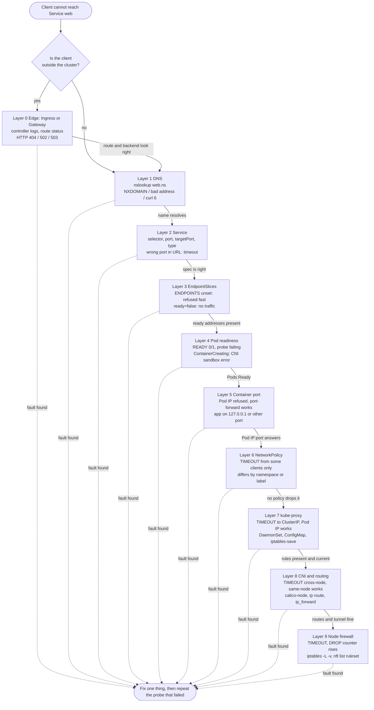

# T4.27 Troubleshoot services and networking

> Competency: "Troubleshoot services and networking" (CKA-2.5) | Domain/weight: CKA — Troubleshooting (30%) | Est. time: 3.5 h | Prerequisites: T4.18, T4.19, T4.20, T1.09

Prerequisite lessons (read them first if a term below is new):

- [T4.18](../part4-cka/T4.18-use-clusterip-nodeport-loadbalancer-service-types.md): Service types, EndpointSlices, and how kube-proxy turns a ClusterIP into a Pod IP. This lesson only shows how to check each of those parts. It does not re-teach them.
- [T4.19](../part4-cka/T4.19-understand-and-use-coredns.md): CoreDNS, the Corefile, `/etc/resolv.conf` in a Pod, `search` and `ndots`. When a check below says "NXDOMAIN", the deep dive is there.
- [T4.20](../part4-cka/T4.20-define-and-enforce-network-policies.md): NetworkPolicy rules, `podSelector`, `namespaceSelector`, AND versus OR. When a check below says "policy", the deep dive is there.
- [T1.09](../part1-linux/T1.09-packet-filtering-iptables-and-nftables-basics.md): how to read `iptables-save` and `nft list ruleset`.
- Also useful: [T4.17](../part4-cka/T4.17-understand-connectivity-between-pods.md) (Pod-to-Pod connectivity and the CNI) and [T4.21](../part4-cka/T4.21-know-how-to-use-ingress-controllers.md) (Ingress controllers).

**Shell setup** (define once per terminal; used everywhere below):

```bash
alias k=kubectl
export do="--dry-run=client -o yaml"
export now="--force --grace-period=0"
source <(kubectl completion bash); complete -o default -F __start_kubectl k
```

**Where commands run.** Environment for the labs: **vms** (three Ubuntu VMs `cp1`, `w1`, `w2`; kubeadm 1.37.x; containerd 2.x; Calico v3.33.0; Pod CIDR `192.168.0.0/16`). The node layers (kube-proxy rules, routes, firewall) need real nodes. Use two terminals:

- Terminal 1 runs `kubectl` (on `cp1`).
- Terminal 2 is for node commands: `ssh w1`, then `sudo -i`. Type `exit` to leave. Nested ssh is not supported on the exam hosts; each task is done on a designated host and you exit back to host `base` after each task ([LF tips page](https://docs.linuxfoundation.org/tc-docs/certification/tips-cka-and-ckad)). Do the same in the lab and never ssh from one node to another.

Lab files live in `~/lab/t427/`. Namespace for everything: `lab-t427`. Create the folder once: `mkdir -p ~/lab/t427`.

**Kind note.** Layers 0 to 6 (Ingress, DNS, Service, EndpointSlices, Pod, port, NetworkPolicy) work the same on the kind cluster from `env/kind-up.sh`. For the node layers on kind, replace `ssh w1; sudo -i` with `docker exec -it lab-worker bash`. Lab B fault 6 and the `nft` commands also work there. Nothing in this lesson was run on kind (see below).

**About the outputs in this lesson.** The machine this lesson was written on has no kind and no Multipass, so no cluster command was run. Output blocks carry one of three labels:

| Label | What it is | How much to trust it |
|---|---|---|
| `REAL OUTPUT (Docker, ...)` | A real run of a real binary or image in a plain Docker container: `kubeadm` v1.37.0 from `kindest/node:v1.37.0`, `kube-proxy` v1.37.0 (`registry.k8s.io/kube-proxy:v1.37.0`), `nicolaka/netshoot:v0.14`, `busybox:1.36`, `curlimages/curl:8.12.1`. | Exact for what the tool printed. It is **not** a result from a cluster. |
| `EXPECTED OUTPUT (not captured)` | Output from a live cluster or node that was not captured. The shape is right. Addresses, Pod names, hashes and timings differ in your cluster. | A guide, not a byte-for-byte promise. Every one is listed in section 11. |
| (none) | A command with no output shown, or a table that explains output. | n/a |

So the done criterion "each layer has a check command with real output" is **not** met with live-cluster output. Section 11 starts with a Known limitation paragraph that says what is needed.

**Example addresses used in the expected outputs.** Read the pattern, not the digits.

| Item | Value in this lesson |
|---|---|
| Node IPs | `cp1` 10.10.0.10, `w1` 10.10.0.11, `w2` 10.10.0.12 |
| Service CIDR (kubeadm default) | `10.96.0.0/12`; kube-dns ClusterIP `10.96.0.10` |
| ClusterIP of Service `web` | `10.109.37.82` |
| Pod IPs of `web` | `192.168.140.5` (on `w1`), `192.168.198.67` (on `w2`) |
| Pod CIDR (Calico pool) | `192.168.0.0/16` |

---

## 1. Why this matters

"The app is unreachable" is the most common failure report on a real cluster, and it can be caused by nine different things: the name, the Service object, the EndpointSlices, the Pod, the app's port, a NetworkPolicy, kube-proxy, the CNI, or a node firewall. If you guess, you lose the whole task time on one wrong layer. If you walk the layers in order and read the *type* of the error (timeout, refused, NXDOMAIN), you find the broken layer in a few commands. In the exam, troubleshooting tasks compete for the same clock as every other task: with 15 to 20 tasks in 2 hours you have about 6 minutes per task on average ([LF tips page](https://docs.linuxfoundation.org/tc-docs/certification/tips-cka-and-ckad), [LF FAQ](https://docs.linuxfoundation.org/tc-docs/certification/faq-cka-ckad-cks)), so a repeatable method matters more than any single command.

---

## 2. Concepts

### 2.1 The path of one request, and the layers

**What it is.** When a client Pod runs `curl http://web`, the request passes through up to nine places. Each place is a *layer*. A fault in any one of them gives "unreachable", but each layer fails in its own way and has its own check command.

```
client Pod
  |  DNS            web -> 10.109.37.82           CoreDNS answers
  |  Service        10.109.37.82:80 exists        API object: selector, port, targetPort
  |  EndpointSlice  which Pod IPs are behind it   API object, written by a controller
  |  kube-proxy     10.109.37.82:80 -> 192.168.140.5:80   kernel rules on the CLIENT's node (DNAT)
  |  CNI / routing  packet travels to the Pod's node
  |  node firewall  host rules on the way
  |  NetworkPolicy  allowed to enter the Pod?
  v  Pod Ready, app listens on the port
web Pod
```

The picture shows the order the request **travels**, top to bottom, with names only. The layer numbers 0 to 9 in the table below are the **check order** used in this lesson; the third column of the table says where each layer sits on the travel path. The check order goes from cheap and API-only (layers 1 to 6) to node-level (7 to 9), and it splits the work so each step tells you whether to go deeper.

**The nine layers (plus the edge).**

| # | Layer | Position on the travel path | The question | First command | Typical symptom |
|---|---|---|---|---|---|
| 0 | Edge: Ingress or Gateway | before step 1, outside clients only | Does the outside request reach a route that points at my Service? | `k get ingress,httproute -A` | HTTP 404, 502 or 503 from the controller |
| 1 | DNS | step 1 | Does the name resolve to the ClusterIP? | `nslookup web.prod` in a test Pod | NXDOMAIN, `bad address`, curl exit 6 |
| 2 | Service | step 2 | Right name, namespace, selector, port, targetPort, type? | `k get svc -n prod -o wide` | Wrong ports or selector |
| 3 | EndpointSlices | step 3 | Are there addresses? Are they ready? | `k get endpointslices -n prod -l kubernetes.io/service-name=web` | ENDPOINTS column `<unset>`, connection refused |
| 4 | Pod readiness | step 8, at the Pod | Are the Pods Running and Ready? | `k get po -n prod -o wide` | READY `0/1` |
| 5 | Container port | step 8, at the Pod | Does the app listen on the targetPort, on the Pod IP? | `k port-forward`, `ss -ltn` | Refused when you use the Pod IP |
| 6 | NetworkPolicy | step 7 | Does a policy drop the traffic? | `k get netpol -n prod` | Timeout from some clients only |
| 7 | kube-proxy | step 4 | Are the rules on the client's node? | `k -n kube-system get ds kube-proxy`, `iptables-save \| grep` | Timeout to the ClusterIP while the Pod IP works |
| 8 | CNI and routing | step 5 | Can nodes route to Pod IPs? | `calico-node` Pods, `ip route` | Works on one node only |
| 9 | Node firewall | step 6 | Does a host rule drop packets? | `iptables -L -n -v`, `nft list ruleset` | Timeout, counter on a DROP rule rises |

**Why this order.** Layers 1 to 6 need only `kubectl`. Layers 7 to 9 need a shell on a node. Most real faults are in 1 to 6, so you find them first without leaving the API. Layer 0 is checked first only if the client is *outside* the cluster.

**What breaks without a method.** The usual wrong move is to restart kube-proxy or CoreDNS because they are famous. They are rarely the cause. A selector typo or a wrong `targetPort` is far more common, and both show up in two commands.

### 2.2 Bisect with three probes

**The idea.** Do not check layers one by one forever. Send three requests from a **client Pod** (a Pod you start for the test) that differ by only one thing, and read which ones work:

| Probe | Command (from the client Pod) | What it skips |
|---|---|---|
| By name | `curl -m 3 http://web.prod:80` | nothing: uses DNS, then the ClusterIP |
| By ClusterIP | `curl -m 3 http://10.109.37.82:80` | DNS (layer 1) |
| By Pod IP and container port | `curl -m 3 http://192.168.140.5:80` | DNS, Service, EndpointSlice, kube-proxy (layers 1 to 3 and 7) |
| By port-forward (from your shell) | `k -n prod port-forward pod/web-xxx 8080:80`, then `curl localhost:8080` | everything on the network: DNS, kube-proxy, CNI, firewall, NetworkPolicy (layers 1 to 3 and 6 to 9) |

Read the results with this table:

| Name | ClusterIP | Pod IP:port | Port-forward | Most likely layer |
|---|---|---|---|---|
| fails (NXDOMAIN, `bad address`) | works | works | works | 1 DNS |
| works | **refused**, slice empty | not applicable | works | 2, 3 or 4: selector, readiness, named port |
| works | **refused**, slice has addresses | **refused** | works | 5: wrong targetPort, or the app listens on `127.0.0.1` only |
| works | **timeout** | works | works | 7 kube-proxy (rules missing on the client's node), or Service ports wrong |
| works | timeout | **timeout** | works | 6 NetworkPolicy, 8 CNI/routing or 9 firewall |
| works | works | works from some Pods only | works | 6 NetworkPolicy (differs by namespace or label), 8 (differs by node) |
| everything fails | | | `port-forward` itself errors | 4: the Pod is not Running |

"Works" means HTTP 200 (or whatever the app returns). "Not applicable" means the slice has no address, so there is no Pod IP to test.

One exception to row 3: if a NetworkPolicy protects the Pod and has a `ports` list, a wrong `targetPort` is dropped instead of refused (see section 2.11, "Policy `ports` and a wrong targetPort"), so you see a timeout. The check that separates the two: compare the slice PORTS column, the port the app listens on, and the `ports` of the policy (`k describe netpol`).

**Why it works.** Each probe removes layers. The first probe that works tells you the broken layer is in the part that probe skipped, and not in the part it shares with a working probe. Vary **one** thing between a failing and a working client (node, namespace, label) and the result points at the layer that cares about that thing: node means layer 8 or 9, namespace or label means layer 6.

### 2.3 Timeout, refused and NXDOMAIN

The *kind* of failure is the single most useful signal. The three kinds have different causes because they come from different parts of the stack.

| Failure | What it means | Which layers can cause it |
|---|---|---|
| **NXDOMAIN** (or `bad address`, curl exit 6) | DNS answered "no such name" | 1 only: wrong name or namespace, CoreDNS data, Pod `dnsPolicy`/search path |
| **Timeout** (curl exit 28, `download timed out`) | Packets are **dropped silently**: nobody answered | 6 NetworkPolicy, 7 kube-proxy (no rule at all), 8 routing, 9 firewall. Also layer 1 when the DNS server itself is unreachable. Also layer 2 when the URL uses a port the Service does not expose: no kube-proxy rule matches `ClusterIP:thatport` (iptables mode), so the packet is lost |
| **Connection refused** (curl exit 7) | Something **actively answered** "no" (a TCP reset or an ICMP port unreachable) | The Pod's kernel: nothing listens on that address and port (layer 5). Or kube-proxy's reject rule: the Service has no ready endpoint (layers 2 to 4). Or a `REJECT` rule in a host firewall (layer 9; the capture above shows `REJECT --reject-with tcp-reset` gives "refused"). More than one layer can produce it, so check the EndpointSlice to tell them apart |

These are the real messages. The first block was produced in a `nicolaka/netshoot:v0.14` container with a Python web server on port 8080, and an `iptables` rule added with `NET_ADMIN`.

```text
REAL OUTPUT (Docker, nicolaka/netshoot:v0.14, curl 8.x)
# listener present
http=200
# no listener on the port: refused
curl: (7) Failed to connect to 127.0.0.1 port 9999 after 0 ms: Could not connect to server
# iptables -A INPUT -p tcp --dport 8080 -j DROP   -> silent drop: timeout after the 3 s we allowed
curl: (28) Connection timed out after 3003 milliseconds
# iptables ... -j REJECT --reject-with tcp-reset  -> an active "no": refused, instantly
curl: (7) Failed to connect to 127.0.0.1 port 8080 after 0 ms: Could not connect to server
# a name that does not exist
curl: (6) Could not resolve host: web.nosuch.invalid
```

The same three cases with the tools that are inside a `busybox:1.36` image:

```text
REAL OUTPUT (Docker, busybox:1.36, sharing the netshoot container's network)
wget: bad address 'nosuch.invalid'                        <- DNS         (exit 1)
wget: can't connect to remote host (127.0.0.1): Connection refused      <- refused   (exit 1)
wget: download timed out                                  <- DROP rule   (exit 1)
nc: 127.0.0.1 (127.0.0.1:8080): Connection timed out      <- DROP rule   (nc -zv -w 2)
** server can't find nosuch.invalid: NXDOMAIN             <- busybox nslookup
```

And DNS failures from `dig` and `nslookup`:

```text
REAL OUTPUT (Docker, nicolaka/netshoot:v0.14)
;; ->>HEADER<<- opcode: QUERY, status: NXDOMAIN, id: 44711        <- dig: the name does not exist
** server can't find nosuch.invalid: NXDOMAIN                      <- nslookup
;; communications error to 10.255.255.1#53: timed out              <- dig: DNS server unreachable
;; no servers could be reached
```

**Two details that save you time.**

1. A DNS **timeout** is not a DNS-content problem. Name lookups are UDP packets to the `kube-dns` ClusterIP. If kube-proxy, the CNI or a policy breaks the path to that Service, the lookup times out (`no servers could be reached`), exactly like a timeout to any other Service. NXDOMAIN means CoreDNS *answered*, so the path to it works.
2. A DNS name that resolves tells you nothing about the connection. Always test the name probe and the ClusterIP probe separately.

**Ingress and Gateway add their own status codes.** The controller answers for the app, so the symptom is an HTTP code, not a TCP error. These are typical, and the exact page text is controller-specific:

| HTTP status from the controller | Typical meaning |
|---|---|
| 404 | No route matched (host, path, wrong IngressClass, Gateway not attached) |
| 502 | The controller found a backend but could not talk to it correctly (refused, or reset) |
| 503 | The route matched but there is no usable backend (Service without ready endpoints) |

**Which cause for "timeout"?** More than one layer produces it. The checks that separate them: `k get netpol` (policy), the kube-proxy DaemonSet and `iptables-save` on the client's node (kube-proxy), a test from a Pod on the same node versus another node (routing), and counters on `DROP` rules (firewall). Sections 2.11 to 2.15 give the checks in order. For a wrong port in the URL, compare the port you typed with the PORT(S) column of `k get svc`.

**Which cause for "refused"?** Also more than one. The checks that separate them: an empty EndpointSlice or a `has no endpoints` line in `iptables-save -t filter` means kube-proxy's reject rule (layers 2 to 4); an endpoint that is present and refused on the Pod IP means nothing listens (layer 5); a `REJECT` rule whose counter rises in `iptables -L -n -v` or `nft list ruleset` on the way means a host firewall (layer 9).

### 2.4 The tools: test Pods, kubectl debug, port-forward

**Why you need a client Pod.** A ClusterIP exists only as a rule in each node's kernel. You cannot open it from your laptop. From a node it usually works, because kube-proxy programs the node too, but that tests the node's path and not a Pod's path (policies, namespace and labels differ). (Do not use `ping` on a ClusterIP: no process owns the address and only TCP, UDP and SCTP ports of a Service are rewritten, so ping fails on a healthy Service.) Test from inside the Pod network, from the same node, namespace and labels as the failing client.

| Image (pinned) | Contains | Use it for |
|---|---|---|
| `busybox:1.36` | `wget`, `nc`, `nslookup`, `ping`, `sh` | Smallest; fine for `wget -qO- -T 3 URL` and `nc -zv -w 2 host port`. Its `nslookup` is basic |
| `curlimages/curl:8.12.1` | `curl`, `sh`, busybox applets | HTTP checks with exit codes and timing. Its entrypoint runs `curl`, so use `--command -- sh -c '...'` to run a shell |
| `registry.k8s.io/e2e-test-images/jessie-dnsutils:1.3` | `dig`, `nslookup` | DNS checks ([T4.19](../part4-cka/T4.19-understand-and-use-coredns.md) uses it) |
| `nicolaka/netshoot:v0.14` | `curl`, `dig`, `nslookup`, `tcpdump`, `ss`, `nc`, `traceroute`, `ip`, `iptables`, `nmap` | One image for everything, including `kubectl debug` |

All the tags above were checked to exist on their registries. The netshoot tag `v0.14` was run in Docker for this lesson. Newer tags exist (`v0.15`, `v0.16`); they were not run. On the exam it is UNVERIFIED whether nodes can pull images from public registries, so look at what the cluster already uses (section 8).

```bash
# 1. Interactive shell in a throw-away Pod (the command from the topic entry, tag pinned)
k run t --rm -it --image=nicolaka/netshoot:v0.14 --restart=Never -- bash
#   --rm        delete the Pod when the shell exits
#   -it         keep stdin open and allocate a terminal
#   --restart=Never  create a bare Pod, not a Deployment

# 2. One-shot command, output to your terminal
k -n prod run t --rm -i --restart=Never --image=curlimages/curl:8.12.1 --command -- \
  sh -c 'sleep 2; curl -s -m 3 -o /dev/null -w "%{http_code}\n" http://web'
#   sleep 2 gives kubectl time to attach, so the first output bytes are not lost.
#   If the first line is missing, run it again.

# 3. Pin the test Pod to a node (to test cross-node versus same-node)
k run c1 --image=nicolaka/netshoot:v0.14 --overrides='{"spec":{"nodeName":"w1"}}' -- sleep 3600
#   nodeName skips the scheduler. The node name must exist (k get nodes).
```

**`kubectl debug`: attach tools to something that already exists.** Use it when the app image has no shell or no tools.

```bash
# Ephemeral container inside a running Pod: shares the Pod's network namespace
k debug -it pod/web-xxx --image=nicolaka/netshoot:v0.14 --target=nginx
#   --target=<container> also shares that container's process namespace (so ps shows the app).
#   Inside: ss -ltnp   (what listens)   curl localhost:80   (the Pod's own view)

# A copy of the Pod with a debug container added (original untouched)
k debug pod/web-xxx -it --image=nicolaka/netshoot:v0.14 --copy-to=web-debug --share-processes

# A Pod on a node, in the node's network, PID and IPC namespaces; the node's disk is at /host
k debug node/w1 -it --image=nicolaka/netshoot:v0.14 --profile=sysadmin
```

`kubectl debug` in v1.37.0 has `--profile` with the values `general` (default), `baseline`, `restricted`, `netadmin` and `sysadmin` (checked with `kubectl debug --help`, kubectl v1.37.0). If `tcpdump` or `nft` reports "Operation not permitted", add `--profile=netadmin` (Pod) or `--profile=sysadmin` (node). Use `k delete pod` on the node-debug Pod when done: node-debug Pods are not removed automatically. Which capabilities each profile grants is in the "To verify" list.

**`kubectl port-forward`: bypass the network.** It tunnels from your terminal through the API server and the kubelet to the Pod, and connects *inside the Pod's own network namespace*.

```bash
k -n prod port-forward pod/web-xxx 8080:80     # local 8080 -> port 80 of that Pod
k -n prod port-forward svc/web 8080:80         # picks one Pod behind the Service, uses the Service's targetPort
k -n prod port-forward deploy/web 8080:80      # picks one Pod of the Deployment
curl -s -m 3 -o /dev/null -w '%{http_code}\n' localhost:8080   # in a second terminal
```

What port-forward proves, and what it does not:

- It works → the Pod runs, and the app listens on that port **at least on localhost** inside the Pod.
- It does **not** use the Service's ClusterIP, kube-proxy, the CNI or a firewall. A NetworkPolicy does not apply to it (the connection comes from the Pod's own namespace, and Kubernetes lets a node reach its own Pods regardless of policy; see the [network policy page](https://kubernetes.io/docs/concepts/services-networking/network-policies/)).
- `port-forward svc/web` still tests the Service's **selector and targetPort** (it resolves the Service to a Pod and uses the targetPort). It does not test kube-proxy.
- If the app listens only on `127.0.0.1`, port-forward works but a request to the Pod IP is **refused**. That combination (forward works, Pod IP refused, endpoint present) is the signature of a bind-address problem.
- Stop it with Ctrl+C, or `kill %1` when you ran it with `&`.

**Useful `curl` flags.**

| Flag | Meaning |
|---|---|
| `-s` | Silent: no progress meter |
| `-S` | With `-s`: still show errors |
| `-m 3` | Give up after 3 seconds in total, so a timeout does not hang for minutes |
| `-o /dev/null` | Throw the body away |
| `-w '%{http_code}\n'` | Print the HTTP status afterwards (`000` when no HTTP answer arrived) |
| `-w '%{time_namelookup} %{time_connect}'` | Show how long DNS and TCP connect took: a slow DNS or a slow connect shows where the time goes |

```text
REAL OUTPUT (Docker, nicolaka/netshoot:v0.14)
$ curl -sS -m 3 -o /dev/null -w 'http=%{http_code} dns=%{time_namelookup}s connect=%{time_connect}s total=%{time_total}s\n' http://localhost:8080/
http=200 dns=0.000015s connect=0.000170s total=0.001994s
```

Exit codes you must know: **6** could not resolve host, **7** failed to connect (refused), **28** timed out. `curl -s` hides the message but the exit code stays.

### 2.5 Layer 0: the edge (Ingress and Gateway)

**What it is.** If the client is outside the cluster, the request first reaches a controller (Traefik in the lab; see [T4.21](../part4-cka/T4.21-know-how-to-use-ingress-controllers.md)). The controller reads `Ingress` or Gateway API objects and forwards to a Service. Many controllers read the EndpointSlices and send to Pod IPs directly, so a broken ClusterIP path (kube-proxy) does not always break the edge, but a broken Pod network does. Check the controller's documentation for the controller you use; this is not true for every controller.

**Check order for Ingress.**

```bash
k get ingressclass                               # does the class named in the Ingress exist?
k -n prod get ingress                            # ADDRESS filled? HOSTS and PORTS as expected?
k -n prod describe ingress web                   # Rules table, the backend Service, Events at the bottom
k get pods -A | grep -i traefik                  # find the controller Pod and its namespace
k -n <controller-ns> logs deploy/traefik --tail=50   # replace the name with what the grep showed
```

```text
EXPECTED OUTPUT (not captured)   (k -n prod get ingress; host, class and address differ in your cluster)
NAME   CLASS     HOSTS          ADDRESS      PORTS   AGE
web    traefik   web.lab.test   10.10.0.11   80      3m
```

An empty ADDRESS usually means the controller has not picked the Ingress up (wrong `ingressClassName`, or no controller running).

In `describe ingress` read the *Rules* section. The backend column shows the Service and port, and the addresses behind it. An empty list, `<none>`, or an error text there means the controller sees no usable backend: go to layers 2 to 4. A missing Service name there means a typo in `spec.rules[].http.paths[].backend.service.name`. The Service `port.number` in the Ingress must be a port the Service exposes (its `port`, not its `targetPort`).

**Check order for Gateway API.** (`gateway-api.sigs.k8s.io` is allowed for the CKA.)

```bash
k get gatewayclass                               # ACCEPTED must be True
k -n prod get gateway                            # PROGRAMMED must be True; ADDRESS present
k -n prod get httproute
k -n prod describe httproute web                 # read Status > Parents > Conditions
k -n prod get httproute web -o jsonpath='{range .status.parents[*].conditions[*]}{.type}={.status} {.reason}{"\n"}{end}'
```

```text
EXPECTED OUTPUT (not captured)   (healthy route; a broken one shows False and a reason from the list below)
Accepted=True Accepted
ResolvedRefs=True ResolvedRefs
```

The two conditions that matter are `Accepted` (the route attached to the Gateway) and `ResolvedRefs` (the backend Service exists and is allowed). Reasons defined by the Gateway API include `NoMatchingParent`, `NoMatchingListenerHostname`, `NotAllowedByListeners` (Accepted=False) and `BackendNotFound`, `RefNotPermitted`, `InvalidKind` (ResolvedRefs=False). A `RefNotPermitted` reason means the Service is in another namespace and no `ReferenceGrant` allows it.

**Rule of thumb.** If the controller returns an HTTP code, the edge works and the problem is the route or the backend: read the table in section 2.3. If the connection to the controller itself fails, the controller's own Service (`LoadBalancer`/`NodePort`) is the thing to troubleshoot with this same method ([T4.18](../part4-cka/T4.18-use-clusterip-nodeport-loadbalancer-service-types.md)).

### 2.6 Layer 1: DNS

**What it is.** CoreDNS answers `web.prod.svc.cluster.local` with the Service's ClusterIP. A Pod's `/etc/resolv.conf` is generated by the kubelet (nameserver = the `kube-dns` ClusterIP, a `search` list, `options ndots:5`). The full story is in [T4.19](../part4-cka/T4.19-understand-and-use-coredns.md). Here you only run the checks.

```bash
# 1. Does the name resolve from a Pod? (the full name removes search-path doubt)
k -n prod run t --rm -i --restart=Never --image=registry.k8s.io/e2e-test-images/jessie-dnsutils:1.3 --command -- \
  sh -c 'sleep 2; cat /etc/resolv.conf; nslookup web.prod.svc.cluster.local'
# 2. Is CoreDNS up, and does its Service have endpoints?
k -n kube-system get po -l k8s-app=kube-dns
k -n kube-system get endpointslices -l kubernetes.io/service-name=kube-dns
# 3. What does CoreDNS say?
k -n kube-system logs -l k8s-app=kube-dns --tail=20
```

```text
EXPECTED OUTPUT (not captured)   (step 1: resolv.conf and the lookup from a Pod in namespace prod; addresses differ)
search prod.svc.cluster.local svc.cluster.local cluster.local
nameserver 10.96.0.10
options ndots:5
Server:		10.96.0.10
Address:	10.96.0.10#53

Name:	web.prod.svc.cluster.local
Address: 10.109.37.82
```

**How to read it.**

| You see | Meaning | Next |
|---|---|---|
| Answer with the ClusterIP | DNS works | Go to layer 2 |
| `NXDOMAIN` for the full name | Service name or namespace wrong, or the Service does not exist | `k get svc -A \| grep web`; check the `<name>.<namespace>` you typed |
| `NXDOMAIN` for the full name **and** for `kubernetes.default.svc.cluster.local` | The Pod is not using CoreDNS (check `/etc/resolv.conf` and the Pod's `dnsPolicy`) or CoreDNS has no `kubernetes` data | [T4.19](../part4-cka/T4.19-understand-and-use-coredns.md) |
| `;; connection timed out; no servers could be reached` | The Pod cannot reach the `kube-dns` ClusterIP | Treat `kube-dns` as the Service you troubleshoot: layers 3 to 9, with this section's tools |
| Short name `web` fails but `web.prod.svc.cluster.local` works | Search path or namespace: the Pod is in another namespace than `prod` | Use `web.prod`, or fix the `search`/`dnsPolicy` |

**Short names.** A Pod in namespace `prod` resolves `web` and `web.prod`. A Pod in namespace `dev` must use at least `web.prod`. The wrong-namespace mistake is the most common NXDOMAIN.

**Bypass for the rest of the troubleshooting.** Read the ClusterIP once and use it in the probes: `k -n prod get svc web -o jsonpath='{.spec.clusterIP}'`.

### 2.7 Layer 2: the Service object

**What it is.** The `Service` holds a virtual IP, a list of ports and a **selector**. The selector chooses the Pods; the ports describe how a request on the ClusterIP maps to a Pod port.

```bash
k get svc,endpointslices -n prod                       # the topic's two-in-one command
k -n prod get svc web -o wide                          # TYPE, CLUSTER-IP, PORT(S), SELECTOR in one row
k -n prod describe svc web                             # Selector, Port, TargetPort, Events
k -n prod get svc web -o jsonpath='{.spec.selector}{"\n"}'
k -n prod get po --show-labels                         # compare the labels to the selector
```

**The fields to read.**

| Field | What it does | Default | Mistake that breaks traffic |
|---|---|---|---|
| `spec.selector` | Labels a Pod must have (all of them) to be a backend | none: with no selector no slice is created for you | Typo (`app: wbe`), a label the Pods do not have, or a label that is on Pods in another namespace (Services only select Pods **in their own namespace**) |
| `spec.ports[].port` | The port clients use on the ClusterIP | required | Clients use another port than the Service exposes: **timeout** in iptables mode (no rule matches, the packet is lost) |
| `spec.ports[].targetPort` | The port on the **Pod** the packet is sent to | same as `port` | Not the port the app listens on: **refused** at the Pod. It may also be a name: it must match a `containerPort` `name` of the Pod, else the Pod is left out of the slice |
| `spec.ports[].protocol` | `TCP`, `UDP` or `SCTP` | `TCP` | A UDP service declared as TCP: DNS-style traffic never matches |
| `spec.ports[].name` | Needed when there is more than one port | none | Two ports without names: the API rejects the Service |
| `spec.type` | `ClusterIP`, `NodePort`, `LoadBalancer`, `ExternalName` | `ClusterIP` | Expecting outside access from a `ClusterIP`; `LoadBalancer` stays `<pending>` without a controller; `ExternalName` has no ClusterIP, no selector and no kube-proxy rules |
| `spec.clusterIP: None` | Headless: no virtual IP, DNS returns Pod IPs | not set | A headless Service does no port translation: clients must use the **Pod** port, not the Service `port` |
| `spec.internalTrafficPolicy` | `Cluster` (any endpoint) or `Local` (only endpoints on the client's node) | `Cluster` | `Local` with no endpoint on the client's node: traffic from that node is **dropped**, so a Service "works from some nodes only" |
| `spec.externalTrafficPolicy` | `Cluster` or `Local` for NodePort/LoadBalancer traffic | `Cluster` | `Local` and no Pod on the node you hit: that node does not answer |
| `spec.publishNotReadyAddresses` | Publish addresses of Pods that are not Ready (used by some databases and StatefulSets) | `false` | Expecting not-Ready Pods to receive traffic: with the default they never do, and that is correct |

Check the **names of the Service ports against what the client uses**. A Service `web` with `port: 8080` and a client that calls `http://web` (port 80) gets a **timeout**, with an empty-looking cause: the Service has endpoints and the Pod runs, but the port in the URL is not a Service port. No kube-proxy rule matches `ClusterIP:80`, and the ClusterIP is not on any interface, so the packet follows the default route and is lost (the same mechanism as "no DNAT rule" in section 2.16; it is in the "To verify" list). Always compare the URL's port to the PORT(S) column of `k get svc`.

### 2.8 Layer 3: EndpointSlices

**What it is.** An `EndpointSlice` (API group `discovery.k8s.io/v1`) is the list of addresses behind a Service. The EndpointSlice controller (inside `kube-controller-manager`) watches Services and Pods and writes the slices. kube-proxy and CoreDNS read the slices, not the Service's selector. The older `Endpoints` object is deprecated; in v1.37 use EndpointSlices ([T4.18](../part4-cka/T4.18-use-clusterip-nodeport-loadbalancer-service-types.md)).

```bash
k -n prod get endpointslices -l kubernetes.io/service-name=web
```

```text
EXPECTED OUTPUT (not captured)
NAME        ADDRESSTYPE   PORTS   ENDPOINTS                      AGE
web-7xk2p   IPv4          80      192.168.140.5,192.168.198.67   4m
```

| Column | Meaning |
|---|---|
| NAME | `<service>-<random>` |
| ADDRESSTYPE | `IPv4`, `IPv6` or `FQDN` |
| PORTS | The **targetPort** numbers (Pod ports), `<unset>` if none |
| ENDPOINTS | The addresses; at most three are printed, then `+ N more...`; `<unset>` when there are none |

**Empty versus present.** This is the first big fork.

| ENDPOINTS | Meaning | Go to |
|---|---|---|
| `<unset>` (no addresses) | No Pod is a backend: selector matches nothing, matches Pods that are not Running, or named `targetPort` not found | Layer 2 (selector), 4 (Pods) |
| Addresses present | The control plane side is fine | Layers 5 to 9 |

**Present is not the same as ready.** The slice lists Pods that match the selector, including ones whose readiness check fails. The `ENDPOINTS` column prints them all ([T4.18](../part4-cka/T4.18-use-clusterip-nodeport-loadbalancer-service-types.md) notes this from the kubectl source). Read the conditions:

```bash
k -n prod get endpointslices -l kubernetes.io/service-name=web \
  -o jsonpath='{range .items[*].endpoints[*]}{.addresses[0]}{"  ready="}{.conditions.ready}{"  pod="}{.targetRef.name}{"\n"}{end}'
```

```text
EXPECTED OUTPUT (not captured)
192.168.140.5  ready=true  pod=web-6d8f9c7b5-4xk2p
192.168.198.67  ready=true  pod=web-6d8f9c7b5-9mq7r
```

An endpoint with `ready=false` is not used by kube-proxy (except in special cases such as terminating Pods when nothing else is ready). `conditions.ready` may be empty for some Services; consumers treat an empty value as ready.

**Other things the slice tells you.** `k -n prod get endpointslice web-7xk2p -o yaml` shows `ports[].port` (the target port actually used), `endpoints[].nodeName` (which node the Pod is on), `targetRef` (which Pod), and `conditions.ready/serving/terminating`. The label `kubernetes.io/service-name: web` ties it to the Service, and `endpointslice.kubernetes.io/managed-by: endpointslice-controller.k8s.io` shows the controller wrote it.

**If the slices never appear or never change** although Pods match, the controller is not running: `k -n kube-system get pods -l component=kube-controller-manager` (a kubeadm static Pod; see [T4.04](../part4-cka/T4.04-manage-the-lifecycle-of-kubernetes-clusters.md) for control plane faults).

**Deprecated look-alike.** `k get ep web` still works but prints a deprecation warning that points to EndpointSlices. Do not rely on it.

### 2.9 Layer 4: Pod readiness

**What it is.** A Pod is a backend only while its **Ready** condition is true. Ready is true when all containers run and the `readinessProbe` (if any) succeeds. A Pod can be `Running` but not Ready: it is then in the slice with `ready=false` and gets no traffic.

```bash
k -n prod get po -o wide                          # READY x/y, STATUS, RESTARTS, IP, NODE
k -n prod describe po web-xxx                     # Events: "Readiness probe failed: ..."
k -n prod get po -l app=web -o jsonpath='{range .items[*]}{.metadata.name}{"  "}{.status.podIP}{"  "}{.status.conditions[?(@.type=="Ready")].status}{"\n"}{end}'
```

```text
EXPECTED OUTPUT (not captured)   (a Pod that runs but fails its readiness probe)
NAME                  READY   STATUS    RESTARTS   AGE   IP              NODE
web-6d8f9c7b5-4xk2p   0/1     Running   0          2m    192.168.140.5   w1
...
Events:
  Warning  Unhealthy  10s (x12 over 2m)  kubelet  Readiness probe failed: HTTP probe failed with statuscode: 404
```

| STATUS or READY | Meaning | Check |
|---|---|---|
| `0/1 Running` | Container runs, readiness fails | `describe` Events: the probe path/port/command; try the same path with `port-forward` |
| `Pending` | Not scheduled yet | Events: `FailedScheduling` (taints, resources, nodeSelector) |
| `ContainerCreating` | Scheduled, but the sandbox or image is not ready | Events: `FailedCreatePodSandBox` (a CNI problem: layer 8) or an image pull error |
| `CrashLoopBackOff` | The app exits | `k logs --previous` |
| `1/1 Running` | Ready | Layer 5 |

The probe is only a *report*: it never opens or closes a network path. When the probe fails, the controller marks the Pod's endpoint `ready=false`; the Pod stays in the slice and kube-proxy stops sending traffic to it.

### 2.10 Layer 5: the container port

**What it is.** The app must listen on the Pod's `targetPort`, on an address the network can reach. The Pod spec's `containerPort` is informational: it neither opens nor blocks a port. Three common mistakes are a wrong `targetPort`, the app listening on another port than you think, and the app binding to `127.0.0.1` only.

```bash
# What listens inside the Pod? (the image may have no shell, so use an ephemeral container)
k -n prod debug -it pod/web-xxx --image=nicolaka/netshoot:v0.14 --target=nginx -- ss -ltn
```

```text
EXPECTED OUTPUT (not captured)
State   Recv-Q  Send-Q   Local Address:Port   Peer Address:Port
LISTEN  0       511            0.0.0.0:80          0.0.0.0:*
LISTEN  0       511               [::]:80             [::]:*
```

| Local Address in `ss -ltn` | Meaning |
|---|---|
| `0.0.0.0:80` or `*:80` or `[::]:80` | Listens on all addresses: reachable by Pod IP |
| `127.0.0.1:80` | Listens on localhost only: port-forward works, Pod IP is **refused** |
| A different port | Your `targetPort` does not match: set it to the real port |

**The quick proof.** From a client Pod, `curl http://<podIP>:<port>`. Refused → this layer (or the Pod is not running). Works → this layer is fine.

### 2.11 Layer 6: NetworkPolicy

**What it is.** A `NetworkPolicy` is a firewall rule for Pods, enforced by the CNI ([T4.20](../part4-cka/T4.20-define-and-enforce-network-policies.md)). A Pod with **no** policy selecting it accepts everything. As soon as one policy selects a Pod for `Ingress`, only traffic allowed by some policy gets in; the rest is **dropped silently**, so the symptom is a **timeout**, not a refusal. Policies are additive: the union of all allow rules applies. Egress works the same way for the client side.

**Policy `ports` and a wrong targetPort.** kube-proxy rewrites the ClusterIP to `PodIP:targetPort` **before** the CNI checks the policy, so a CNI such as Calico sees the packet addressed to the Pod's real port. If the policy that selects the Pod has a `ports` list (for example only TCP 80) and the Service `targetPort` is wrong (for example 8080), the packet is dropped by the policy and the client sees a **timeout**, not "refused". Without a `ports` list on the policy, the packet reaches the Pod, nothing listens, and the client sees "refused". To tell the two apart, compare three things: the slice PORTS column, the port the app listens on (`ss -ltn`), and the `ports` entries in `k -n prod describe netpol`. The lab policy in section 7.1 has no `ports` list, so the labs show "refused". This ordering (DNAT first, then the policy check) is in the "To verify" list.

```bash
k get netpol -n prod                                   # command from the topic entry
k -n prod describe netpol                              # who is selected, what is allowed
k -n prod get netpol -o custom-columns=NAME:.metadata.name,SELECTS:.spec.podSelector.matchLabels,TYPES:.spec.policyTypes
k -n prod get po --show-labels                         # does the target Pod match a policy's podSelector?
k get ns --show-labels                                 # namespaceSelector uses these labels
```

```text
EXPECTED OUTPUT (not captured)   (k -n prod get netpol, then k -n prod describe netpol web-allow-client)
NAME               POD-SELECTOR   AGE
web-allow-client   app=web        5m

Name:         web-allow-client
Namespace:    prod
Spec:
  PodSelector:     app=web
  Allowing ingress traffic:
    To Port: <any> (traffic allowed to all ports)
    From:
      PodSelector: app=client
  Not affecting egress traffic
  Policy Types: Ingress
```

Read `Spec > PodSelector` (which Pods are protected), `From` (who may enter) and `To Port` (which ports). `Not affecting egress traffic` means `Egress` is not in `policyTypes`.

**Which policies matter for one connection.**

| Direction | Policies in | That select | Matters when |
|---|---|---|---|
| Ingress to the target | the **target's** namespace | the **target** Pod (`spec.podSelector`) with `Ingress` in `policyTypes` | A default-deny or allow-list exists for the target |
| Egress from the client | the **client's** namespace | the **client** Pod with `Egress` in `policyTypes` | The client's namespace restricts outgoing traffic (and DNS port 53, UDP and TCP, must be allowed) |

**Signals that point to a policy.**

- Timeout from some clients but not from others, and the difference is a **namespace or a label** → ingress `from` rules.
- "Blocked only from one namespace" → the `from` list has a `podSelector` but no `namespaceSelector`, or it names a different namespace.
- Nothing works from a namespace and even DNS times out → an egress policy without the DNS rule.
- The CNI does not enforce policies (for example Flannel alone) → the policy is silently ignored, so a policy can never explain a failure there.

**AND versus OR (the classic trap).** In `ingress[].from`, entries in the list are **OR**. A `namespaceSelector` and a `podSelector` inside the **same** list item are **AND**. A `podSelector` alone only matches Pods in the policy's **own** namespace. Both policies below are complete (they need the namespace `prod` to exist: `k create ns prod`); the first allows two groups, the second allows one group.

```yaml
apiVersion: networking.k8s.io/v1
kind: NetworkPolicy
metadata:
  name: web-or
  namespace: prod
spec:
  podSelector:
    matchLabels:
      app: web
  policyTypes:
  - Ingress
  ingress:
  - from:
    - podSelector:                # OR item 1: Pods labelled app=client in namespace prod
        matchLabels:
          app: client
    - namespaceSelector:          # OR item 2: ANY Pod in namespace staging
        matchLabels:
          kubernetes.io/metadata.name: staging
---
apiVersion: networking.k8s.io/v1
kind: NetworkPolicy
metadata:
  name: web-and
  namespace: prod
spec:
  podSelector:
    matchLabels:
      app: web
  policyTypes:
  - Ingress
  ingress:
  - from:
    - namespaceSelector:          # one item with both selectors = AND:
        matchLabels:              # Pods labelled app=client that are in namespace staging
          kubernetes.io/metadata.name: staging
      podSelector:
        matchLabels:
          app: client
```

**Prove it without deleting the policy.** Start a test Pod with the labels (and namespace) the policy allows:

```bash
k -n staging run ok  --image=curlimages/curl:8.12.1 --labels=app=client --command -- sleep 3600
k -n staging run bad --image=curlimages/curl:8.12.1 --labels=app=other  --command -- sleep 3600
k -n staging exec ok  -- curl -s -m 3 -o /dev/null -w '%{http_code}\n' http://web.prod
k -n staging exec bad -- curl -s -m 3 -o /dev/null -w '%{http_code}\n' http://web.prod; echo "exit=$?"
```

Deleting a policy to "see if it helps" removes the security control. In the exam, add or fix an allow rule that matches what the task asks; do not remove the policy unless the task says so.

**Calico-specific policy.** Calico can also hold its own policies (`GlobalNetworkPolicy`, `NetworkPolicy` in `projectcalico.org`). If `k get netpol -A` shows nothing that explains the drop, look: `k api-resources | grep -i projectcalico`, then `k get globalnetworkpolicies.projectcalico.org` (if the API is installed; otherwise the CRD group is `crd.projectcalico.org`). The lab cluster has none.

### 2.12 Layer 7: kube-proxy health and configuration

**What it is.** kube-proxy runs on every node as a DaemonSet in `kube-system`. It watches Services and EndpointSlices and writes the kernel rules that rewrite a ClusterIP to a Pod IP ([T4.18](../part4-cka/T4.18-use-clusterip-nodeport-loadbalancer-service-types.md) section 2.12). If it is down or misconfigured, a *new* Service gets no rules on that node. A Service the node already knew keeps its **old** rules, because the kernel keeps them; the rules just stop updating, and they disappear on a reboot.

```bash
k -n kube-system get ds kube-proxy                          # DESIRED, READY (one per node)
k -n kube-system get pods -l k8s-app=kube-proxy -o wide     # command from the topic entry; one per node
k -n kube-system logs ds/kube-proxy                         # command from the topic entry; logs of ONE Pod of the DaemonSet
k -n kube-system logs -l k8s-app=kube-proxy --prefix --tail=20   # all Pods, each line prefixed
k -n kube-system describe po kube-proxy-xxxxx               # Events, restart count
```

`logs ds/kube-proxy` picks one Pod, not all. Use the label form to see every node, and `--previous` for a crashed container.

**The configuration is a ConfigMap with two keys.**

```bash
k -n kube-system get cm kube-proxy -o yaml
k -n kube-system get cm kube-proxy -o jsonpath='{.data.config\.conf}' | grep -E '^ *(mode|clusterCIDR):'
```

This is what `kubeadm` 1.37.0 generates (the ConfigMap data, from `kubeadm init phase addon kube-proxy --print-manifest --pod-network-cidr=192.168.0.0/16 --control-plane-endpoint=10.0.0.1:6443`, trimmed):

```text
REAL OUTPUT (Docker, kubeadm v1.37.0 from kindest/node:v1.37.0)
kind: ConfigMap
apiVersion: v1
metadata:
  name: kube-proxy
  namespace: kube-system
  labels:
    app: kube-proxy
data:
  kubeconfig.conf: |-
    apiVersion: v1
    kind: Config
    clusters:
    - cluster:
        certificate-authority: /var/run/secrets/kubernetes.io/serviceaccount/ca.crt
        server: https://10.0.0.1:6443
      name: default
    ...
  config.conf: |-
    apiVersion: kubeproxy.config.k8s.io/v1alpha1
    bindAddress: 0.0.0.0
    clientConnection:
      kubeconfig: /var/lib/kube-proxy/kubeconfig.conf
      ...
    clusterCIDR: 192.168.0.0/16
    ...
    healthzBindAddress: ""
    ...
    metricsBindAddress: ""
    mode: iptables
    ...
```

| Key or field | What it does | Value above | Risky value |
|---|---|---|---|
| `data.kubeconfig.conf` | How kube-proxy logs in to the API server (mounted at `/var/lib/kube-proxy/kubeconfig.conf`) | `https://<control-plane-endpoint>:6443`, service account token | Wrong server address: kube-proxy cannot read Services, so no rules |
| `data.config.conf` | The `KubeProxyConfiguration` file | see below | A parse or validation error: kube-proxy exits at start |
| `clientConnection.kubeconfig` | Path to the kubeconfig inside the Pod | `/var/lib/kube-proxy/kubeconfig.conf` | A path that does not exist: `stat ... no such file or directory` |
| `clusterCIDR` | The Pod network range. kube-proxy treats traffic from outside it as "external" and masquerades it | the Pod CIDR given to kubeadm (`192.168.0.0/16`) | A range that does not contain the real Pod IPs, or empty on a cluster that needs it: Pod-to-Service traffic can be source-NATed, so the destination sees the node's IP instead of the client Pod's IP, and policies that match on client Pod labels stop matching |
| `mode` | The proxy backend: `iptables`, `nftables` or `ipvs` (deprecated) | `iptables` (kubeadm 1.37.0 writes this word; an empty value means "best available", currently iptables) | Any other word: kube-proxy refuses to start |
| `healthzBindAddress` | Where the health endpoint listens | `""` means the default `0.0.0.0:10256` | A bad address |
| `metricsBindAddress` | Where metrics and `/proxyMode` listen | `""` means the default `127.0.0.1:10249` | A bad address |

The Pod gets the file through a volume (`configMap: kube-proxy` mounted at `/var/lib/kube-proxy`) and the DaemonSet's command is `/usr/local/bin/kube-proxy --config=/var/lib/kube-proxy/config.conf --hostname-override=$(NODE_NAME)`, with `hostNetwork: true`, `privileged: true` and a toleration for every taint (REAL OUTPUT, same kubeadm command). That is why kube-proxy runs on control plane nodes too.

**A ConfigMap change does nothing until the Pods restart.** The Pods read the file once at start.

```bash
k -n kube-system rollout restart ds/kube-proxy
k -n kube-system rollout status ds/kube-proxy
```

**What a broken config looks like.** The following are real errors printed by the kube-proxy v1.37.0 image when given a bad file (run in Docker with `--config` pointing at the file; the lines are the error lines of the log, trimmed of the timestamp prefix):

```text
REAL OUTPUT (Docker, registry.k8s.io/kube-proxy:v1.37.0)
# config.conf has  mode: iptable   (a typo for iptables)
E... run.go:72] "command failed" err="failed validate: KubeProxyConfiguration.Mode.ProxyMode: Invalid value: \"iptable\": must be iptables, ipvs, nftables or blank (blank means the best-available proxy [currently iptables])"

# config.conf has  clusterCIDR: 192.168.0.0/99
E... run.go:72] "command failed" err="failed validate: KubeProxyConfiguration.DetectLocalConfiguration.ClusterCIDRs[0]: Invalid value: \"192.168.0.0/99\": must be a valid CIDR block (e.g. 10.100.0.0/16 or fde4:8dba:82e1::/48)"

# config.conf is not valid YAML
E... run.go:72] "command failed" err="failed complete: failed to decode: yaml: line 4: mapping values are not allowed in this context"

# clientConnection.kubeconfig points at a missing file
E... server.go:137] "Error running ProxyServer" err="stat /nonexistent: no such file or directory"
E... run.go:72] "command failed" err="stat /nonexistent: no such file or directory"

# a misspelled field name (clusterCidr instead of clusterCIDR) is NOT an error:
I... options.go:502] "Using lenient decoding as strict decoding failed" err="strict decoding error: unknown field \"clusterCidr\""
```

Read the last one carefully: kube-proxy accepts unknown or misspelled **field names** with only an info line, and then **ignores the field**. A typo in a key can silently turn off a setting. Typos in a **value** that is validated (mode, CIDR) stop the Pod.

In the cluster a bad file shows as: Pods in `CrashLoopBackOff` or `Error`, `k -n kube-system logs <pod>` showing the lines above, and `READY 0/3` on the DaemonSet. A healthy log names the proxier it chose; the exact wording is version-dependent and is in the "To verify" list.

**Health endpoints on the node** (run on a node, `sudo -i`):

```bash
curl -s localhost:10256/healthz            # kube-proxy health: HTTP 200 with a small JSON body when healthy
curl -s localhost:10249/proxyMode          # the active mode, e.g. iptables
```

```text
EXPECTED OUTPUT (not captured)
iptables
```

Port 10256 appears in the [ports and protocols](https://kubernetes.io/docs/reference/networking/ports-and-protocols/) page as the kube-proxy health check port. The metrics port 10249 and `/proxyMode` are from kube-proxy's defaults; they are in the "To verify" list.

**What "kube-proxy down" looks like.**

| What changed | Symptom |
|---|---|
| kube-proxy never ran on a node (fresh node, bad config at install) | Every Service times out from Pods on that node |
| kube-proxy crashed after a reboot | Rules are gone (they are in kernel memory): all Services time out on that node |
| kube-proxy crashed but the node did not reboot | Old Services still work. **New** Services and endpoint changes are not applied: new Services time out, and traffic may still go to a deleted Pod's IP |

### 2.13 Layer 7: the rules on the node

If the DaemonSet is healthy, look at what it wrote. Do this on the node where the **client** Pod runs: the rewrite happens on the client's node.

```bash
k -n prod get po -o wide                    # find the NODE of the client Pod
# then, in terminal 2:   ssh w1   ;   sudo -i
iptables-save | grep -i web                 # command from the topic entry; replace "web" with the Service name
iptables-save -t nat | grep 'prod/web'      # the comments carry namespace/name
iptables-save -t filter | grep 'prod/web'   # "has no endpoints" REJECT rules are in the filter table
nft list ruleset | grep -i 'prod/web'       # when the node uses nftables
```

**What to read in iptables mode.** Follow the chain: ClusterIP match → `KUBE-SVC-<hash>` (picks an endpoint) → `KUBE-SEP-<hash>` (DNAT to `PodIP:targetPort`). Chain names are in [T4.18](../part4-cka/T4.18-use-clusterip-nodeport-loadbalancer-service-types.md) section 2.12.

```text
EXPECTED OUTPUT (not captured)   (hashes, IPs and exact comment text differ in your cluster)
-A KUBE-SERVICES -d 10.109.37.82/32 -p tcp -m comment --comment "prod/web:http cluster IP" -m tcp --dport 80 -j KUBE-SVC-AAAAAAAAAAAAAAAA
-A KUBE-SVC-AAAAAAAAAAAAAAAA -m comment --comment "prod/web:http -> 192.168.140.5:80" -m statistic --mode random --probability 0.50000000000 -j KUBE-SEP-BBBBBBBBBBBBBBBB
-A KUBE-SVC-AAAAAAAAAAAAAAAA -m comment --comment "prod/web:http -> 192.168.198.67:80" -j KUBE-SEP-CCCCCCCCCCCCCCCC
-A KUBE-SEP-BBBBBBBBBBBBBBBB -p tcp -m comment --comment "prod/web:http" -m tcp -j DNAT --to-destination 192.168.140.5:80
-A KUBE-SEP-CCCCCCCCCCCCCCCC -p tcp -m comment --comment "prod/web:http" -m tcp -j DNAT --to-destination 192.168.198.67:80
```

| What you find | Meaning |
|---|---|
| No line with the ClusterIP at all | kube-proxy did not program this Service on this node: layer 7 (down, crashed, or wrong API server address) |
| A `KUBE-SERVICES` line but the `KUBE-SEP` DNAT target is not the current Pod IP | Stale rules: kube-proxy is not syncing |
| A `REJECT` line with `has no endpoints` in the comment, in the filter table | The Service has no ready endpoint: go back to layers 2 to 4. This is why such a Service answers *refused* fast |
| `--to-destination` port is not the app's port | The Service `targetPort` is wrong (layer 2) |
| The rules look right | kube-proxy is fine: go to layers 6, 8, 9 |

**Sanity counters.** `iptables-save | grep -c KUBE-` is 0 when kube-proxy never ran on this node. `iptables --version` shows `(nf_tables)` on Ubuntu 24.04: the `iptables` command is a front end to nftables, so the same rules also show in `nft list ruleset`. In `nftables` mode kube-proxy writes its own table: `nft list table ip kube-proxy`; its chain names contain the namespace and Service name, so `grep 'prod/web'` still works (the exact chain-name format is in the "To verify" list).

### 2.14 Layer 8: the CNI and routing

**What it is.** The CNI plugin (Calico here) gives each Pod an IP and makes Pod IPs routable between nodes. The plugin runs as a DaemonSet (`calico-node`) and its binaries and config sit on each node in `/opt/cni/bin` and `/etc/cni/net.d`. Pod-to-Pod traffic across nodes goes either straight over the node network (routes) or inside a tunnel (IPIP or VXLAN). See [T4.17](../part4-cka/T4.17-understand-connectivity-between-pods.md).

```bash
k get ds -A -l k8s-app=calico-node               # namespace differs by install method (kube-system or calico-system)
k get po -A -l k8s-app=calico-node -o wide       # one per node, all Ready
k -n kube-system describe po calico-node-xxxxx   # Events; use the right namespace from the line above
k get po -A -o wide | grep -E 'ContainerCreating|Pending'
k describe po <stuck-pod>                         # Events: "Failed to create pod sandbox" -> CNI
```

```text
EXPECTED OUTPUT (not captured)
NAMESPACE     NAME                READY   STATUS    RESTARTS   AGE   IP           NODE
kube-system   calico-node-4h7vd   1/1     Running   0          2d    10.10.0.10   cp1
kube-system   calico-node-9rl2c   1/1     Running   0          2d    10.10.0.11   w1
kube-system   calico-node-xp5tm   1/1     Running   0          2d    10.10.0.12   w2
```

**Checks, in order.**

1. `calico-node` Ready on every node. A Pod that is `0/1` shows the reason in the readiness event. For BGP problems the text is of the form `calico/node is not ready: BIRD is not ready: BGP not established with <node IP>` (typical; see "To verify").
2. **Pod IP assignment.** New Pods get an IP inside the Pod CIDR: `k get po -A -o wide`. A Pod stuck in `ContainerCreating` with an event like `Failed to create pod sandbox ... plugin type="calico" failed (add)` means the CNI could not set up networking on that node. A node `NotReady` with the reason `NetworkPluginNotReady ... cni plugin not initialized` means the node has no working CNI config.
3. **Cross-node reachability of Pod IPs.** The one test that separates the CNI from kube-proxy:

```bash
# Server on w2, client on w1 (Pod IP to Pod IP, no Service involved)
k run s2 --image=nginx:1.27 --overrides='{"spec":{"nodeName":"w2"}}'
k run c1 --image=curlimages/curl:8.12.1 --overrides='{"spec":{"nodeName":"w1"}}' --command -- sleep 3600
k get po s2 -o wide                                   # note the Pod IP, e.g. 192.168.198.70
k exec c1 -- curl -s -m 3 -o /dev/null -w '%{http_code}\n' http://192.168.198.70
```

Then repeat with the client on `w2` (same node as the server). If same-node works and cross-node times out, the fault is in routing, the tunnel, or a firewall between nodes. Delete the two Pods when done.

4. **Routes on the node** (`ssh w1; sudo -i`):

```bash
ip -br addr                              # node address, tunnel interfaces
ip route                                 # one route per Pod block of the OTHER nodes
ip route get 192.168.198.70              # which interface and next hop the kernel will use
sysctl net.ipv4.ip_forward               # must be 1
ping -c 2 192.168.198.70                 # node to Pod IP: tests the node-to-node path
```

```text
EXPECTED OUTPUT (not captured)   (interface names depend on the Calico mode: IPIP shows tunl0, VXLAN shows vxlan.calico)
default via 10.10.0.1 dev enp0s1 ...
192.168.140.0/26 dev cali... scope link      <- this node's own Pods
192.168.198.64/26 via 10.10.0.12 dev tunl0 proto bird onlink
```

A missing route for another node's Pod block means the CNI has not learnt it (BGP or the datastore). `net.ipv4.ip_forward = 0` makes the node refuse to forward packets between interfaces: Pod-to-Pod across nodes fails. `kubeadm` preflight checks this ([T4.01](../part4-cka/T4.01-prepare-underlying-infrastructure-for-a-kubernetes.md)).

5. **What the node-to-node transport needs.** With IPIP, IP protocol 4 must pass between nodes; with VXLAN, UDP 4789; with BGP, TCP 179 (Calico documentation; the Kubernetes docs list only the Kubernetes ports). A cloud security group or a host firewall that blocks them gives exactly the "same-node works, cross-node times out" symptom.

6. **Large responses hang but small ones work.** An MTU mismatch (the tunnel adds a header). Test with `ping -M do -s 1400 <podIP>` (do-not-fragment): if small pings work and large ones fail, the MTU is wrong. This is awareness material; the fix is in the CNI configuration.

### 2.15 Layer 9: the node firewall

**What it is.** A host firewall (`ufw`, `firewalld`, hand-written `iptables` or `nftables` rules) filters packets on the node. It can drop forwarded Pod traffic, tunnel traffic or kubelet traffic. Reading rulesets is covered in [T1.09](../part1-linux/T1.09-packet-filtering-iptables-and-nftables-basics.md).

```bash
ufw status verbose                                    # if ufw is installed
iptables -S FORWARD | head -20                        # the FORWARD chain: Pod traffic passes through it
iptables -L FORWARD -n -v --line-numbers | head -20   # -v shows packet counters per rule
nft list ruleset | less                               # ALL nftables tables, including ones iptables does not show
nft list tables                                       # a short list: unexpected table names stand out
```

```text
EXPECTED OUTPUT (not captured)   (nft list ruleset on a node with a hand-written drop rule; the priority wording differs by nft version)
table inet host_fw {
	chain fwd {
		type filter hook forward priority -10; policy accept;
		ip daddr 192.168.0.0/16 tcp dport 80 counter packets 12 bytes 720 drop
	}
}
```

Run the failing request again and list the ruleset again: `packets 12` rising to `packets 13` or higher on the `drop` rule is the proof.

**The counter trick.** Drop rules show a packet counter. Run the failing request, run the same `-v` listing again, and see which rule's counter went up. The rule with a rising counter and the action `DROP` is the cause. In `nft list ruleset`, add `counter` to a rule to get the same effect; rules the admin already marked with `counter` show it.

**Why more than one tool.** Kubernetes and Calico write `iptables` rules (the `iptables-nft` front end on Ubuntu 24.04 stores them in nftables). A *separate* `nft` table (for example a hand-written `inet` table with a forward hook) is **not** shown by `iptables -L`. Always run `nft list ruleset` too, or you miss it. Rules in a table with a lower priority number run **earlier**.

**Ports the nodes must allow.**

| Port | Used by | Source |
|---|---|---|
| 6443/TCP | Kubernetes API server | [ports and protocols](https://kubernetes.io/docs/reference/networking/ports-and-protocols/) |
| 10250/TCP | kubelet API (logs, exec, port-forward) | same page |
| 30000-32767/TCP | NodePort Services (default range) | same page |
| 10256/TCP | kube-proxy health check | same page |
| 179/TCP, IP protocol 4, 4789/UDP | Calico BGP, IPIP, VXLAN (mode-dependent) | Calico documentation (not on kubernetes.io) |

**Tools to see packets.** If `tcpdump` is installed on the node (it is in the netshoot image: `k debug node/w1 -it --image=nicolaka/netshoot:v0.14 --profile=sysadmin`), capture on all interfaces and watch where a SYN leaves but no SYN-ACK returns:

```bash
tcpdump -ni any 'host 192.168.198.70 and tcp port 80' -c 10
```

A SYN that leaves the client's node and never appears on the server's node was lost in between (transport, firewall). A SYN that appears on the server's node but gets no reply was dropped there (firewall, policy).

### 2.16 Under the hood: what the kernel does for one request

1. The client Pod's `curl` resolves `web` and sends a SYN to `10.109.37.82:80` through its `eth0`, which is one end of a veth pair whose other end is on the node.
2. The packet arrives in the node's network namespace. The `nat` table's `PREROUTING` hook runs `KUBE-SERVICES`. The ClusterIP matches, `KUBE-SVC` picks an endpoint with a random weight, and `KUBE-SEP` rewrites the **destination** (DNAT) to `192.168.140.5:80`. The kernel's connection tracking (conntrack) records the translation so replies are rewritten back.
3. The routing table decides where `192.168.140.5` is: a local veth (same node) or a route to another node (tunnel or direct).
4. The packet is *forwarded*, so it passes the `FORWARD` hooks: Calico's policy chains (NetworkPolicy is enforced here, and also on the way into the Pod), then any host firewall rules.
5. At the Pod, the app's socket accepts, or the Pod's kernel sends a reset (refused) if nothing listens.
6. The reply goes back through conntrack, which rewrites the source from the Pod IP to the ClusterIP, so the client sees an answer from the address it asked.

That is why each symptom maps to a layer: no DNAT rule → the packet leaves toward the default route and dies (timeout); DNAT but no route → timeout; route but dropped in FORWARD → timeout; reached the Pod with no listener → refused; reject rule for a Service with no endpoints → refused.

### 2.17 Related but different

| Pair | Difference |
|---|---|
| Service IP versus Pod IP | The Service IP is virtual and stable, and exists only in rules. The Pod IP is real and short-lived. A test that works on the Pod IP says nothing about the Service rules |
| Ready versus Running | Running means the container started. Ready means it passes its readiness check and gets traffic |
| `containerPort` versus `targetPort` | `containerPort` is documentation. `targetPort` is what traffic is sent to. Only `targetPort` can be wrong in a way that breaks traffic |
| `port-forward` versus a Service | `port-forward` is a tunnel from your terminal to one Pod. It skips kube-proxy, the CNI and policies |
| Refused versus reset versus timeout | Refused and reset are active answers (something sent a packet back). A timeout is silence |
| `kubectl exec curl` versus the real client | Test from the same node, namespace and labels as the real client, or you test a different path |
| kube-proxy versus CNI | kube-proxy maps **Service IP → Pod IP**. The CNI makes **Pod IP → Pod IP** work. Test the Pod IP first to split them |

---

## 3. How it works (diagram)



Walkthrough:

1. Start at the layer that matches where the client is. An outside client begins at layer 0; an inside client begins at layer 1.
2. Each box names the error type that points to it. NXDOMAIN means layer 1. Refused means 2 to 5 (a host-firewall `REJECT` rule in layer 9 can also refuse; section 2.3 gives the check). Timeout means 6 to 9, or a port in the URL that the Service does not expose (layer 2). A DNS timeout means the path to `kube-dns` is broken, which is again 6 to 9. Read the error before you pick a layer.
3. Each arrow says what you must see before you move on. If you do not see it, the fault is in that box. Fix **one** thing at a time.
4. After a fix, repeat the probe that failed first. A compound outage hides the next fault behind the first: a timeout may turn into a refusal, then into a 200, and each change tells you the previous layer is done.
5. Layers 1 to 6 use only `kubectl`. Layers 7 to 9 need a shell on the node where the client runs.

---

## 4. Commands and YAML you must produce fast

### 4.1 Imperative shortcuts

```bash
# Layer 2 + 3: the Service and its EndpointSlices in one command (the topic's first check)
k get svc,endpointslices -n prod
#   Compare PORT(S) and the SELECTOR with what the client uses and what the Pods have.

# Layer 3: ready flag of every address (EndpointSlice, not the deprecated Endpoints)
k -n prod get endpointslices -l kubernetes.io/service-name=web \
  -o jsonpath='{range .items[*].endpoints[*]}{.addresses[0]}{"  ready="}{.conditions.ready}{"\n"}{end}'

# Layer 4: Pods, node and IP in one table
k -n prod get po -o wide --show-labels

# Layer 2 fix, fastest forms
k -n prod set selector svc web app=web                 # REPLACES the whole selector
k -n prod patch svc web --type json -p '[{"op":"replace","path":"/spec/ports/0/targetPort","value":80}]'
k -n prod expose deploy web --port=80 --target-port=80 $do   # print a correct Service for a Deployment (selector comes from the Deployment)

# Layer 5: bypass the network, test the app only
k -n prod port-forward svc/web 8080:80 &               # background; then:  curl -s localhost:8080 ; kill %1

# Layer 6: policies in the namespace, and who they select
k get netpol -n prod
k -n prod describe netpol

# Layer 7: kube-proxy health, logs, config
k -n kube-system get pods -l k8s-app=kube-proxy
k -n kube-system logs ds/kube-proxy
k -n kube-system get cm kube-proxy -o jsonpath='{.data.config\.conf}' | grep -E '^ *(mode|clusterCIDR):'
k -n kube-system rollout restart ds/kube-proxy

# Layer 7 on the node (ssh w1; sudo -i)
iptables-save | grep -i web                             # replace "web" with the Service name
nft list ruleset | grep -i web

# The test Pod from the topic entry (tag pinned)
k run t --rm -it --image=nicolaka/netshoot:v0.14 --restart=Never -- bash
```

One line of explanation each is in the comments. `$do` expands to `--dry-run=client -o yaml`, so the `expose` line prints YAML without creating anything.

### 4.2 The layered checklist as a script

The topic asks for a script that prints the status of each layer for a given Service. Save this as `~/lab/t427/svc-check.sh` and run `chmod +x ~/lab/t427/svc-check.sh`. It needs only `kubectl`, `sed` and `grep`. `sed` and `grep` are standard Linux tools, but the exam-host tool list names only `kubectl`, `yq`, `curl`, `wget` and `man` ([LF tips page](https://docs.linuxfoundation.org/tc-docs/certification/tips-cka-and-ckad)), so whether `sed` and `grep` are on the exam host is UNVERIFIED. The script is a lab and practice tool; on the exam, type the single commands from 4.1. It does not use `jq`. It starts one short-lived Pod, so the cluster must be able to pull `curlimages/curl:8.12.1`.

```bash
#!/usr/bin/env bash
# Usage: ./svc-check.sh <namespace> <service>
# Optional env: CLIENT_NS (probe Pod in another namespace), CLIENT_NODE (pin it to a node),
#               CLIENT_LABELS (labels for the probe Pod, e.g. app=client, to look like the real client)
# Needs only kubectl, sed, grep. Probes the FIRST port of the Service over HTTP.
set -u
ns=${1:?usage: svc-check.sh <namespace> <service>}
svc=${2:?usage: svc-check.sh <namespace> <service>}
cns=${CLIENT_NS:-$ns}
k() { kubectl "$@"; }
h() { printf '\n== %s ==\n' "$*"; }

k -n "$ns" get svc "$svc" >/dev/null || { echo "Service $ns/$svc not found (wrong name or namespace)"; exit 1; }
cip=$(k -n "$ns" get svc "$svc" -o jsonpath='{.spec.clusterIP}')
port=$(k -n "$ns" get svc "$svc" -o jsonpath='{.spec.ports[0].port}')
sel=$(k -n "$ns" get svc "$svc" -o jsonpath='{.spec.selector}' | sed 's/[{}"]//g; s/:/=/g')
slice="kubernetes.io/service-name=$svc"

h "L1 DNS: CoreDNS Pods and the kube-dns endpoints"
k -n kube-system get po -l k8s-app=kube-dns
k -n kube-system get endpointslices -l kubernetes.io/service-name=kube-dns

h "L2 Service: type, ClusterIP, ports, selector"
k -n "$ns" get svc "$svc" -o custom-columns=NAME:.metadata.name,TYPE:.spec.type,CLUSTERIP:.spec.clusterIP,PORT:.spec.ports[*].port,TARGET:.spec.ports[*].targetPort,SELECTOR:.spec.selector

h "L3 EndpointSlices: one line per address"
eps=$(k -n "$ns" get endpointslices -l "$slice" -o jsonpath='{range .items[*]}{range .endpoints[*]}{.addresses[0]}{" ready="}{.conditions.ready}{" pod="}{.targetRef.name}{"\n"}{end}{end}')
tport=$(k -n "$ns" get endpointslices -l "$slice" -o jsonpath='{.items[0].ports[0].port}')
if [ -z "$eps" ]; then echo "NO ENDPOINTS (selector matches no Ready Pod, or named port not found)"; else echo "$eps"; echo "endpoint port: $tport"; fi

h "L4 Pods that match the selector ($sel)"
if [ -z "$sel" ]; then echo "no selector: slices are written by hand"; else k -n "$ns" get po -l "$sel" -o wide; fi

h "L5 Probes from a Pod in $cns: by name, by ClusterIP, by each endpoint IP:port"
urls="http://$svc.$ns:$port http://$cip:$port"
for ip in $(echo "$eps" | sed -n 's/ .*//p'); do urls="$urls http://$ip:$tport"; done
# shellcheck disable=SC2016
probe='for u in '"$urls"'; do o=$(curl -s -m 3 -o /dev/null -w "http=%{http_code}" "$u"); echo "$u rc=$? $o"; done'
ov=()
[ -n "${CLIENT_NODE:-}" ] && ov+=(--overrides="{\"spec\":{\"nodeName\":\"$CLIENT_NODE\"}}")
[ -n "${CLIENT_LABELS:-}" ] && ov+=(--labels="$CLIENT_LABELS")
pod=chk-$$
k -n "$cns" run "$pod" --image=curlimages/curl:8.12.1 --restart=Never "${ov[@]}" --command -- sh -c "$probe" >/dev/null
k -n "$cns" wait --for=jsonpath='{.status.phase}'=Succeeded pod/"$pod" --timeout=90s >/dev/null 2>&1
k -n "$cns" logs "$pod" | while read -r u rc rest; do
  case ${rc#rc=} in
    0)  v="OK" ;;
    6)  v="DNS: name does not resolve" ;;
    7)  v="REFUSED: no listener, or no endpoint" ;;
    28) v="TIMEOUT: packets dropped (policy, firewall, routing, kube-proxy)" ;;
    *)  v="curl exit ${rc#rc=}" ;;
  esac
  printf '%-45s %s   [%s]\n' "$u" "$v" "$rest"
done
k -n "$cns" delete pod "$pod" --now >/dev/null

h "L6 NetworkPolicies"
k -n "$ns" get netpol
[ "$cns" != "$ns" ] && k -n "$cns" get netpol

h "L7 kube-proxy: DaemonSet, Pods, mode and clusterCIDR"
k -n kube-system get ds kube-proxy
k -n kube-system get po -l k8s-app=kube-proxy -o wide
k -n kube-system get cm kube-proxy -o jsonpath='{.data.config\.conf}' | grep -E '^ *(mode|clusterCIDR):'

h "L8 CNI: calico-node DaemonSet"
k get ds -A -l k8s-app=calico-node

h "L7/L9 on the node (run by hand: ssh <node of the client Pod>; sudo -i)"
echo "iptables-save | grep -i '$ns/$svc'     # or: nft list ruleset | grep -i '$ns/$svc'"
echo "iptables -L FORWARD -n -v --line-numbers; nft list ruleset | grep -B2 -A2 drop"
```

**How the script works, step by step.**

- `set -u` stops on an unset variable. `${1:?...}` stops with a usage message when an argument is missing.
- `k() { kubectl "$@"; }` re-creates the alias inside the script (aliases do not work in scripts).
- The selector is read as JSON (`{"app":"web"}`) and turned into `app=web` with `sed`. Several keys become `a=1,b=2`, which `-l` accepts.
- The endpoint addresses come from the EndpointSlice jsonpath. The `ready=` text is whatever `conditions.ready` holds (`true`, `false`, or empty).
- The probe Pod runs one `curl` per URL: by name, by ClusterIP, and by every endpoint IP at the **endpoint port** (the slice's port, the Service's real `targetPort`). `-m 3` caps each at 3 seconds. `-s` hides the message but `$?` keeps curl's exit code. The `rc=` code is decoded as **6 DNS, 7 refused, 28 timeout**.
- `CLIENT_NS=other` runs the probe Pod in another namespace to test "blocked from one namespace". `CLIENT_NODE=w1` pins it to a node to test cross-node paths. `CLIENT_LABELS=app=client` gives it the labels of the real client. The probe Pod must look like the real client (namespace, labels, node), or a NetworkPolicy that only allows the real client will block the probe and mislead you.
- Layers 7 to 9 on the node cannot be done through the API. The script prints the commands for you to run by hand.
- Limits: it probes only the first Service port, over HTTP/TCP, and only `Succeeded` Pods give output (a slow image pull longer than 90 seconds prints nothing: run it again).

The probe logic was run for real in Docker against a Python server (curl 8.x in `curlimages/curl:8.12.1`); the whole script was run only against a stub `kubectl`, not a cluster:

```text
REAL OUTPUT (Docker, curlimages/curl:8.12.1: the probe loop only)
http://nosuch.invalid:80 rc=6 http=000
http://127.0.0.1:9999 rc=7 http=000
http://127.0.0.1:8080 rc=0 http=200
```

### 4.3 The application YAML used by the examples and drills

`~/lab/t427/app.yaml`: a Deployment and a Service in the lab namespace. It creates the namespace as well, so the file applies on an empty cluster.

```yaml
apiVersion: v1
kind: Namespace
metadata:
  name: lab-t427                  # all objects of this lesson live here
---
apiVersion: apps/v1
kind: Deployment
metadata:
  name: web                       # the Pods are named web-<hash>-<id>
  namespace: lab-t427
spec:
  replicas: 2                     # two backends; default is 1
  selector:
    matchLabels:
      app: web                    # must equal template.metadata.labels, or the API rejects the Deployment
  template:
    metadata:
      labels:
        app: web                  # the label the Service selector must match
    spec:
      containers:
      - name: nginx
        image: nginx:1.27         # pinned tag; listens on port 80
        ports:
        - name: http
          containerPort: 80       # informational only; it neither opens nor blocks the port
        readinessProbe:           # decides when the Pod is added to the EndpointSlice
          httpGet:
            path: /               # nginx answers 200 here; a path that returns 404 keeps the Pod NotReady
            port: 80              # the port the probe calls on the Pod IP
          periodSeconds: 5        # probe every 5 s (default 10)
---
apiVersion: v1
kind: Service
metadata:
  name: web                       # DNS name web.lab-t427.svc.cluster.local
  namespace: lab-t427
spec:
  type: ClusterIP                 # default; virtual IP, reachable inside the cluster only
  selector:
    app: web                      # all listed labels must be on the Pod; a typo here gives an empty EndpointSlice
  ports:
  - name: http                    # port name (shows in iptables comments and slice ports)
    port: 80                      # the port clients use on the ClusterIP
    targetPort: 80                # the Pod port traffic is sent to; default is the value of port
    protocol: TCP                 # default TCP
```

Apply and check it:

```bash
k apply -f ~/lab/t427/app.yaml
k -n lab-t427 rollout status deploy/web
k -n lab-t427 get svc,endpointslices
```

```text
EXPECTED OUTPUT (not captured)
deployment "web" successfully rolled out

NAME          TYPE        CLUSTER-IP     EXTERNAL-IP   PORT(S)   AGE
service/web   ClusterIP   10.109.37.82   <none>        80/TCP    25s

NAME                                       ADDRESSTYPE   PORTS   ENDPOINTS                      AGE
endpointslice.discovery.k8s.io/web-7xk2p   IPv4          80      192.168.140.5,192.168.198.67   25s
```

### 4.4 Speed drill

Targets are exam pace (about 6 minutes per task on average: 15 to 20 tasks in 2 hours, [LF tips page](https://docs.linuxfoundation.org/tc-docs/certification/tips-cka-and-ckad)); these mini-tasks are shorter because each one is a single step of a larger task.

**Setup (once):** `k apply -f ~/lab/t427/app.yaml && k -n lab-t427 rollout status deploy/web`. All tasks use namespace `lab-t427`.

1. (2 min) Print the address and `ready` flag of every endpoint of Service `web`.
2. (1 min) Show which node each kube-proxy Pod runs on and whether all of them are Ready.
3. (2 min) Print the `mode` and `clusterCIDR` lines of the kube-proxy configuration.
4. (3 min) From a throw-away Pod in `lab-t427`, print only the HTTP status code of `http://web`.
5. (2 min) Print the Service's selector and the Pods it selects, with their labels.
6. (3 min) Without using the Service IP, show that the app answers: forward local port 8080 to Service `web` port 80 and print the HTTP status.
7. (3 min) On node `w1`, print the iptables lines that mention this Service.
8. (1 min) A `curl` exits with 6, another with 7, another with 28. For each, name the layers to check first.

<details><summary>Answers</summary>

```bash
# 1
k -n lab-t427 get endpointslices -l kubernetes.io/service-name=web \
  -o jsonpath='{range .items[*].endpoints[*]}{.addresses[0]}{"  ready="}{.conditions.ready}{"\n"}{end}'
# 2   READY column, NODE column; the DaemonSet line shows DESIRED = READY
k -n kube-system get po -l k8s-app=kube-proxy -o wide
k -n kube-system get ds kube-proxy
# 3
k -n kube-system get cm kube-proxy -o jsonpath='{.data.config\.conf}' | grep -E '^ *(mode|clusterCIDR):'
# 4   sleep 2 lets kubectl attach first; if the first line is missing, run it again
k -n lab-t427 run t --rm -i --restart=Never --image=curlimages/curl:8.12.1 --command -- \
  sh -c 'sleep 2; curl -s -m 3 -o /dev/null -w "%{http_code}\n" http://web'
# 5
k -n lab-t427 get svc web -o jsonpath='{.spec.selector}{"\n"}'
k -n lab-t427 get po -l app=web --show-labels
# 6   in one shell
k -n lab-t427 port-forward svc/web 8080:80 &
sleep 2; curl -s -o /dev/null -w '%{http_code}\n' localhost:8080; kill %1
# 7   first: k -n lab-t427 get po -o wide shows nodes; then ssh w1 ; sudo -i
iptables-save | grep -i lab-t427/web
exit
# 8   6 -> layer 1 (DNS: name, namespace, Pod dnsPolicy, CoreDNS)
#     7 -> layers 2 to 5 (refused: empty EndpointSlice, wrong targetPort, nothing listening); a host-firewall REJECT (layer 9) can also refuse
#     28 -> layers 6 to 9 (policy, kube-proxy rules, routing, firewall), or a port in the URL the Service does not expose (compare with k get svc);
#           a DNS timeout means the same for the kube-dns Service
```

</details>

**Cleanup:** `jobs` should show nothing (stop leftovers with `kill %1`), then `k delete ns lab-t427 --wait`. The namespace is recreated by the next `app.yaml` apply.

---

## 5. Worked example

**Situation.** Service `web` in `lab-t427` used to work. Users now report that `http://web` fails from other Pods. You do not know the cause. You walk the layers with the script.

**Setup (the healthy state, then the change someone made).**

```bash
k apply -f ~/lab/t427/app.yaml
k -n lab-t427 rollout status deploy/web
# the "change someone made":
k -n lab-t427 patch svc web -p '{"spec":{"selector":{"app":"wbe"}}}'
```

**Step 1: run the checklist.**

```bash
~/lab/t427/svc-check.sh lab-t427 web
```

```text
EXPECTED OUTPUT (not captured)   (shortened with ...)
== L1 DNS: CoreDNS Pods and the kube-dns endpoints ==
NAME                       READY   STATUS    RESTARTS   AGE
coredns-7c65d6cfc9-8k2lm   1/1     Running   0          2d
coredns-7c65d6cfc9-xv4tq   1/1     Running   0          2d
NAME             ADDRESSTYPE   PORTS        ENDPOINTS                      AGE
kube-dns-9f2bz   IPv4          53,53,9153   192.168.140.2,192.168.198.66   2d

== L2 Service: type, ClusterIP, ports, selector ==
NAME   TYPE        CLUSTERIP      PORT   TARGET   SELECTOR
web    ClusterIP   10.109.37.82   80     80       map[app:wbe]

== L3 EndpointSlices: one line per address ==
NO ENDPOINTS (selector matches no Ready Pod, or named port not found)

== L4 Pods that match the selector (app=wbe) ==
No resources found in lab-t427 namespace.

== L5 Probes from a Pod in lab-t427: by name, by ClusterIP, by each endpoint IP:port ==
http://web.lab-t427:80                        REFUSED: no listener, or no endpoint   [http=000]
http://10.109.37.82:80                        REFUSED: no listener, or no endpoint   [http=000]

== L6 NetworkPolicies ==
No resources found in lab-t427 namespace.

== L7 kube-proxy: DaemonSet, Pods, mode and clusterCIDR ==
NAME         DESIRED   CURRENT   READY   UP-TO-DATE   AVAILABLE   NODE SELECTOR            AGE
kube-proxy   3         3         3       3            3           kubernetes.io/os=linux   2d
...
    clusterCIDR: 192.168.0.0/16
    mode: iptables

== L8 CNI: calico-node DaemonSet ==
NAMESPACE     NAME          DESIRED   CURRENT   READY   ...
kube-system   calico-node   3         3         3       ...
```

**Step 2: read it, top to bottom.**

- L1: CoreDNS has two Ready Pods and `kube-dns` has two addresses. The probe by name reached the ClusterIP (it printed REFUSED, exit code 7), not "DNS" (exit code 6). So **DNS works**. This is the first fork passed.
- L5: both the name and the ClusterIP are **refused**, and refused is an active answer. That makes a silent drop (layers 6 to 9) unlikely. It points to layers 2 to 5. A host-firewall `REJECT` rule can also refuse, so step 4 reads the filter table and finds the kube-proxy `has no endpoints` rule, which settles it.
- L3: **no endpoints**. This is the second fork: an empty slice means the cause is in layers 2 to 4, and the "refused" comes from kube-proxy's reject rule for a Service without endpoints, not from the app.
- L4 and L2 together: the Service selects `app=wbe`; no Pod has it. Compare with the Pods' real labels.
- L6, L7, L8: no policy, 3 of 3 kube-proxy Pods, 3 of 3 `calico-node` Pods. Nothing to fix there; you did not need them to find the fault, but you now know they are healthy and need no more time.

**Step 3: confirm the cause with two commands.**

```bash
k -n lab-t427 get po --show-labels
k -n lab-t427 get svc web -o jsonpath='{.spec.selector}{"\n"}'
```

```text
EXPECTED OUTPUT (not captured)
NAME                   READY   STATUS    RESTARTS   AGE   LABELS
web-6d8f9c7b5-4xk2p    1/1     Running   0          6m    app=web,pod-template-hash=6d8f9c7b5
web-6d8f9c7b5-9mq7r    1/1     Running   0          6m    app=web,pod-template-hash=6d8f9c7b5
{"app":"wbe"}
```

The Pods have `app=web`; the Service wants `app=wbe`. A one-letter typo.

**Step 4 (bonus, on the node): what kube-proxy did with a Service that has no endpoints.** On `w1` (`ssh w1`, `sudo -i`):

```bash
iptables-save -t filter | grep 'lab-t427/web'
```

```text
EXPECTED OUTPUT (not captured)
-A KUBE-SERVICES -d 10.109.37.82/32 -p tcp -m comment --comment "lab-t427/web:http has no endpoints" -m tcp --dport 80 -j REJECT --reject-with icmp-port-unreachable
```

This is why the client saw *refused* quickly, not a timeout. Type `exit` to return to terminal 1.

**Step 5: fix it and prove it.**

```bash
k -n lab-t427 set selector svc web app=web
k -n lab-t427 get endpointslices -l kubernetes.io/service-name=web
~/lab/t427/svc-check.sh lab-t427 web | sed -n '/L3/,/L6/p'
```

```text
EXPECTED OUTPUT (not captured)
== L3 EndpointSlices: one line per address ==
192.168.140.5 ready=true pod=web-6d8f9c7b5-4xk2p
192.168.198.67 ready=true pod=web-6d8f9c7b5-9mq7r
endpoint port: 80
...
== L5 Probes from a Pod in lab-t427: by name, by ClusterIP, by each endpoint IP:port ==
http://web.lab-t427:80                        OK   [http=200]
http://10.109.37.82:80                        OK   [http=200]
http://192.168.140.5:80                       OK   [http=200]
http://192.168.198.67:80                      OK   [http=200]
```

All four probes return 200. `kubectl set selector` replaced the whole selector. The EndpointSlice controller updated the slice within a second or two, and kube-proxy updated the node rules after it.

**Step 6: what the same method says about other symptoms.** If L5 had shown `TIMEOUT` for the ClusterIP but `OK` for the endpoint IPs, you would go to L7 (kube-proxy). If the endpoint IPs had also timed out, you would look at L6, then L8, then L9. If only the endpoint IP on the *other* node had timed out, that is L8 or L9.

**Cleanup:** `k delete ns lab-t427 --wait`.

---

## 6. Common mistakes and how to fix them

| Symptom | What you will see | Cause | Fix (command) |
|---|---|---|---|
| **Timeout to the ClusterIP from every Pod**, Pod IP works | `curl: (28) Connection timed out after 3001 milliseconds` to the ClusterIP; same request to the Pod IP returns 200; kube-proxy Pods `CrashLoopBackOff` or `0/1` | kube-proxy is down or has a broken config, so there are no rules for the Service on the client's node | `k -n kube-system logs -l k8s-app=kube-proxy --tail=20`; fix the ConfigMap; `k -n kube-system rollout restart ds/kube-proxy` |
| **NXDOMAIN** | `curl: (6) Could not resolve host: web.prod`; `** server can't find web.prod: NXDOMAIN` | The name or namespace is wrong, the Pod does not use CoreDNS (`dnsPolicy: Default`), or CoreDNS has no data. Go to [T4.19](../part4-cka/T4.19-understand-and-use-coredns.md) | Use `<service>.<namespace>`; `k exec <pod> -- cat /etc/resolv.conf`; set `dnsPolicy: ClusterFirst`; check `k -n kube-system get po -l k8s-app=kube-dns` |
| **Works by Pod IP, not by Service** | Pod IP: 200. ClusterIP: refused (fast) or timeout | Refused: the EndpointSlice is empty (selector, readiness, named port). Timeout: kube-proxy rules missing or stale on the client's node | `k get endpointslices -l kubernetes.io/service-name=<svc>`; if empty fix the selector or probe; if present, `iptables-save \| grep <ns>/<svc>` on the client's node and the kube-proxy DaemonSet |
| **Works same-node only** | Pod IP on the same node: 200. Pod IP on another node: `curl: (28)` | CNI or routing between nodes: tunnel protocol blocked, BGP down, missing route, `ip_forward=0`. Go to [T4.17](../part4-cka/T4.17-understand-connectivity-between-pods.md) | `k get po -A -l k8s-app=calico-node`; on the node `ip route`, `sysctl net.ipv4.ip_forward`, `nft list ruleset`; open IPIP/VXLAN/BGP between nodes |
| **Blocked only from one namespace** | From `prod`: 200. From `dev`: `curl: (28)`. Same Service, same Pod | A NetworkPolicy `from` list has a `podSelector` but no `namespaceSelector` for `dev`. Go to [T4.20](../part4-cka/T4.20-define-and-enforce-network-policies.md) | `k -n prod describe netpol`; add `namespaceSelector: {matchLabels: {kubernetes.io/metadata.name: dev}}` (inside the same `from` item as the `podSelector` if both must match) |
| Refused, **EndpointSlice empty** | `curl: (7) Failed to connect to 10.109.37.82 port 80 after 2 ms: Could not connect to server`; ENDPOINTS `<unset>` | Selector typo or label missing; Pods in another namespace; no Pod Ready | `k -n prod set selector svc web app=web`; `k -n prod get po --show-labels` |
| Refused, **EndpointSlice has addresses** | Same curl error; ENDPOINTS shows `192.168.140.5:8080`; Pod IP at that port refused | `targetPort` is not the port the app listens on. (If a NetworkPolicy with a `ports` list protects the Pod, this shows as a **timeout** instead; compare slice PORTS, the app port and the policy `ports`, section 2.11) | `k -n prod patch svc web --type json -p '[{"op":"replace","path":"/spec/ports/0/targetPort","value":80}]'` |
| **Timeout**, Service and Pods look healthy | `curl: (28)` to `http://web:8080`, while `k get svc` shows PORT(S) `80/TCP` | The URL uses a port the Service does not expose; no kube-proxy rule matches | Use the Service `port` from `k get svc`, or fix the client config |
| Pod `Running` but `0/1`, no traffic | `k describe po` Events: `Warning  Unhealthy  ...  Readiness probe failed: HTTP probe failed with statuscode: 404` | The readiness probe path or port is wrong; the Pod stays out of the slice (`ready=false`) | Fix the probe in the Deployment (`k -n prod edit deploy web`) |
| Pod IP refused, `port-forward` works | `curl: (7) ...` to the Pod IP; `curl localhost:8080` through port-forward: 200; `ss -ltn` shows `127.0.0.1:80` | The app binds to localhost only | Configure the app to listen on `0.0.0.0` (app setting, not a Kubernetes setting) |
| DNS lookups hang | `;; connection timed out; no servers could be reached` | The Pod cannot reach the `kube-dns` ClusterIP: kube-proxy, CNI, firewall, or an **egress** policy without a DNS rule | Treat `kube-dns` as the failing Service: layers 3 to 9; add egress to port 53 UDP and TCP |
| Ingress returns 503 | `503 Service Unavailable` from the controller | The Service has no ready endpoints | Layers 2 to 4 for the backend Service |
| Ingress returns 404 | `404 page not found` | No route matched: host, path, or IngressClass | `k get ingress,ingressclass`; `k describe ingress` |
| Only some requests fail | About half of the requests time out | One endpoint is unreachable (a Pod on a node with a broken route or firewall) or kube-proxy keeps a stale rule | Probe each endpoint IP (the script does); compare nodes |

**Worked reasoning for the five core failures.** Each lists the checks in the order you run them.

**1. Timeout to the ClusterIP from every Pod.** (a) Run the three probes. Pod IP works and ClusterIP times out → layer 7. (b) `k -n kube-system get ds kube-proxy`: READY is lower than DESIRED. (c) `k -n kube-system get po -l k8s-app=kube-proxy`: `CrashLoopBackOff`. (d) `k -n kube-system logs <pod>`: the error line names the cause, for example `failed validate: KubeProxyConfiguration.Mode.ProxyMode: Invalid value: "iptable"` (the real message from the v1.37.0 image is in section 2.12). (e) Fix the value: `k -n kube-system get cm kube-proxy -o yaml | sed 's/mode: iptable$/mode: iptables/' | k replace -f -`, or `k -n kube-system edit cm kube-proxy`. (f) Restart: `k -n kube-system rollout restart ds/kube-proxy`; `rollout status`. (g) Check the node: `iptables-save | grep -c <ns>/<svc>` is no longer 0. The DaemonSet pods only read the file at start, so editing alone changes nothing.

**2. NXDOMAIN.** (a) Probe by ClusterIP: it works, so the Service is fine. (b) `nslookup <svc>.<ns>.svc.cluster.local` from a Pod: if the full name works, the short name is the problem (namespace, search path). (c) If even `kubernetes.default.svc.cluster.local` fails, look at the Pod's `/etc/resolv.conf` and `dnsPolicy`, then CoreDNS ([T4.19](../part4-cka/T4.19-understand-and-use-coredns.md)). (d) Fix the name in the client, or the Pod's DNS policy.

**3. Works by Pod IP, not by Service.** (a) `k get endpointslices -l kubernetes.io/service-name=<svc>`. Empty → fix the selector/readiness (layers 2 to 4). (b) Present and ready → the rules: on the client's node `iptables-save | grep <ns>/<svc>`. Missing ClusterIP line → kube-proxy (layer 7). Present but pointing at old Pod IPs → kube-proxy is not syncing: restart it. (c) The Service `port` the client uses must exist in `k get svc`.

**4. Works same-node only.** (a) Create a server and clients pinned with `nodeName` (section 2.14) and confirm same-node 200 versus cross-node timeout, using Pod IPs only, so Services are out of the picture. (b) `calico-node` Ready on both nodes. (c) `ip route` on each node shows a route to the other node's Pod block. (d) `sysctl net.ipv4.ip_forward` is 1. (e) `nft list ruleset` and `iptables -S FORWARD` for a drop between nodes. (f) Check the transport (IPIP protocol 4, VXLAN UDP 4789, BGP TCP 179) is allowed between the nodes.

**5. Blocked only from one namespace.** (a) Run the probe from the failing namespace (`CLIENT_NS=dev ./svc-check.sh prod web`) and from the working one. (b) `k -n prod get netpol` and `describe`: which policy selects the web Pod? (c) Read its `from`: is there a `namespaceSelector` that includes the failing namespace? Does the namespace carry the label (`k get ns dev --show-labels`)? (d) Fix the rule; do not delete the policy. (e) Re-run both probes: the failing one must pass and a Pod without the allowed labels must still fail.

---

## 7. Labs

**Lab order and baseline.** Do them as **A (easy), then B (medium), then C (break-fix)**. Each lab ends with a cleanup that deletes the namespace `lab-t427` and, where a lab touched anything outside it, restores that too. So any order works, as long as you finish a lab's cleanup before you start the next one.

**Environment for all three labs: vms** (`cp1`, `w1`, `w2`; kubeadm 1.37.x; Calico v3.33.0). Terminal 1 is a shell on `cp1` with `kubectl`. Terminal 2 is for node commands (`ssh w1` or `ssh w2`, then `sudo -i`; `exit` to leave). The lab files go in `~/lab/t427/` on `cp1`: `app.yaml` (section 4.3) and `svc-check.sh` (section 4.2) for Lab A; `base.yaml`, `reset.sh`, `inject.sh`, `verify.sh` below for Labs B and C. On a kind cluster use `docker exec -it lab-worker bash` for the node commands, and edit the `nodeSelector` in `base.yaml` to `lab-worker2`.

### 7.1 Files shared by Labs B and C

`~/lab/t427/base.yaml`: a healthy application with a NetworkPolicy, one allowed client Pod and one Pod that must stay blocked. `web` is pinned to node `w2` so the node-level fault in Lab B always hits it. `strategy: Recreate` makes a failing rollout remove the old Pod first.

```yaml
apiVersion: v1
kind: Namespace
metadata:
  name: lab-t427
---
apiVersion: apps/v1
kind: Deployment
metadata:
  name: web
  namespace: lab-t427
spec:
  replicas: 1
  strategy:
    type: Recreate                # stop the old Pod before starting a new one
  selector:
    matchLabels:
      app: web
  template:
    metadata:
      labels:
        app: web
    spec:
      nodeSelector:
        kubernetes.io/hostname: w2    # node name must exist: k get nodes
      containers:
      - name: nginx
        image: nginx:1.27
        ports:
        - name: http
          containerPort: 80
        readinessProbe:
          httpGet:
            path: /
            port: 80
          periodSeconds: 3
---
apiVersion: v1
kind: Service
metadata:
  name: web
  namespace: lab-t427
spec:
  type: ClusterIP
  selector:
    app: web
  ports:
  - name: http
    port: 80
    targetPort: 80
    protocol: TCP
---
apiVersion: networking.k8s.io/v1
kind: NetworkPolicy
metadata:
  name: web-allow-client
  namespace: lab-t427
spec:
  podSelector:
    matchLabels:
      app: web                    # the policy protects the web Pods
  policyTypes:
  - Ingress                       # only ingress is restricted; egress is untouched
  ingress:
  - from:
    - podSelector:
        matchLabels:
          app: client             # only Pods labelled app=client, in this namespace
                                  # no `ports` list: every port is allowed from the client (see section 2.11)
---
apiVersion: v1
kind: Pod
metadata:
  name: client
  namespace: lab-t427
  labels:
    app: client                   # allowed by the policy
spec:
  terminationGracePeriodSeconds: 0
  containers:
  - name: curl
    image: curlimages/curl:8.12.1
    command: ["sleep", "3600"]
---
apiVersion: v1
kind: Pod
metadata:
  name: intruder
  namespace: lab-t427
  labels:
    app: intruder                 # NOT allowed: must stay blocked after every fix
spec:
  terminationGracePeriodSeconds: 0
  containers:
  - name: curl
    image: curlimages/curl:8.12.1
    command: ["sleep", "3600"]
```

`~/lab/t427/reset.sh`: return the namespace to the healthy state.

```bash
#!/usr/bin/env bash
set -e
k() { kubectl "$@"; }
k delete ns lab-t427 --ignore-not-found --wait=true
k apply -f ~/lab/t427/base.yaml >/dev/null
k -n lab-t427 rollout status deploy/web --timeout=180s
k -n lab-t427 wait --for=condition=Ready pod/client pod/intruder --timeout=120s
```

`~/lab/t427/verify.sh`: the check used by Labs B and C. It can fail in three ways: the client cannot get 200, the intruder is not blocked (someone deleted or weakened the policy), or the policy is gone.

```bash
#!/usr/bin/env bash
S=lab-t427; rc=0
k() { kubectl "$@"; }
ok()  { echo "PASS  $1"; }
bad() { echo "FAIL  $1"; rc=1; }
code=$(k -n $S exec client -- curl -s -m 3 -o /dev/null -w '%{http_code}' http://web 2>/dev/null)
[ "$code" = 200 ] && ok "client gets 200 from http://web" || bad "client gets 200 from http://web (got '${code:-nothing}')"
k -n $S exec intruder -- curl -s -m 3 -o /dev/null http://web 2>/dev/null; r=$?
[ "$r" = 28 ] && ok "intruder (no allowed label) is still blocked" || bad "intruder is not blocked (curl exit $r)"
k -n $S get netpol web-allow-client >/dev/null 2>&1 && ok "NetworkPolicy web-allow-client still exists" || bad "NetworkPolicy web-allow-client is gone"
exit $rc
```

Make the scripts executable: `chmod +x ~/lab/t427/*.sh`.

### 7.2 Lab A (easy): walk the layered method on a healthy Service

**Environment:** vms. **Time:** 20 minutes.

**Setup.**

```bash
mkdir -p ~/lab/t427 && cd ~/lab/t427
k apply -f app.yaml
k -n lab-t427 rollout status deploy/web
```

**Task.** Namespace `lab-t427` holds the healthy Service `web` (two Pods). Walk the layered method once, from layer 1 to layer 8, and record the facts below in the file `~/lab/t427/layers.txt`, one `key=value` per line, with exactly these keys:

| Key | Value |
|---|---|
| `clusterip` | the ClusterIP of Service `web` |
| `targetport` | the Service's `targetPort` |
| `ready-endpoints` | the number of EndpointSlice endpoints of `web` whose `ready` is `true` |
| `kubeproxy-ready` | kube-proxy DaemonSet `numberReady/desiredNumberScheduled`, for example `3/3` |
| `kubeproxy-mode` | the value of `mode:` in the kube-proxy ConfigMap's `config.conf` (empty if blank) |
| `calico-ready` | the `calico-node` DaemonSet `numberReady/desiredNumberScheduled` |
| `code-by-name` | the HTTP status from a test Pod using `http://web` |
| `code-by-podip` | the HTTP status from a test Pod using `http://<IP of one endpoint>` |
| `dnat` | on node `w1`, the `--to-destination` value (`ip:port`) of one of the Service's `KUBE-SEP` rules |

Use only `kubectl`, `iptables-save` and `curl` (no `jq`).

<details><summary>Hint 1</summary>

The two DaemonSet counters are `.status.numberReady` and `.status.desiredNumberScheduled`. Print them with `-o jsonpath='{.status.numberReady}/{.status.desiredNumberScheduled}'`. For `calico-node` use `k get ds -A -l k8s-app=calico-node` and `.items[0]`.
</details>

<details><summary>Hint 2</summary>

The kube-proxy `mode` is inside the ConfigMap key `config.conf`. Escape the dot in jsonpath: `{.data.config\.conf}`. Then keep the `mode:` line with `sed -n 's/^ *mode: *//p'` and remove any quotes with `tr -d '"'`.
</details>

<details><summary>Hint 3</summary>

For the DNAT value, run on `w1` (as root) `iptables-save -t nat | grep 'lab-t427/web'`. The lines that end in `-j DNAT --to-destination <ip:port>` are the endpoints. Copy one value back to `cp1` by hand. The test Pod command is in section 4.4, task 4: `sleep 2` first, and run it again if the first line is missing.
</details>

<details><summary>Solution</summary>

Each step answers one layer's question, in the order of the method.

```bash
cd ~/lab/t427
S=lab-t427
# Layer 2 (Service) and layer 3 (EndpointSlices): the facts the rest depends on
{
echo "clusterip=$(k -n $S get svc web -o jsonpath='{.spec.clusterIP}')"
echo "targetport=$(k -n $S get svc web -o jsonpath='{.spec.ports[0].targetPort}')"
echo "ready-endpoints=$(k -n $S get endpointslices -l kubernetes.io/service-name=web -o jsonpath='{range .items[*].endpoints[*]}{.conditions.ready}{"\n"}{end}' | grep -c true)"
# Layer 7 (kube-proxy) and layer 8 (CNI): are the node-level components alive?
echo "kubeproxy-ready=$(k -n kube-system get ds kube-proxy -o jsonpath='{.status.numberReady}/{.status.desiredNumberScheduled}')"
echo "kubeproxy-mode=$(k -n kube-system get cm kube-proxy -o jsonpath='{.data.config\.conf}' | sed -n 's/^ *mode: *//p' | tr -d '"')"
echo "calico-ready=$(k get ds -A -l k8s-app=calico-node -o jsonpath='{.items[0].status.numberReady}/{.items[0].status.desiredNumberScheduled}')"
} > layers.txt

# Layers 1 and 5: the probes (by name = DNS + Service; by Pod IP = skips Service and kube-proxy)
IP=$(k -n $S get endpointslices -l kubernetes.io/service-name=web -o jsonpath='{.items[0].endpoints[0].addresses[0]}')
code() { k -n $S run "t$RANDOM" --rm -i --restart=Never --image=curlimages/curl:8.12.1 --command -- \
  sh -c "sleep 2; curl -s -m 3 -o /dev/null -w 'code=%{http_code}\n' $1" | grep -o 'code=[0-9]*' | cut -d= -f2; }
echo "code-by-name=$(code http://web)" >> layers.txt
echo "code-by-podip=$(code http://$IP)" >> layers.txt
cat layers.txt
```

Then the node layer, in terminal 2:

```bash
ssh w1
sudo -i
iptables-save -t nat | grep 'lab-t427/web' | grep -o 'to-destination [0-9.:]*' | head -1     # e.g. to-destination 192.168.140.5:80
exit
exit
```

Back in terminal 1: `echo "dnat=192.168.140.5:80" >> ~/lab/t427/layers.txt` (use the value you saw).

Why each step: the ClusterIP and `targetPort` are what kube-proxy must translate. The ready count proves the slice has backends. The DaemonSet counters and the mode prove kube-proxy runs and which backend it uses. The two HTTP codes show that DNS plus Service, and the Pod network alone, both work. The `dnat` value proves the Service rules exist on a node and point at a real endpoint at the `targetPort`.
</details>

**Verification.** Save as `~/lab/t427/verify-a.sh`, make it executable, run it. Every line must print PASS.

```bash
#!/usr/bin/env bash
cd ~/lab/t427 || exit 1
S=lab-t427; rc=0
k() { kubectl "$@"; }
get() { grep -m1 "^$1=" layers.txt | cut -d= -f2-; }
chk() { if [ "$(get "$1")" = "$2" ]; then echo "PASS  $1"; else echo "FAIL  $1 (file has '$(get "$1")', expected '$2')"; rc=1; fi; }
chk clusterip        "$(k -n $S get svc web -o jsonpath='{.spec.clusterIP}')"
chk targetport       80
chk ready-endpoints  2
chk kubeproxy-ready  "$(k -n kube-system get ds kube-proxy -o jsonpath='{.status.numberReady}/{.status.desiredNumberScheduled}')"
chk kubeproxy-mode   "$(k -n kube-system get cm kube-proxy -o jsonpath='{.data.config\.conf}' | sed -n 's/^ *mode: *//p' | tr -d '"')"
chk calico-ready     "$(k get ds -A -l k8s-app=calico-node -o jsonpath='{.items[0].status.numberReady}/{.items[0].status.desiredNumberScheduled}')"
chk code-by-name     200
chk code-by-podip    200
d=$(get dnat)
if k -n $S get endpointslices -l kubernetes.io/service-name=web -o jsonpath='{range .items[*].endpoints[*]}{.addresses[0]}{":80\n"}{end}' | grep -qx "$d"; then echo "PASS  dnat"; else echo "FAIL  dnat ('$d' is not an endpoint ip:port)"; rc=1; fi
exit $rc
```

A missing key, a wrong count, or a `dnat` value that is not one of the current Pod IPs makes a line print FAIL and the script exit with status 1.

**Cleanup.**

```bash
k delete ns lab-t427 --wait
rm -f ~/lab/t427/layers.txt ~/lab/t427/verify-a.sh
```

### 7.3 Lab B (medium): one fault per layer, six faults

**Environment:** vms. **Time:** 6 faults, about 8 minutes each. Faults 1 to 5 are injected from `cp1`; fault 6 is injected on `w2`. This lab covers six layers, listed here in no particular order: node firewall, NetworkPolicy, container port, DNS, Pod readiness and Service selector. kube-proxy is the subject of Lab C and the CNI layer is covered by the checks in section 2.14.

**Setup.** Save `base.yaml`, `reset.sh` and `verify.sh` from 7.1, then save the injector:

```bash
#!/usr/bin/env bash
# ~/lab/t427/inject.sh <1-6>
set -e
n=${1:?usage: inject.sh <1-6>}
S=lab-t427
~/lab/t427/reset.sh >/dev/null
case $n in
1) kubectl -n $S delete pod client --now >/dev/null
   kubectl -n $S run client --image=curlimages/curl:8.12.1 --labels=app=client \
     --overrides='{"spec":{"dnsPolicy":"Default","terminationGracePeriodSeconds":0}}' --command -- sleep 3600 >/dev/null
   kubectl -n $S wait --for=condition=Ready pod/client --timeout=120s >/dev/null ;;
2) kubectl -n $S patch svc web -p '{"spec":{"selector":{"app":"wbe"}}}' >/dev/null ;;
3) kubectl -n $S patch deploy web --type json \
     -p '[{"op":"replace","path":"/spec/template/spec/containers/0/readinessProbe/httpGet/path","value":"/healthz"}]' >/dev/null
   sleep 15 ;;
4) kubectl -n $S patch svc web --type json -p '[{"op":"replace","path":"/spec/ports/0/targetPort","value":8080}]' >/dev/null ;;
5) kubectl -n $S patch netpol web-allow-client --type json \
     -p '[{"op":"replace","path":"/spec/ingress/0/from/0/podSelector/matchLabels/app","value":"clinet"}]' >/dev/null ;;
6) echo "also paste the commands from the node block on w2, as root" ;;
esac
echo "injected $n"
```

For fault 6 only, in terminal 2 on `w2` (`ssh w2`, `sudo -i`), paste:

```bash
nft add table inet host_fw
nft add chain inet host_fw fwd '{ type filter hook forward priority -10 ; policy accept ; }'
nft add rule inet host_fw fwd ip daddr 192.168.0.0/16 tcp dport 80 counter drop
exit
```

Run `chmod +x ~/lab/t427/*.sh`.

**Task.** In namespace `lab-t427`, Pod `client` must get HTTP 200 from `http://web`. For each N from 1 to 6: run `~/lab/t427/inject.sh N` (for 6 also paste the node block), find the broken layer with the layered method, and fix it with the smallest change. Rules: do not delete the NetworkPolicy `web-allow-client`, and do not delete the namespace. When `~/lab/t427/verify.sh` prints three PASS lines, append one line `N word` to `~/lab/t427/medium.txt`, where `word` is the layer you found: one of `firewall`, `netpol`, `dns`, `targetport`, `readiness`, `selector` (the words are listed in no particular order; each is used once). Do not read the injector's commands before you try.

<details><summary>Hint 1</summary>

Always start the same way: `CLIENT_LABELS=app=client ~/lab/t427/svc-check.sh lab-t427 web`. Write down the error type first (6 DNS, 7 refused, 28 timeout), then use the map in section 2.3 to choose the layer. When the script's probe lines contradict the real client, remember that `client` is a Pod you can `k exec` into.
</details>

<details><summary>Hint 2</summary>

Refused: look at the EndpointSlice. Empty → selector or readiness. Present → compare the slice's port with what nginx listens on (80). Timeout: compare a probe by Pod IP, check `k describe netpol`, and test `k port-forward`; if the policy matches the client and the network still drops, go to the node.
</details>

<details><summary>Hint 3</summary>

Fault 1 is only on the client Pod: the `intruder` Pod resolves `web` fine (its curl ends in a timeout, exit 28, not exit 6). Compare `/etc/resolv.conf` of the two. Fault 6 is on a node: run `nft list tables` and `nft list ruleset` on the node that runs the web Pod (`k -n lab-t427 get po -o wide`).
</details>

<details><summary>Solution</summary>

Run the same first step every time. The fault-specific reading is in this table; the fix is the command in the last column.

| N | What you see | How you narrow it | Layer word | Fix |
|---|---|---|---|---|
| 1 | `k exec client -- curl http://web` → `curl: (6) Could not resolve host: web`. The script's probe Pod (`app=client`) resolves fine. | `k -n lab-t427 exec client -- cat /etc/resolv.conf` shows the node's resolver, not the kube-dns ClusterIP, and no `cluster.local` search. `k -n lab-t427 get po client -o jsonpath='{.spec.dnsPolicy}'` → `Default`. A `dnsPolicy` cannot be changed on a running Pod, so recreate it. | `dns` | `k -n lab-t427 delete pod client --now` then `k -n lab-t427 run client --image=curlimages/curl:8.12.1 --labels=app=client --command -- sleep 3600` and `k -n lab-t427 wait --for=condition=Ready pod/client` |
| 2 | Refused, quickly: `curl: (7) Failed to connect to <ClusterIP> port 80 ...`. | `k -n lab-t427 get endpointslices -l kubernetes.io/service-name=web` → ENDPOINTS `<unset>`. Selector `app=wbe`; the Pod has `app=web`. | `selector` | `k -n lab-t427 set selector svc web app=web` |
| 3 | Refused, quickly. | The slice lists the Pod but `ready=false`; `k -n lab-t427 get po` → `0/1 Running`; `describe po` Events: `Readiness probe failed: HTTP probe failed with statuscode: 404`. The Service has no *ready* endpoint, so kube-proxy rejects. | `readiness` | `k -n lab-t427 patch deploy web --type json -p '[{"op":"replace","path":"/spec/template/spec/containers/0/readinessProbe/httpGet/path","value":"/"}]'`, then `k -n lab-t427 rollout status deploy/web` |
| 4 | Refused. | The slice has the Pod address and PORTS `8080`; `curl` to the Pod IP on port 80 returns 200; port 8080 is refused. The Service `targetPort` is wrong. | `targetport` | `k -n lab-t427 patch svc web --type json -p '[{"op":"replace","path":"/spec/ports/0/targetPort","value":80}]'` |
| 5 | Timeout: `curl: (28)`. | Slice and Pod are fine; the Pod IP times out too; `k port-forward` works; `k -n lab-t427 describe netpol web-allow-client` shows `PodSelector: app=clinet`, but the client has `app=client`. Because the CNI enforces the policy, the packet is dropped at the web Pod. | `netpol` | `k -n lab-t427 patch netpol web-allow-client --type json -p '[{"op":"replace","path":"/spec/ingress/0/from/0/podSelector/matchLabels/app","value":"client"}]'` |
| 6 | Timeout: `curl: (28)`. | The policy matches the client; the slice is fine; kube-proxy has rules (`iptables-save` on the client's node shows them); the Pod IP times out; `port-forward` works. So the drop is on the path, not in the API. On `w2`: `nft list tables` shows `table inet host_fw`, and `nft list ruleset` shows its rule with a `counter` that rises on each retry. `iptables -L FORWARD -n -v` shows nothing, because the rule is in a separate nftables table that `iptables` does not list. | `firewall` | On `w2` as root: `nft delete table inet host_fw` |

Why the fix is the smallest change in each case: the policy is the security control, so for 5 you edit its selector and never delete it; the Service object is fine in 3, so you fix the probe and not the Service; the client Pod in 1 has an immutable field, so it must be recreated, and nothing else is touched.

Record the file: `printf '1 dns\n2 selector\n3 readiness\n4 targetport\n5 netpol\n6 firewall\n' > ~/lab/t427/medium.txt`.
</details>

**Verification.**

Terminal 1 (on `cp1`):

```bash
~/lab/t427/verify.sh                    # three PASS lines after each fix; exit status 0
echo "exit=$?"
# after all six (this only checks the format of your own notes):
test "$(grep -cE '^[1-6] (dns|selector|readiness|targetport|netpol|firewall)$' ~/lab/t427/medium.txt)" = 6 \
  && test "$(cut -d' ' -f1 ~/lab/t427/medium.txt | sort -u | wc -l)" = 6 && echo "MEDIUM-FILE-OK"
```

Terminal 2 (`ssh w2`, then `sudo -i`, so that `nft` runs as root; type `exit` afterwards):

```bash
! nft list tables | grep -q host_fw && echo "PASS firewall table gone" || echo "FAIL firewall table still present"
```

`verify.sh` fails (FAIL line, exit 1) when the client cannot reach `web`, when the intruder gets through, or when the policy was deleted. The `nft` check prints FAIL while the table `inet host_fw` exists on `w2`. The `medium.txt` check is a **self-report**: it fails only if a line is missing, repeated or uses a word outside the list, and it cannot tell whether you did the work. The real proofs are `verify.sh` and the `nft` check. Compare your `word` for each N with the table in the solution.

**Cleanup.**

```bash
# terminal 2, on w2 (as root), if fault 6 is still active:
nft delete table inet host_fw 2>/dev/null; exit
# terminal 1:
k delete ns lab-t427 --wait
rm -f ~/lab/t427/medium.txt
```

### 7.4 Lab C (break-fix): a compound outage

**Environment:** vms. **Time:** 20 minutes. This lab changes the cluster-wide kube-proxy ConfigMap. Run it only on a lab cluster.

**Setup.** Save `base.yaml`, `reset.sh` and `verify.sh` from 7.1, then run:

```bash
chmod +x ~/lab/t427/*.sh
~/lab/t427/reset.sh
~/lab/t427/verify.sh        # all three lines must PASS before you break it
```

**The fault injector.** Save as `~/lab/t427/break.sh` and run it. Do not read it before you try.

```bash
#!/usr/bin/env bash
set -e
S=lab-t427
kubectl -n kube-system get cm kube-proxy -o yaml | sed -e 's/^\( *\)mode: iptables$/\1mode: iptable/' -e 's/^\( *\)mode: ""$/\1mode: iptable/' | kubectl replace -f - >/dev/null
kubectl -n kube-system get cm kube-proxy -o jsonpath='{.data.config\.conf}' | grep -q 'mode: iptable$' || { echo "unexpected baseline"; exit 1; }
kubectl -n kube-system delete pod -l k8s-app=kube-proxy --wait=false >/dev/null
for _ in $(seq 1 60); do
  [ "$(kubectl -n kube-system get ds kube-proxy -o jsonpath='{.status.numberReady}')" = 0 ] && break
  sleep 2
done
kubectl -n $S delete svc web >/dev/null
kubectl -n $S apply -f - >/dev/null <<'EOF'
apiVersion: v1
kind: Service
metadata:
  name: web
  namespace: lab-t427
spec:
  selector:
    app: web
  ports:
  - name: http
    port: 80
    targetPort: 8080
    protocol: TCP
EOF
kubectl -n $S patch netpol web-allow-client --type json \
  -p '[{"op":"replace","path":"/spec/ingress/0/from","value":[{"namespaceSelector":{"matchLabels":{"kubernetes.io/metadata.name":"staging"}}}]}]' >/dev/null
echo "outage injected"
```

**Task.** After `break.sh`, the Pod `client` in namespace `lab-t427` cannot get HTTP 200 from `http://web`. Restore the service. More than one thing is wrong. Rules: keep the NetworkPolicy `web-allow-client` (only Pods labelled `app=client` in `lab-t427` may reach the web Pods), keep the namespace, and do not delete the kube-proxy DaemonSet. Write the layers you had to fix, one word per line in any order, to `~/lab/t427/found.txt`. Choose from these words, which are listed in no particular order: `targetport`, `dns`, `netpol`, `firewall`, `kubeproxy`, `readiness`, `selector`. Write only the layers that were actually broken.

<details><summary>Hint 1</summary>

Start with `CLIENT_LABELS=app=client ~/lab/t427/svc-check.sh lab-t427 web`. Notice that the **name** resolves (so DNS works) but every probe is a timeout. Compare the ClusterIP probe with the probe by Pod IP, and read the kube-proxy block of the output.
</details>

<details><summary>Hint 2</summary>

A ConfigMap change is not picked up by running Pods. After you fix the value you need `rollout restart` on the DaemonSet. After each fix, run the script again: the error type changes (timeout, then refused, then 200) and that tells you which layer is next.
</details>

<details><summary>Hint 3</summary>

When both the ClusterIP and the Pod IP time out, but the Pod IP probe uses the right labels, compare `k describe netpol web-allow-client` with what the client is. When everything is refused, compare the slice's PORTS column with the port nginx listens on.
</details>

<details><summary>Solution</summary>

**Step 1: observe.**

```bash
CLIENT_LABELS=app=client ~/lab/t427/svc-check.sh lab-t427 web
```

You see: the name probe is a **timeout** (exit 28, not 6), so DNS works and the packets are dropped. The ClusterIP probe times out. The endpoint-IP probe at port 8080 times out too. The slice has addresses and `ready=true`. In the L7 block the DaemonSet shows `READY 0` (or fewer than DESIRED).

**Step 2: kube-proxy (timeout to ClusterIP, no rules).**

```bash
k -n kube-system get po -l k8s-app=kube-proxy
k -n kube-system logs -l k8s-app=kube-proxy --tail=3
```

The Pods are in `CrashLoopBackOff` and the log ends with `failed validate: KubeProxyConfiguration.Mode.ProxyMode: Invalid value: "iptable": must be iptables, ipvs, nftables or blank ...` (this message was reproduced with the real v1.37.0 image, section 2.12). A new Service gets no rules on any node while this is broken; that is why `web` has a ClusterIP that goes nowhere. Fix the value and restart (the DaemonSet reads the file only at start):

```bash
k -n kube-system get cm kube-proxy -o yaml | sed 's/mode: iptable$/mode: iptables/' | k replace -f -
k -n kube-system rollout restart ds/kube-proxy
k -n kube-system rollout status ds/kube-proxy
```

Check on `w1` (terminal 2): `iptables-save | grep -c 'lab-t427/web'` is no longer 0.

**Step 3: the NetworkPolicy (timeouts remain).** Run the script again. The ClusterIP probe and the Pod-IP probe still time out. The Pod IP bypasses kube-proxy, and the probe has the right labels, so the drop is the policy or the network. `k -n lab-t427 describe netpol web-allow-client` shows it allows traffic **from namespace `staging`** only (a `NamespaceSelector`), but `client` is in `lab-t427`. Restore the rule that the task describes (Pods labelled `app=client` in this namespace):

```bash
k -n lab-t427 patch netpol web-allow-client --type json \
  -p '[{"op":"replace","path":"/spec/ingress/0/from","value":[{"podSelector":{"matchLabels":{"app":"client"}}}]}]'
```

**Step 4: the targetPort (refused).** Run the script again. Now the answers are **REFUSED**: the packets reach the Pod, and nothing listens on the port they are sent to. The slice shows PORTS `8080`; nginx listens on 80.

```bash
k -n lab-t427 patch svc web --type json -p '[{"op":"replace","path":"/spec/ports/0/targetPort","value":80}]'
```

**Step 5: prove it.** The script shows 200 on every probe. Run `verify.sh`.

Why this order: the error type changed from timeout (layer 7, then layer 6) to refused (layer 5), and each change confirmed the previous layer was done. Fixing `targetPort` first would not have helped: no rules existed to carry the packet. Deleting the policy would have made the connection work and would have failed the intruder check.

Record: `printf 'kubeproxy\nnetpol\ntargetport\n' > ~/lab/t427/found.txt`.

If your cluster's baseline `mode` was blank (`mode: ""`) instead of `iptables`, `break.sh` still breaks it, and the fix above sets `iptables`, which behaves the same because blank means the best available proxy, currently iptables.
</details>

**Verification.**

```bash
~/lab/t427/verify.sh                                                    # 3 PASS lines
n=$(k -n kube-system get ds kube-proxy -o jsonpath='{.status.numberReady}'); d=$(k -n kube-system get ds kube-proxy -o jsonpath='{.status.desiredNumberScheduled}')
test "$n" = "$d" && test "$d" -ge 1 && echo "PASS kube-proxy $n/$d" || echo "FAIL kube-proxy $n/$d"
test "$(k -n kube-system get cm kube-proxy -o jsonpath='{.data.config\.conf}' | sed -n 's/^ *mode: *//p')" = iptables && echo "PASS mode" || echo "FAIL mode"
test "$(k -n lab-t427 get svc web -o jsonpath='{.spec.ports[0].targetPort}')" = 80 && echo "PASS targetPort" || echo "FAIL targetPort"
test "$(sort ~/lab/t427/found.txt | tr '\n' ' ')" = "kubeproxy netpol targetport " && echo "PASS found.txt" || echo "FAIL found.txt"
```

Each check can fail: `verify.sh` fails if the client has no 200, the intruder gets through, or the policy is gone; the DaemonSet counters differ while any kube-proxy Pod is down; the mode check passes only on exactly `iptables` (a typo or an empty string fails, so set it with the `sed` from step 2); `targetPort` is exactly `80`; `found.txt` must contain exactly the three broken layers, in any order (a missing or extra word fails). `found.txt` is a self-report of what you found; the other checks are the proof that the fixes are in place.

**Cleanup.** Restore the cluster to the baseline even if you did not finish:

```bash
k -n kube-system get cm kube-proxy -o yaml | sed 's/mode: iptable$/mode: iptables/' | k replace -f -
k -n kube-system rollout restart ds/kube-proxy
k -n kube-system rollout status ds/kube-proxy
k delete ns lab-t427 --wait
rm -f ~/lab/t427/found.txt ~/lab/t427/layers.txt
```

If the `sed` finds nothing to change, the ConfigMap is already correct and `replace` re-applies it unchanged. Confirm with `k -n kube-system get ds kube-proxy`: DESIRED equals READY.

---

## 8. Exam tips

- **Read the error type before you touch anything.** Exit 6 (or NXDOMAIN) is DNS, exit 7 (refused) is layers 2 to 5 (rarely a host-firewall `REJECT`), exit 28 (timeout) is layers 6 to 9, or a port in the URL that `k get svc` does not list. Then run the three probes (name, ClusterIP, Pod IP) from a Pod in the same namespace and on the same node as the failing client. This takes about two minutes and saves the rest of the task. With 15 to 20 tasks in 2 hours there are about 6 minutes per task on average ([LF tips page](https://docs.linuxfoundation.org/tc-docs/certification/tips-cka-and-ckad)).
- **Open these four pages in the allowed docs** ([allowed resources](https://docs.linuxfoundation.org/tc-docs/certification/certification-resources-allowed) list `kubernetes.io/docs`, `kubernetes.io/blog`, `helm.sh/docs` and, for the CKA, `gateway-api.sigs.k8s.io`):
  - https://kubernetes.io/docs/tasks/debug/debug-application/debug-service/
  - https://kubernetes.io/docs/tasks/administer-cluster/dns-debugging-resolution/
  - https://kubernetes.io/docs/reference/networking/virtual-ips/
  - https://kubernetes.io/docs/concepts/services-networking/network-policies/
- **Use only the tools the exam hosts have.** The SSH hosts have `kubectl`, `yq`, `curl`, `wget` and `man` (the page says "kubectl with kalias and Bash autocompletion"; the exact alias name is UNVERIFIED). `jq` is not listed, so use `-o jsonpath` as in this lesson ([LF tips page](https://docs.linuxfoundation.org/tc-docs/certification/tips-cka-and-ckad)). Node commands run after `ssh <node>` and `sudo -i`; type `exit` to return to host `base`. Nested ssh is not supported.
- **Pick a test image the cluster can pull.** Whether the exam nodes can pull images from public registries is UNVERIFIED. List what the cluster already runs and use one of those images: `k get po -A -o jsonpath='{.items[*].spec.containers[*].image}' | tr ' ' '\n' | sort -u`. The application image is often enough for `curl`, `wget` or `nc` from inside a Pod (`k exec`).
- **Traps to check before you move on.**
  - After a fix, repeat the probe that failed first. A compound outage hides the next fault behind the first.
  - Editing the `kube-proxy` ConfigMap or the `coredns` ConfigMap changes nothing until the Pods restart.
  - Never delete a NetworkPolicy to "test". Fix the rule. A task may check that other Pods are still blocked.
  - A name that resolves does not mean the connection works. Test the ClusterIP separately. `ping` does not work on a ClusterIP.
  - `k logs ds/kube-proxy` shows one Pod. Use `-l k8s-app=kube-proxy` for all nodes.
  - Run node checks on the node of the **client** Pod, not on the node of the server.

---

## 9. Quick review

1. Name the three failure types and the layers each one can come from.
<details><summary>Answer</summary>

NXDOMAIN (curl exit 6, `bad address`) comes only from layer 1, DNS. Refused (curl exit 7) is an active "no": nothing listens on the Pod IP and port (layer 5), or kube-proxy rejects because the Service has no ready endpoint (layers 2 to 4), or a host-firewall `REJECT` rule answers (layer 9). Tell them apart with the EndpointSlice, the `has no endpoints` line in `iptables-save -t filter`, and the counters in `iptables -L -n -v`. Timeout (curl exit 28) is a silent drop: NetworkPolicy (6), no kube-proxy rule (7), routing (8) or a firewall (9); a URL port that the Service does not expose (layer 2) also times out, so compare it with `k get svc`. A DNS lookup that times out also points to 6 to 9, because the path to the `kube-dns` ClusterIP is broken.
</details>

2. Which command lists the EndpointSlices of Service `web` in namespace `prod`, and why not `k get ep`?
<details><summary>Answer</summary>

`k -n prod get endpointslices -l kubernetes.io/service-name=web`. The `Endpoints` API is deprecated, and kube-proxy and CoreDNS read EndpointSlices. The label `kubernetes.io/service-name` links a slice to its Service.
</details>

3. ENDPOINTS shows `<unset>`. Name three causes and the command that tells you which.
<details><summary>Answer</summary>

The selector matches no Pod (typo, label missing, Pods in another namespace); the matching Pods are not Ready; the Service uses a named `targetPort` that no Pod defines. Compare `k -n prod get svc web -o jsonpath='{.spec.selector}'` with `k -n prod get po --show-labels`, then check the READY column and `describe po` Events.
</details>

4. `curl` to a Pod IP works, but to the ClusterIP it times out from every Pod. Which layer, and which two commands first?
<details><summary>Answer</summary>

Layer 7, kube-proxy (the rules are missing). `k -n kube-system get ds kube-proxy` (READY below DESIRED?) and `k -n kube-system logs -l k8s-app=kube-proxy --tail=20` (the error line). Then check the ConfigMap `config.conf` (`mode`, `clusterCIDR`), fix it and run `k -n kube-system rollout restart ds/kube-proxy`.
</details>

5. Why does a DNS lookup that hangs not mean CoreDNS has wrong data?
<details><summary>Answer</summary>

A lookup is a UDP packet to the `kube-dns` ClusterIP. If kube-proxy, the CNI, a firewall, or an egress policy without port 53 blocks the path, nothing answers and the client times out. Wrong data gives an answer: NXDOMAIN or a wrong IP.
</details>

6. `port-forward` to the Pod works, but a request to the Pod IP is refused. What is the likely cause?
<details><summary>Answer</summary>

The app listens on `127.0.0.1` only. Port-forward connects inside the Pod's network namespace, where localhost works; a request to the Pod IP arrives on the Pod's `eth0` address, where nothing listens. Confirm with `ss -ltn` in a debug container (`127.0.0.1:80` instead of `0.0.0.0:80`).
</details>

7. Why can you not test a Service with `ping <ClusterIP>`?
<details><summary>Answer</summary>

The ClusterIP is virtual: no interface owns it. kube-proxy rewrites only the TCP, UDP or SCTP ports listed in the Service, so ICMP echo gets no answer even when the Service is healthy. Test with `curl` or `nc` to the Service port.
</details>

8. On which node do you run `iptables-save | grep -i <svc>` and what do you look for?
<details><summary>Answer</summary>

On the node of the **client** Pod (`k get po -o wide`), because the rewrite happens where the packet enters the node network. Look for the ClusterIP and port in `KUBE-SERVICES`, the `KUBE-SVC` chain, and `KUBE-SEP` rules whose `--to-destination` equals the current Pod IP and `targetPort`. No ClusterIP line means kube-proxy has not programmed the Service. A `REJECT ... has no endpoints` rule in the filter table means no ready endpoint.
</details>

9. You fixed a typo in the `kube-proxy` ConfigMap but nothing changed. What did you forget?
<details><summary>Answer</summary>

The Pods read the file only at start. Run `k -n kube-system rollout restart ds/kube-proxy` and `rollout status`. A DaemonSet does not watch its ConfigMap.
</details>

10. A timeout appears only for Pods on other nodes, never on the same node. Which tests do you run?
<details><summary>Answer</summary>

Pod IP to Pod IP tests with the client pinned to each node (`--overrides='{"spec":{"nodeName":"w1"}}'`), so Services are out of the picture. Then `calico-node` Ready on both nodes, `ip route` for the other node's Pod block, `sysctl net.ipv4.ip_forward`, and `nft list ruleset` plus `iptables -S FORWARD` for drops. Also confirm the node-to-node transport (IPIP, VXLAN or BGP) is allowed.
</details>

11. A NetworkPolicy allows `from: [podSelector: app=client]` but Pods in namespace `dev` with that label are blocked. Why, and what is the rule for AND versus OR?
<details><summary>Answer</summary>

A `podSelector` alone selects Pods in the policy's **own** namespace. To allow `dev`, add a `namespaceSelector` for it. Items in the `from` list are OR. A `namespaceSelector` and a `podSelector` in the **same** item are AND (that label, in that namespace).
</details>

12. Why does a Service with no ready endpoint answer "refused" quickly instead of timing out?
<details><summary>Answer</summary>

In iptables mode kube-proxy installs a `REJECT` rule for the Service's ClusterIP and port in the filter table (comment `... has no endpoints`). The rule sends an ICMP port unreachable, and the client reports a refused connection immediately. A Service whose kube-proxy rules are missing has no such rule, so the packet is lost and the client times out.
</details>

---

## 10. References

Kubernetes documentation (allowed in the exam):

- https://kubernetes.io/docs/tasks/debug/debug-application/debug-service/
- https://kubernetes.io/docs/tasks/administer-cluster/dns-debugging-resolution/
- https://kubernetes.io/docs/reference/networking/virtual-ips/
- https://kubernetes.io/docs/concepts/services-networking/network-policies/
- https://kubernetes.io/docs/reference/networking/ports-and-protocols/ (node ports)
- https://gateway-api.sigs.k8s.io (CKA only; HTTPRoute status conditions)

Study resources (coverage only, not allowed in the exam):

- R14 The Kubernetes Networking Guide: https://www.tkng.io/
- R5 bmuschko/cka-study-guide (chapters 21 and 22): https://github.com/bmuschko/cka-study-guide
- R13 ahmetb/kubernetes-network-policy-recipes: https://github.com/ahmetb/kubernetes-network-policy-recipes
- R4 bmuschko/cka-crash-course: https://github.com/bmuschko/cka-crash-course
- R15 killer.sh and Killercoda Killer Shell scenarios: https://killer.sh/faq , https://killercoda.com/killer-shell-cka , https://killercoda.com/killer-shell-ckad

Exam facts used in this lesson: https://docs.linuxfoundation.org/tc-docs/certification/tips-cka-and-ckad , https://docs.linuxfoundation.org/tc-docs/certification/faq-cka-ckad-cks , https://docs.linuxfoundation.org/tc-docs/certification/certification-resources-allowed

Related lessons: [T4.17](../part4-cka/T4.17-understand-connectivity-between-pods.md), [T4.18](../part4-cka/T4.18-use-clusterip-nodeport-loadbalancer-service-types.md), [T4.19](../part4-cka/T4.19-understand-and-use-coredns.md), [T4.20](../part4-cka/T4.20-define-and-enforce-network-policies.md), [T4.21](../part4-cka/T4.21-know-how-to-use-ingress-controllers.md), [T1.09](../part1-linux/T1.09-packet-filtering-iptables-and-nftables-basics.md).

---

## 11. To verify

**Known limitation.** This lesson was written on a machine without kind or Multipass, and T4.27 is a **vms** topic (the node layers need real nodes). So no cluster command was run. The done criteria "each layer has a check command with **real output**" and "the compound outage lab was run through to the end" are **not met by capture**: every output from a cluster or a node is labelled `EXPECTED OUTPUT (not captured)`, and the three labs were not run end to end. To meet them you need the three-VM cluster (`cp1`, `w1`, `w2`) with kubeadm 1.37.x and Calico v3.33.0: run the worked example, the speed drill and the three labs, and replace each expected block below with the real output. The lab scripts passed `shellcheck` and `bash -n`; the `svc-check.sh` flow was run against a stub `kubectl`, and its probe loop was run for real in the `curlimages/curl:8.12.1` image. Reviewers should not raise this limitation as a major problem on its own.

**What was checked on real binaries (Docker, not a cluster).**

1. `kubeadm` v1.37.0 (from `kindest/node:v1.37.0@sha256:a1ed56cf...`): `kubeadm init phase addon kube-proxy --print-manifest --pod-network-cidr=192.168.0.0/16 --control-plane-endpoint=10.0.0.1:6443` printed the kube-proxy ConfigMap with the keys **`config.conf`** and **`kubeconfig.conf`**, `clusterCIDR: 192.168.0.0/16`, `mode: iptables`, and the DaemonSet (`/usr/local/bin/kube-proxy --config=/var/lib/kube-proxy/config.conf --hostname-override=$(NODE_NAME)`, `hostNetwork`, `privileged`, toleration `operator: Exists`). The DaemonSet image tag printed was `registry.k8s.io/kube-proxy:v1.37.2` because the command's default `--kubernetes-version` is `stable-1`; the tag on your cluster follows your kubeadm version. **Note:** kubeadm 1.37.0 writes `mode: iptables`. [T4.18](../part4-cka/T4.18-use-clusterip-nodeport-loadbalancer-service-types.md) section 2.12 says to expect `mode: ""` and asks the reader to confirm; compare that text with this result. **Cross-lesson fix needed for T4.18:** its section 2.12 should say that kubeadm 1.37.0 writes `mode: iptables` (blank is also valid and means iptables); this lesson's Lab C `break.sh` handles both values.
2. `kube-proxy` v1.37.0 (`registry.k8s.io/kube-proxy:v1.37.0`): the error messages for an invalid `mode`, an invalid `clusterCIDR`, invalid YAML, a missing kubeconfig file, and the info line for a misspelled field (lenient decoding) in section 2.12.
3. `nicolaka/netshoot:v0.14` (tools present: `curl`, `dig`, `nslookup`, `tcpdump`, `ss`, `nc`, `traceroute`, `ip`, `iptables`, `nmap`), `busybox:1.36` and `curlimages/curl:8.12.1`: the timeout, refused and NXDOMAIN messages in section 2.3 and the probe loop in 4.2. Tags `nicolaka/netshoot:v0.15`, `v0.16`, `curlimages/curl:8.11.1`, `nginx:1.27`, `busybox:1.36.1` and `registry.k8s.io/e2e-test-images/jessie-dnsutils:1.3` exist (`docker manifest inspect`); they were not run.
4. `kubectl` v1.37.0 (from the `kindest/node` image) `--help`: `kubectl debug` has `--target`, `--copy-to`, `--profile` (values `general`, `baseline`, `restricted`, `netadmin`, `sysadmin`), `--share-processes`; `kubectl run` has `--overrides`, `--command`, `--rm`, `-l/--labels`; `kubectl delete --now` exists; `kubectl port-forward` accepts `service/...`.

**Version-dependent or memory-based claims to confirm on a live v1.37 cluster.**

1. Healthy kube-proxy log wording (which line names the proxier it chose). Section 2.12 describes it without quoting it.
2. The kube-proxy health port `10256` (`/healthz`, JSON body) and the metrics port `127.0.0.1:10249` with `/proxyMode` returning `iptables`. Port 10256 is on the ports-and-protocols page; the rest is from the defaults.
3. The exact iptables rule comment formats in section 2.13: `"<ns>/<svc>:<port> cluster IP"`, `"<ns>/<svc>:<port> -> <ip>:<port>"`, and the `has no endpoints` `REJECT --reject-with icmp-port-unreachable` rule in the **filter** table. Also the nftables-mode table `kube-proxy` and that chain names contain `<ns>/<svc>`.
4. The statement that the iptables client on Ubuntu 24.04 is `iptables-nft` (`iptables --version` shows `(nf_tables)`), so the same rules are visible in `nft list ruleset`.
5. `kubectl debug` profiles: which capabilities `netadmin` and `sysadmin` grant, and that `node/` debug Pods share the host network, PID and IPC namespaces with the host root at `/host` (section 2.4).
6. `kubectl get ep` deprecation warning (text not quoted in the lesson) and that `describe ingress` shows backend addresses (`<none>` or an error text when there are none).
7. Calico: the `calico-node` DaemonSet namespace for your install (`kube-system` or `calico-system`); the readiness text `calico/node is not ready: BIRD is not ready: BGP not established with <ip>`; the `FailedCreatePodSandBox` event wording; the default encapsulation of Calico v3.33.0 (IPIP, VXLAN or none) and therefore the interface name in `ip route`; the Calico CRD group (`projectcalico.org` versus `crd.projectcalico.org`).
8. The readiness event text `Readiness probe failed: HTTP probe failed with statuscode: 404`, and that nginx answers 404 on `/healthz`.
9. Traefik behaviour for 404, 502 and 503 (section 2.3 says "typical, controller-specific"), and the Traefik namespace in the lab add-on (`k get pods -A | grep -i traefik`).
10. That `kubectl port-forward` is not affected by NetworkPolicy under Calico, and that `port-forward svc/...` only resolves the Service to a Pod without using the ClusterIP.
11. `internalTrafficPolicy: Local` drops traffic from nodes without a local endpoint (taken from the Service documentation; not run).
12. The claim that a wrong `clusterCIDR` makes Pod-to-Service traffic masqueraded so that the destination sees the node IP (section 2.12). Check on the lab cluster by changing `clusterCIDR` in a scratch cluster and looking at the source IP in the web Pod's access log.
13. `kubectl run ... --overrides='{"spec":{"nodeName":"w1"}}' --command -- sleep 3600` and `--labels` together (the client-side dry run could not be executed offline, so the combination is untested).
14. Lab B fault 6: that the `nft` table `inet host_fw` with a forward hook at priority `-10` drops traffic that Calico's `iptables-nft` chains would otherwise accept, and that Calico (Felix) does not remove it. Also that `nft` is installed on the VMs (`apt install nftables` if not).
15. Lab C: that deleting the kube-proxy Pods and waiting for `numberReady` to reach 0 leaves the nodes with stale rules but without rules for a newly created Service, and that fixing the ConfigMap plus `rollout restart` restores everything. The timing of `break.sh` (up to 120 s for the DaemonSet counter).
16. That image pulls of `curlimages/curl:8.12.1` and `nicolaka/netshoot:v0.14` work from the lab nodes. Whether exam nodes can pull public images is UNVERIFIED.
17. The exact alias name for kubectl on the exam hosts (the LF page says "kalias"): UNVERIFIED.
18. That Calico drops (does not reject) traffic denied by a NetworkPolicy, so the client sees a timeout and not a refusal (sections 2.3 and 2.11). Observe it with the Lab B fault 5 and the `intruder` Pod.
19. That in kube-proxy iptables mode a request to `ClusterIP:<port the Service does not expose>` times out (no rule matches, the packet follows the default route) and is not refused (sections 2.3, 2.7). Observe: `k -n lab-t427 exec client -- curl -s -m 3 http://web:8080; echo $?` should print 28.
20. That Calico evaluates a NetworkPolicy `ports` list against the Pod port **after** kube-proxy's DNAT, so a wrong `targetPort` under a policy with `ports: [TCP 80]` times out instead of being refused (section 2.11). Observe: add `ports: [{protocol: TCP, port: 80}]` to `web-allow-client`, set `targetPort: 8080`, and probe from `client`. The lab policy deliberately has no `ports` list so the labs show "refused".
21. That a `REJECT` rule in a host firewall gives "refused" for forwarded Pod traffic as well (shown above only for a local INPUT rule in Docker, section 2.3).
22. The `FailedScheduling` event reason for a `Pending` Pod and `FailedCreatePodSandBox` for a `ContainerCreating` Pod (section 2.9).
23. Lab C `break.sh` with a blank baseline `mode: ""` (the two `sed -e` expressions in `break.sh` are plain POSIX; check they match the line as `k get cm kube-proxy -o yaml` prints it).

**Every `EXPECTED OUTPUT (not captured)` block in this lesson** (replace each with real output):

| Section | Block |
|---|---|
| 2.5 | `k get ingress` table (layer 0) and the HTTPRoute condition lines |
| 2.6 | `resolv.conf` and `nslookup` from a Pod (layer 1) |
| 2.8 | EndpointSlice table and the `ready=` jsonpath lines |
| 2.9 | Pod `0/1 Running` row and the readiness probe event (layer 4) |
| 2.10 | `ss -ltn` inside a debug container |
| 2.11 | `get netpol` and `describe netpol` (layer 6) |
| 2.12 | `/proxyMode` output |
| 2.13 | The `iptables-save` rule set for Service `web` |
| 2.14 | `calico-node` Pods and the `ip route` lines |
| 2.15 | `nft list ruleset` with a counter on a drop rule (layer 9) |
| 4.3 | `rollout status`, `get svc,endpointslices` for the application |
| 5 | The `svc-check.sh` run with the selector fault; the Pod labels; the `iptables-save -t filter` REJECT line; the run after the fix |

